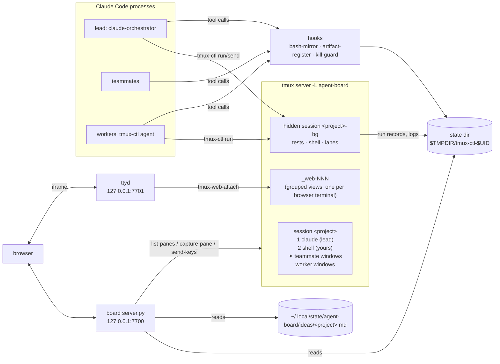

# How agent-board works

agent-board turns one tmux session per project into a workspace for a team of Claude Code agents. It has three parts:

1. **The `dev` toolkit** (`bin/`): zsh scripts that create the project session, let agents drive windows safely (`tmux-ctl`), and keep tmux tidy (teammate windows, state cleanup, worktree cleanup).
2. **The Agent Board** (`board/`): a localhost web UI (stdlib Python server + one HTML page + ttyd terminals) that shows every project, agent, run, artifact and idea, and lets you act on them.
3. **The Claude rules, settings and plugin** (`claude/`): system-prompt files that make the lead orchestrate a team and workers act alone, a settings file for agent teams, and a Claude Code plugin (hooks that feed the board and stop dangerous commands, the `tmux-orchestrator` and `handoff` skills, the `effort-*` agent types).

Nothing here is a daemon except the board. All coordination goes through **tmux** (windows, panes, user options) and **plain files** in a per-user state directory. Everything runs on **agent-board's own tmux server** (`tmux -L agent-board`), so your own tmux server and `~/.claude` are not involved (see [Install footprint](#install-footprint)).



## Concepts

| Term | Meaning |
| --- | --- |
| **Project** | One tmux session, named after the repo's top-level folder (`.` and `:` replaced with `_`). All per-project state is keyed by this name. |
| **Lead / orchestrator** | The Claude in the project's `claude` window, started by `claude-orchestrator` with `claude/orchestrator.md` appended to its system prompt. |
| **Teammate** | A Claude Code agent-team member spawned by the lead. Claude Code opens it as a split pane; the `after-split-window` hook moves it into its own window `✦ <name>`. |
| **Worker** | An independent Claude started by `tmux-ctl agent <name> "<task>"`, in its own window and its own git worktree (`.claude/worktrees/<name>`, branch `worktree-<name>`), with `claude/worker.md` appended. |
| **-bg session** | A hidden session `<project>-bg` holding the agents' `tests` and `shell` windows, so agents never type into the user's `shell`. Tagged with the session option `@tc_bg=1`. |
| **Lane** | A per-caller window `tests·<agent>` created when `tests` is busy. Idle lanes are closed after 15 minutes. |
| **Artifact** | A document worth showing on the board: plan, spec, handoff, report, published claude.ai artifact, or anything registered by hand. |
| **Epoch** | How many handoff relays this project has had (lines in `lineage-<project>.jsonl`). The board groups artifacts by epoch. |

### tmux user options used as tags

| Option | Scope | Set by | Meaning |
| --- | --- | --- | --- |
| `@tc_bg` | session | `tmux-ctl ensure_bg`, `tmux-dev-layout` | this is the hidden `<project>-bg` session (set last, marks setup complete) |
| `@tc_agent` | window | `tmux-ctl agent` | the window runs a worker |
| `@tc_teammate` | window | `tmux-teammate-window` | the window holds an agent-team teammate |
| `@tc_lane`, `@tc_lane_used` | window | `tmux-ctl pick_win` | a lane window and when it was last used (epoch seconds) |
| `@tc_role` | pane | `tmux-dev-layout` | `watch` pane from `.dev/windows` (legacy: `feed`); `tmux-ctl` never types into a pane with a role |
| `@tc_label` | window | legacy | removed by `tmux-dev-layout` on migration |

## Lifecycle of a project session

1. **`dev [dir]`** resolves the git top level (a non-repo folder under a home-directory repo stays itself), derives the session name and, if no session exists, creates it with window `claude` running `${DEV_CLAUDE_CMD:-claude-orchestrator}` and window `shell`. It then runs `tmux-dev-layout` and attaches (or `switch-client` when already inside tmux; `DEV_NO_ATTACH=1` only creates, which the board uses).
2. **`tmux-dev-layout <session> <root>`** is idempotent. It migrates old layouts (moves an idle `tests` window into `-bg`, kills feed/watch panes, drops labels), creates `<project>-bg` atomically (`new-session` is the lock; latecomers wait for `@tc_bg`), and adds optional watch panes from `<root>/.dev/windows`.
3. **`claude-orchestrator`** puts the clone's `bin/` first on `PATH`, exports `AGENT_BOARD_REPO`, and runs `claude --name orchestrator --model opus --settings <clone>/claude/settings.json --plugin-dir <clone>/claude/plugin --append-system-prompt-file <rules> "$@"`, where `<rules>` is `~/.config/agent-board/orchestrator.md` if it exists, else `<clone>/claude/orchestrator.md`. Passing your own `--name` or `--model` overrides the defaults. Inside tmux it also records `AGENT_BOARD_REPO` and `PATH` on the tmux session with `set-environment`, because teammates inherit the session environment and not the lead's shell. Side effect: every window opened in that session afterwards has the clone's `bin/` first on its `PATH`.
4. The lead splits work into teammates or workers (see below). The user watches in tmux or on the board.
5. **Closing** the session (board "Close project", or `tmux kill-session`) fires the `session-closed` hook. `tmux-session-closed` checks that no session or grouped view of that name is left, then deletes that project's state files. It never touches the ideas files, and it never runs for `_web-*` or `*-bg` names.

## tmux-ctl: agents driving windows

`tmux-ctl` (`bin/tmux-ctl`) is the only way agents should touch other windows. It targets the caller's own session (from `$TMUX_PANE`, or `TC_SESSION`); the window names `tests` and `shell` (and their lanes) resolve to `<project>-bg`.

### `tmux-ctl run [-t secs] [-C dir] <win> <cmd>`

```mermaid
sequenceDiagram
  participant A as agent (Bash tool)
  participant C as tmux-ctl run
  participant P as pane in -bg
  participant S as state dir
  A->>C: run tests "pytest -q"
  C->>C: lock_win (mkdir lock dir, stale-pid aware)
  C->>C: pick_win: tests idle? else lane tests·<agent>
  C->>S: runs-<project>.jsonl += {id, exit:null}
  C->>P: send-keys "printf @@TCSTART-id; (cd dir; cmd); tmux-ctl _done id $?"
  C->>C: settle_win, unlock
  P->>S: _done writes <id>.rc (atomic rename)
  C->>P: capture-pane from the start marker
  C->>S: logs/<project>/<id>.log, runs += {exit, duration, summary}
  C-->>A: output + "[exit N]", exit code N
```

Design points:

- **One typist per window.** `lock_win` uses an atomic `mkdir` lock with the owner pid. Stale locks (dead pid) are taken over; a 30-second cap prevents a permanent wedge.
- **Never type into a busy pane.** "Idle" means the pane's current command is a shell. A busy target falls back to the caller's lane; a busy lane fails.
- **Output capture by marker.** The typed line prints `@@TCSTART-<id>` (split in the source so the echo of the command can't match), and output is everything after it.
- **Interrupts and timeouts** save the partial log and record exit `143`/`124`; a `.gone` file tells the late `_done` to drop its exit code.
- **Summaries** come from pytest-style counts (`N passed, M failed`) or the toolkit's own `ALL PASS` / `N FAILED` lines.

### Other subcommands

| Command | What it does |
| --- | --- |
| `list` | windows of the session and of `-bg`: idle/busy, needs-user (bell), worker, lane |
| `read <win> [feed\|watch] [lines]` | capture the last N lines of a window's main pane, or of its role pane |
| `feed [win] [lines]` | tail the mirrored-Bash feed log(s); the only reader of the feed since the board dropped it |
| `send [-C dir] <win> <text>` | type into an idle window without waiting |
| `keys <win> <key>…` | raw keys (e.g. `C-c`); refused on worker windows |
| `new <win> [dir]` | open a plain shell window |
| `agent <name> [--force] (<task> \| --brief FILE)` | start a worker. Briefs under 8 words are refused unless `--force` or `--brief`; user-config work (hooks, settings, dotfiles) draws a warning |
| `tell <agent> <message>` | type into a worker's prompt; refused while it waits on the user (bell or a visible permission prompt) |
| `agents` | each worker's state (working / WAITING ON USER / exited) and last lines |
| `artifact <path> [--kind K]` | register a file in the board's artifacts panel |
| `idea <text>` | append to `~/.local/state/agent-board/ideas/<project>.md` |
| `relay <doc> [--old-session ID]` | after this turn, restart the `claude` window as a fresh orchestrator reading `<doc>` (used by `/handoff`) |

## Agent teams and workers

**Teammates.** With `CLAUDE_CODE_EXPERIMENTAL_AGENT_TEAMS=1` and `teammateMode: auto` (from `claude/settings.json`), Claude Code spawns teammates as split panes next to the lead. The tmux `after-split-window` hook runs `tmux-teammate-window`, which finds panes whose start command carries `--agent-name <name>` (or older Claude's placeholder `cat`, waiting up to 10 s for the respawn) and `break-pane`s each into a window `✦ <name>`, placed after the lead and any teammate windows already there. The pane id is kept, so Claude still reaches it.

**Workers.** `tmux-ctl agent` creates a window tagged `@tc_agent`, then types `PATH=<clone>/bin:$PATH AGENT_BOARD_REPO=<clone> claude -w <name> -n <name> --settings <clone>/claude/settings.json --plugin-dir <clone>/claude/plugin --append-system-prompt-file <rules> '<task>'`, where `<rules>` is `~/.config/agent-board/worker.md` if it exists, else `<clone>/claude/worker.md`. `-w` makes Claude create and lock its own worktree under `.claude/worktrees/<name>`. Worktrees are removed later with `prefix W` (`tmux-agent-cleanup`) or the board's Worktrees list. Both refuse to force: a dirty worktree is kept, a lock is cleared only when its Claude pid is dead or reused, and a branch is deleted only if merged (`git branch -d`).

**Rules.** `claude/orchestrator.md` makes the lead build a team by default (2–3 teammates, never more than 4), run work through the superpowers skills, route models by tier (`mechanical → haiku`, `standard → sonnet`, `frontier → fable`, overridable in `docs/superpowers/model-routing.json`), never answer an agent's permission prompt, and never push or merge without being asked. `claude/worker.md` makes a worker plan, test and review on its own, decide instead of asking, and finish with a commit and a report.

## Hooks

The hooks ship in the agent-board plugin (`claude/plugin/hooks/hooks.json`, scripts in `claude/plugin/scripts/`), which every agent-board Claude loads with `--plugin-dir`. They therefore run in agent-board's leads and workers, and in teammates through the session environment, never in the user's other Claude Code sessions. Each is registered with `--scoped`; the scripts also still work registered globally, as the pre-plugin install did, and when both are present the global registration defers to the scoped one (without `--scoped` a script exits when `AGENT_BOARD=1`, which `claude/settings.json` sets). Each script is a no-op outside a tmux pane, except `kill-guard.sh`.

| Hook (event, matcher) | Script | Writes | Notes |
| --- | --- | --- | --- |
| PreToolUse, `Bash` | `kill-guard.sh` | nothing; exit 2 blocks the call | Parses `pkill`/`killall` (also inside `bash -c "…"`), checks the pattern against running Claude processes (`ps` comm and args) and blocks when it would hit one. Fails open on any error. |
| PostToolUse + PostToolUseFailure, `Bash` | `bash-mirror.sh` | `feed-<project>-{tests,shell}.log` | Classifies the command as `tests` (pytest, make, npm test, go test, cargo, terraform plan, …) or `shell`, appends a header `── HH:MM:SS · agent · cwd · exit N · @epoch`, the first line and the last 12 output lines. Skips `tmux-ctl` calls (those are recorded as runs). Caps the log at 2 MB (keeps the last 1 MB). Only in dev sessions. |
| PostToolUse, `Write\|Edit\|MultiEdit\|Artifact` | `artifact-register.sh` | `artifacts-<project>.jsonl` | Kinds by path: `docs/superpowers/plans/` → plan, `…/specs/` → spec, `~/.local/state/agent-board/handoffs/` (or the old `~/.claude/handoffs/`) or a tmp `*handoff*` → handoff, `scratchpad/*report*` → report, Artifact tool URL → published. Other files are ignored unless registered by hand (`--path`). Records sha256, agent, session id and epoch. |
| Stop / PostToolUse `TaskUpdate` (optional, not registered by agent-board; `claude/hooks/`) | `superpowers-hook.sh <name>` | — | Finds the superpowers-extended-cc plugin wherever it is installed and runs its example hook; silent no-op without the plugin. |

All hooks are silent and exit 0 except kill-guard's deliberate block.

## The Agent Board

### Processes

`tmux-dash start` launches two processes, records their pids in `~/.local/state/tmux-dash/` and prints the URL:

- **`server.py`** on `127.0.0.1:${TMUX_DASH_PORT:-7700}`: the page, vendored `marked`/`DOMPurify`, and a JSON API.
- **`ttyd`** on `127.0.0.1:${TMUX_DASH_TTYD_PORT:-7701}` under base path `/<token>-tty`, running `tmux-web-attach <session> [window]` per browser terminal. That script creates a throw-away **grouped** session `_web-<pid>` so the browser can show a different window than your real terminal; it is destroyed when the browser disconnects. The board hides `_web-*` sessions.

### Security model

- Binds 127.0.0.1 only.
- Every URL carries a random token (`~/.local/state/tmux-dash/token`, mode 600, `tmux-dash rotate` to replace it). Wrong token → 404.
- `Host` must be `127.0.0.1:<port>` or `localhost:<port>` (blocks DNS rebinding).
- POSTs also need the token in `X-Dash-Token` (blocks cross-site form posts).
- Strict CSP; only the ttyd origin may be framed; `X-Frame-Options: DENY`.
- Files are served only if they are in the project's artifact manifest; saves need the hash the editor loaded (409 on conflict); run logs must resolve under `logs/<project>/`.
- Actions go through the same scripts as the keyboard (`tmux-ctl`, `dev`, `git worktree remove` without `--force`).

### State building

`GET api/state` runs one `tmux list-panes -a` with 15 fields, attaches usage alerts (see [Usage tracking](#usage-tracking)), captures every pane in parallel (a 12-thread pool; each process spawn is slow under macOS endpoint security), classifies each pane with `paneclass.classify` and attaches cached worktree info (30 s TTL, refreshed in the background). The whole result is cached for 1.5 s so concurrent polls share one build.

`paneclass.classify(cmd, rows, bell)` returns `(kind, status)`:

| kind | status | rule |
| --- | --- | --- |
| shell | idle | current command is a shell |
| claude | working | the tail shows `esc to interrupt` |
| claude | waiting | the tail shows a prompt (`Do you want to`, `(y/n)`, `❯ 1. Yes`, …) |
| claude | ready | Claude, neither of the above |
| program | waiting / running | anything else; waiting when the bell flag is set |

`input_has_text(rows)` detects text the user is typing into Claude's input line, so the board never glues a queued line onto it.

### API

All paths are under `/<token>/`.

| Method, path | Returns / does |
| --- | --- |
| `GET /` | the page (`TMUX_DASH_PAGE`, default `index.html`) |
| `GET api/state` | sessions → windows → panes (kind, status, preview), worktrees, ttyd location |
| `GET api/artifacts?session=` | artifact summary (items with history, epoch, lineage, active plan) + pending comments |
| `GET api/artifact?session=&path=` | one artifact's text and hash (allowlisted) |
| `GET api/runs?session=` | last 100 `tmux-ctl run` records |
| `GET api/log?session=&id=` | a run's log (last 512 KB) |
| `GET api/usage?session=` | the project's usage report (see [Usage tracking](#usage-tracking)) plus threshold warning and indexer progress; 500 if the index can't be read |
| `GET api/ideas?session=` | parsed ideas + open count |
| `GET api/dirs?path=&prefix=&hidden=` | folders for the Open project dialog |
| `GET api/dirs/recent` | open projects' paths, then the last 10 opened |
| `POST api/action` | `{action, session, …}`; see below |

Actions: `agent` (start a worker; the name is derived from the task if blank), `tell`, `send`, `dev` (open a project), `close_session` (also kills its `_web-*` views and its tagged `-bg`), `restart_orchestrator` (refuses a busy lead unless `confirm`), `stop_agent` (worker window only), `ask_shutdown` (queues `[Board] Please shut down teammate <name>.` for the lead), `remove_worktree`, `save` (edit an artifact), `comment` (queue a plan comment), `idea`, `idea_edit`, `idea_status`, `idea_move`, `artifact_move` (moves a plan/spec and its `.tasks.json` to another open project's repo, uncommitted).

### Comments to the lead

Plan comments and `[Board]` requests sit in an in-memory `CommentQueue` per project. On each state build the server delivers them by typing one line plus Enter into the `claude` pane, but only when that pane runs Claude, is not showing a prompt, and has no half-typed input. A failed send re-queues the rest. The queue is lost if the server restarts.

### The page

`board/index.html` is a single file with inline CSS and JS (no build step). It polls `api/state` and the per-project endpoints, renders project tabs, agent cards (status, "Needs you" attention bar), usage alert badges on agent cards, an embedded ttyd terminal, the Activity drawer (a **Usage** tab: cost headline, alerts, live sessions, 30-day chart and breakdowns; a **Runs** tab: `tmux-ctl run` records and failures), the artifacts panel (grouped by epoch, markdown rendered with marked + DOMPurify, inline edit with conflict detection, comments, move), the ideas box, the worktrees list and the Open project dialog. UI preferences (current project, drawer width, collapsed sidebar, show hidden folders, show dropped ideas) are kept in `localStorage`.

## Usage tracking

`board/usage.py` estimates API-equivalent cost per project from Claude Code's own transcripts. It is read-only on Claude Code's data.

- **Indexer.** When `server.py` starts, a background `usage.Indexer` thread scans `${USAGE_ROOT:-~/.claude/projects}/*/*.jsonl` and `*/*/subagents/*.jsonl` every 5 s, incrementally. It tracks each file's inode, size and offset, and detects rewrites. Every assistant line that carries `usage` becomes a row in `calls` (request id, session, timestamp, model, effort, agent/team name, branch, cwd, token counts by kind). The index is `$TC_STATE/usage.sqlite` (WAL mode). The thread keeps an in-memory snapshot of live sessions for the cards.
- **Prices.** `board/prices.json` maps each model to $/Mtok for input, output, cache read and 5 m / 1 h cache writes, plus its context window. Calls on a model with no entry count as *unpriced* and are never shown as $0. `tools/usage-sum.py` is an independent re-implementation, used to cross-check the totals; `tools/usage-capture-fixture.py` makes content-stripped test fixtures from real transcripts.
- **Attribution.** A call belongs to a project when its `cwd` is the project's checkout or one of its `.claude/worktrees/`. Its role is `teammate` (has an agent name), `subagent` (sidechain or subagent file), `worker` (in a worktree) or `lead`.
- **Report** (`api/usage`): today, 7-day and 30-day totals; a 30-day per-model daily series; breakdowns by role, model (with cache-read share) and branch; live sessions (newest call within `live_s`) with their alerts.
- **Alerts.** Thresholds come from `~/.config/agent-board/usage-alerts.json`, else the older `~/.claude/usage-alerts.json`, if present (defaults otherwise; invalid keys are reported as a warning):

  | Key | Default | Alert when |
  | --- | --- | --- |
  | `context_pct` | 80 | the session's context is at least this % of the model window |
  | `burn_per_hour`, `burn_window_s` | 15, 900 | spend over the last `burn_window_s`, scaled to an hour, is above `burn_per_hour` USD |
  | `session_total` | 25 | the session's total is above this many USD |
  | `mismatch_efforts`, `mismatch_models` | `["low","medium"]`, `["opus","fable"]` | a teammate runs one of these model families at one of these efforts |
  | `live_s` | 1800 | (not an alert) how recent a session's last call must be to count as live |

  `usage.card_alerts()` pins each live session's alerts to its pane on the board. A teammate window `✦ <name>` matches by agent name, a worker pane by cwd, and the `claude` window by the newest non-teammate session in the repo root.

## Handoff relay

`/handoff` (a skill in the agent-board plugin) checkpoints teammates, writes `~/.local/state/agent-board/handoffs/<date>-<slug>.md` (older docs in `~/.claude/handoffs/` are still read) and calls `tmux-ctl relay <doc>`. That schedules `board/relay.py` with `tmux run-shell -b`, so the lead can finish its turn first. `relay.py` waits until the lead's pane is idle or ready on two polls 2 s apart (120 s cap), respawns the pane with a fresh shell in the repo root, types `claude-orchestrator "Read <doc> and continue from where the previous session left off."` and appends `{ts, old_session_id, doc, pane}` to `lineage-<project>.jsonl` (which bumps the epoch). On failure the old pane is untouched and `_relay_failed` shows the manual command on every attached client and in `relay-failed-<project>.txt`.

## Ideas inbox

`board/ideas.py` owns `${TC_IDEAS_DIR:-~/.local/state/agent-board/ideas}/<project>.md` (an older `~/.claude/ideas/<project>.md` is copied across on first use, and the original stays). Each idea is `- [ ] YYYY-MM-DD HH:MM · text` with indented detail lines; `[x]` means taken up (`→ <spec>`), `[-]` dropped (or `→ moved to <project>`). Ideas are never deleted. Writers take an exclusive `fcntl` lock on `<file>.lock`. Edits address an idea by a key and raise `Stale` (HTTP 409) if the file changed underneath. The lead files `idea:` messages here and only reads the file once a plan is finished.

## State files

Runtime state lives in `TC_STATE`, default `${TMPDIR:-/tmp}/tmux-ctl-$UID/`. It is per-user and is deleted per project when the session closes.

| File | Writer | Reader |
| --- | --- | --- |
| `runs-<p>.jsonl` | `tmux-ctl run` (start + final record per id) | board Activity |
| `logs/<p>/<id>.log` | `tmux-ctl run` | board `api/log` |
| `feed-<p>-{tests,shell}.log` | `bash-mirror.sh` | `tmux-ctl feed` |
| `usage.sqlite` (+ `-wal`, `-shm`) | board usage indexer | `api/usage`, card alerts. Shared by all projects; not deleted when a session closes |
| `artifacts-<p>.jsonl` | `artifact-register.sh`, board save/move | board artifacts panel |
| `lineage-<p>.jsonl` | `relay.py` | artifacts epoch, board |
| `relay-<p>.log`, `relay-failed-<p>.txt` | `tmux-ctl relay` | you |
| `lock-<p>-<win>/` | `tmux-ctl` (transient) | `tmux-ctl` |
| `<id>.rc`, `<id>.gone` | `tmux-ctl run`/`_done` (transient) | `tmux-ctl run` |
| `recent-projects.json` | board `dev` action | Open project dialog |

Durable user data is in `~/.local/state/agent-board/` (`ideas/`, `handoffs/`). Board process state (`token`, `server.pid`, `ttyd.pid`, `*.log`) lives in `~/.local/state/tmux-dash/`.

## Install footprint

`install.sh` links one file, `~/.local/bin/agent-board`, to `bin/agent-board` in the clone. Everything else is found from the clone, so the checked-out branch is what runs.

- **Claude Code.** Every Claude agent-board starts (the lead via `claude-orchestrator`, workers via `tmux-ctl agent`) gets `--settings <clone>/claude/settings.json` and `--plugin-dir <clone>/claude/plugin` from `bin/_ab_claude.zsh`, so the hooks, skills and agent types exist only in those sessions. Teammates inherit the tmux session environment (`PATH`, `AGENT_BOARD_REPO`), which `claude-orchestrator` sets on the session. `~/.claude` is never written, except by `install.sh --migrate`, which removes what the earlier global install left there.
- **tmux.** `bin/_tc_bins.zsh` is the one resolver for the tmux command. Its order, first match wins: `TMUX_DASH_TMUX_ARGS`; the server named by `$TMUX` (hooks, `tmux-ctl`, the tests; skipped by the entry points `dev` and `tmux-dash`, which always use agent-board's server); otherwise `tmux -L ${AGENT_BOARD_TMUX_SOCKET:-agent-board} -f <clone>/config/tmux.conf`. A server started that way loads `config/tmux.conf` (the `after-split-window` and `session-closed` hooks, bell and passthrough options, the `D`, `f` and `W` bindings) instead of `~/.tmux.conf`. `board/paneclass.py` asks the same resolver, so Python and zsh agree on the server.
- **Legacy detection.** On an install from before the dedicated server, `tc_tmux_legacy` is true: `~/.tmux.conf` still has agent-board's hook lines (`tmux-teammate-window` or `tmux-session-closed`) and no `agent-board` server is running. Then `dev` and `tmux-dash` keep using the user's own default server until `install.sh --migrate` removes those lines.
- **State paths.** Durable data: `~/.local/state/agent-board/` (`ideas/`, `handoffs/`, `migrated-YYYYMMDD/`). Board process state: `~/.local/state/tmux-dash/`. Runtime state: `TC_STATE`. Optional user overrides: `~/.config/agent-board/` (`orchestrator.md`, `worker.md`, `tmux.local.conf`, `usage-alerts.json`).
- **Helper binaries.** ttyd and fzf come from `TTYD_BIN` / `FZF_BIN`, else `PATH`, else `~/.local/bin/<tool>`; tmux from `TC_TMUX`, else `~/.local/bin/tmux`.

## Tests

| Suite | Command | How it isolates |
| --- | --- | --- |
| Board (Python `unittest`) | `python3 -m unittest discover -s board/tests` | temporary `TC_STATE` / `TC_IDEAS_DIR`, fake tmux runners |
| Install helpers (Python `unittest`) | `python3 -m unittest discover -s tools/tests -p 'test_*.py'` | `install_lib` (the `install.sh --migrate` settings and tmux edits) on temporary files |
| Toolkit (zsh) | `zsh tools/tests/run-all.zsh` | `tools/tests/lib.zsh` starts a private tmux server (`-L tctest-…  -f /dev/null`) with a temp `TC_STATE`, and kills it on exit. Covers tmux-ctl, the dev layout, the plugin and hooks, `install.sh` |

Hook tests feed captured Claude hook JSON from `tools/tests/fixtures/`. Each zsh test prints `ok - …` / `FAIL - …` and ends with `ALL PASS` or `N FAILED`, which `tmux-ctl run` summarizes.

## Repository layout

```
install.sh           link ~/.local/bin/agent-board; --check, --uninstall, --migrate
bin/                 zsh commands; agent-board is the single entry point (dev, ctl, dash, jump, cleanup)
board/               Agent Board: server.py, index.html, helper modules, vendor/, tests/
claude/              orchestrator.md, worker.md, settings.json, plugin/ (hooks, skills, agents), hooks/
config/              tmux.conf: agent-board's tmux server configuration
tools/               install_lib.py (install.sh helpers), usage tools; tests/: zsh harness and tests
docs/                INSTALL, ARCHITECTURE, CUSTOMIZATION; superpowers/ specs and plans
```

Design history for each feature is in `docs/superpowers/specs/` (the why) and `docs/superpowers/plans/` (how it was built, task by task).
