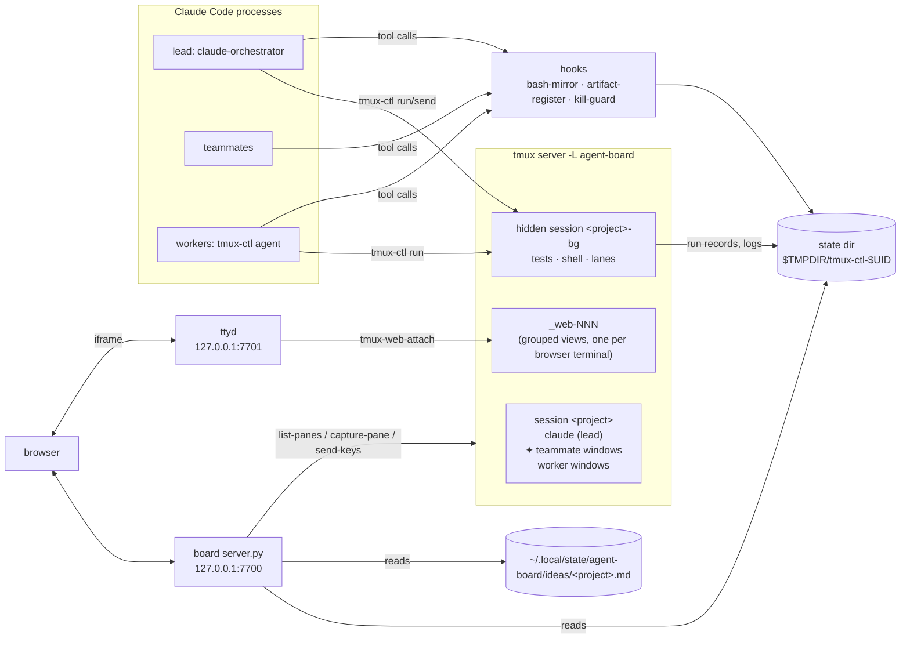

# How agent-board works

agent-board turns one tmux session per project into a workspace for a team of Claude Code agents. It has three parts:

1. **The `dev` toolkit** (`bin/`): zsh scripts that create the project session, let agents drive windows safely (`tmux-ctl`), and keep tmux tidy (teammate windows, state cleanup, worktree cleanup).
2. **The Agent Board** (`board/`): a localhost web UI (stdlib Python server + one HTML page + ttyd terminals) that shows every project, agent, run, artifact and idea, and lets you act on them.
3. **The Claude rules, settings and plugin** (`claude/`): system-prompt files that make the lead orchestrate a team and workers act alone, a settings file for agent teams, and a Claude Code plugin (hooks that feed the board and stop dangerous commands, the `tmux-orchestrator` and `handoff` skills, the `effort-*` agent types).

Nothing here is a daemon except the board. All coordination goes through **tmux** (windows, panes, user options) and **plain files** in a per-user state directory. Everything runs on **agent-board's own tmux server** (`tmux -L agent-board`), so your own tmux server and `~/.claude` are not involved (see [Install footprint](#install-footprint)).



## Concepts

| Term | Meaning |
| --- | --- |
| **Project** | One tmux session, named after the repo's top-level folder (`.` and `:` replaced with `_`). All per-project state is keyed by this name. |
| **Lead / orchestrator** | The Claude in the project's `claude` window, started by `claude-orchestrator` with `claude/orchestrator.md` appended to its system prompt. |
| **Teammate** | A Claude Code agent-team member spawned by the lead. Claude Code opens it as a split pane; the `after-split-window` hook moves it into its own window `✦ <name>`. |
| **Worker** | An independent Claude started by `tmux-ctl agent <name> "<task>"`, in its own window and its own git worktree (`.claude/worktrees/<name>`, branch `worktree-<name>`), with `claude/worker.md` appended. |
| **-bg session** | A hidden session `<project>-bg` holding the agents' `tests` and `shell` windows, so agents' commands stay out of the user's session; the user's session has `claude` (plus `✦` windows), and `prefix S` opens a throwaway shell popup. Tagged with the session option `@tc_bg=1`. |
| **Lane** | A per-caller window `tests·<agent>` created when `tests` is busy. Idle lanes are closed after 15 minutes. |
| **Artifact** | A document worth showing on the board: plan, spec, handoff, report, published claude.ai artifact, or anything registered by hand. |
| **Epoch** | How many handoff relays this project has had (lines in `~/.local/state/agent-board/lineage/<project>.jsonl`). The board groups artifacts by epoch. |

### tmux user options used as tags

| Option | Scope | Set by | Meaning |
| --- | --- | --- | --- |
| `@tc_bg` | session | `tmux-ctl ensure_bg`, `tmux-dev-layout` | this is the hidden `<project>-bg` session (set last, marks setup complete) |
| `@tc_agent` | window | `tmux-ctl agent` | the window runs a worker |
| `@tc_teammate` | window | `tmux-teammate-window` | the window holds an agent-team teammate |
| `@tc_lane`, `@tc_lane_used` | window | `tmux-ctl pick_win` | a lane window and when it was last used (epoch seconds) |
| `@tc_role` | pane | `tmux-dev-layout` | `watch` pane from `.dev/windows` (legacy: `feed`); `tmux-ctl` never types into a pane with a role |
| `@tc_label` | window | legacy | removed by `tmux-dev-layout` on migration |

## Lifecycle of a project session

1. **`dev [dir]`** resolves the git top level (a non-repo folder under a home-directory repo stays itself), derives the session name and, if no session exists, creates it with window `claude` running `${DEV_CLAUDE_CMD:-<clone>/bin/claude-orchestrator}` (the absolute path, so it needs nothing on `PATH`); there is no `shell` window, `prefix S` opens a throwaway one. It then runs `tmux-dev-layout` and attaches (or `switch-client` when already inside tmux; `DEV_NO_ATTACH=1` only creates, which the board uses).
2. **`tmux-dev-layout <session> <root>`** is idempotent. It migrates old layouts (moves an idle `tests` window into `-bg`, removes an idle user `shell` window (a busy one stays, with a note), closes an old `plan` window that still runs `tmux-plan` (a user window named `plan` stays), kills feed/watch panes, drops labels), creates `<project>-bg` atomically (`new-session` is the lock; latecomers wait for `@tc_bg`), and adds optional watch panes from `<root>/.dev/windows`. Finally it runs `tmux-overseer ensure`, so the first project session also starts the [overseer](#overseer).
3. **`claude-orchestrator`** puts the clone's `bin/` first on `PATH`, exports `AGENT_BOARD_REPO`, and runs `claude --name orchestrator --model opus --settings <clone>/claude/session-settings.json --plugin-dir <clone>/claude/plugin --append-system-prompt-file <rules> "$@"`, where `<rules>` is `~/.config/agent-board/orchestrator.md` if it exists, else `<clone>/claude/orchestrator.md`. Passing your own `--name` or `--model` overrides the defaults. Inside tmux it also records `AGENT_BOARD_REPO` and `PATH` on the tmux session with `set-environment`, so windows and teammates started from the session find the clone's commands. Side effect: every window opened in that session afterwards has the clone's `bin/` first on its `PATH`.
4. The lead splits work into teammates or workers (see below). The user watches in tmux or on the board.
5. **Closing** the session (board "Close project", or `tmux kill-session`) fires the `session-closed` hook. `tmux-session-closed` checks that no session or grouped view of that name is left, then deletes that project's state files. It never touches the ideas files, and it never runs for `_web-*` or `*-bg` names. It then runs `tmux-overseer stop`, which closes the `overseer` session once no project session is left.

## tmux-ctl: agents driving windows

`tmux-ctl` (`bin/tmux-ctl`) is the only way agents should touch other windows. It targets the caller's own session (from `$TMUX_PANE`, or `TC_SESSION`); the window names `tests` and `shell` (and their lanes) resolve to `<project>-bg`.

### `tmux-ctl run [-t secs] [-C dir] <win> <cmd>`

```mermaid
sequenceDiagram
  participant A as agent (Bash tool)
  participant C as tmux-ctl run
  participant P as pane in -bg
  participant S as state dir
  A->>C: run tests "pytest -q"
  C->>C: lock_win (mkdir lock dir, stale-pid aware)
  C->>C: pick_win: tests idle? else lane tests·<agent>
  C->>S: runs-<project>.jsonl += {id, exit:null}
  C->>P: send-keys "printf @@TCSTART-id; (cd dir; cmd); tmux-ctl _done id $?"
  C->>C: settle_win, unlock
  P->>S: _done writes <id>.rc (atomic rename)
  C->>P: capture-pane from the start marker
  C->>S: logs/<project>/<id>.log, runs += {exit, duration, summary}
  C-->>A: output + "[exit N]", exit code N
```

Design points:

- **One typist per window.** `lock_win` uses an atomic `mkdir` lock with the owner pid. Stale locks (dead pid) are taken over; a 30-second cap prevents a permanent wedge.
- **Never type into a busy pane.** "Idle" means the pane's current command is a shell. A busy target falls back to the caller's lane; a busy lane fails.
- **Output capture by marker.** The typed line prints `@@TCSTART-<id>` (split in the source so the echo of the command can't match), and output is everything after it.
- **Interrupts and timeouts** save the partial log and record exit `143`/`124`; a `.gone` file tells the late `_done` to drop its exit code.
- **Summaries** come from pytest-style counts (`N passed, M failed`) or the toolkit's own `ALL PASS` / `N FAILED` lines.

### Other subcommands

| Command | What it does |
| --- | --- |
| `list` | windows of the session and of `-bg`: idle/busy, needs-user (bell), worker, lane |
| `read <win> [feed\|watch] [lines]` | capture the last N lines of a window's main pane, or of its role pane |
| `feed [win] [lines]` | tail the mirrored-Bash feed log(s); the only reader of the feed since the board dropped it |
| `send [-C dir] <win> <text>` | type into an idle window without waiting |
| `keys <win> <key>…` | raw keys (e.g. `C-c`); refused on worker windows |
| `new <win> [dir]` | open a plain shell window |
| `agent <name> [--force] (<task> \| --brief FILE)` | start a worker. Briefs under 8 words are refused unless `--force` or `--brief`; user-config work (hooks, settings, dotfiles) draws a warning |
| `tell <agent> <message>` | type into a worker's prompt; refused while it waits on the user (bell or a visible permission prompt) |
| `agents` | each worker's state (working / WAITING ON USER / exited) and last lines |
| `artifact <path> [--kind K]` | register a file in the board's artifacts panel |
| `idea <text>` | append to `~/.local/state/agent-board/ideas/<project>.md` |
| `context show \| path \| add <section> "<entry>"` | the project's shared context file, `${TC_CONTEXT_DIR:-~/.local/state/agent-board/context}/<project>.md`; see [Shared project context](#shared-project-context) |
| `overview [project] [--json]` | one line per open project (plan, in-progress tasks, needs-you, lead, last run, spend, alerts) from the running board, else a local build without usage data; `--json` prints the `api/overview` body |
| `relay <doc> [--old-session ID]` | after this turn, restart the `claude` window as a fresh orchestrator reading `<doc>` (used by `/handoff`) |

## Agent teams and workers

**Teammates.** With `CLAUDE_CODE_EXPERIMENTAL_AGENT_TEAMS=1` and `teammateMode: auto` (from `claude/session-settings.json`), Claude Code spawns teammates as split panes next to the lead. The tmux `after-split-window` hook runs `tmux-teammate-window`, which finds panes whose start command carries `--agent-name <name>` (or older Claude's placeholder `cat`, waiting up to 10 s for the respawn) and `break-pane`s each into a window `✦ <name>`, placed after the lead, the `tasks` window and any teammate windows already there. The pane id is kept, so Claude still reaches it.

**Tasks window.** `tmux-dev-layout` opens a `tasks` window right after `claude`, running `board/taskwin.py watch`. It reads the lead's live task list through `planview.view()`, keeps per-task timing in `$TC_STATE/taskwin/<session>.json` (`board/taskwin_state.py`), and redraws once a second, or at once on a key. On a TTY `watch` puts stdin in cbreak mode and waits with `select`; without one it sleeps. Three views: **queue** (the spec queue, with titles and the queue report), **plan** (the dependency graph of cards with status glyphs, tier badges, owner state and a progress header) and **history** (finished tasks and queue outcomes). Keys: `Tab` or `1`-`3` switch view, `j`/`k` or the arrows move the cursor, `Enter` opens the plan or folds the row's group, `f` cycles the filter, `c` folds or unfolds every finished group, `?` toggles help, `q` returns to the queue view. The view, cursors, filter and collapsed set live under the `ui` key of `$TC_STATE/taskwin/<session>.json` and survive a lead change. Each task that turns completed while watched adds a line to the journal `$TC_STATE/taskwin/<project>.history.jsonl` (capped at 5000 lines); the history view also reads the spec ledgers and queue reports under `--root` (`board/taskwin_hist.py`). `TC_TASKS_WINDOW=0` turns it off.

**Workers.** `tmux-ctl agent` creates a window tagged `@tc_agent`, then types `PATH=<clone>/bin:$PATH AGENT_BOARD_REPO=<clone> claude -w <name> -n <name> --settings <clone>/claude/session-settings.json --plugin-dir <clone>/claude/plugin --append-system-prompt-file <rules> '<task>'`, where `<rules>` is `~/.config/agent-board/worker.md` if it exists, else `<clone>/claude/worker.md`. `-w` makes Claude create and lock its own worktree under `.claude/worktrees/<name>`. 

**Worktree cleanup.** One engine, `board/worktree_safety.py` (CLI `agent-board worktrees <cmd>`, i.e. `bin/agent-worktrees`), decides what happens to the worktrees under `.claude/worktrees/`; a worktree anywhere else is never listed or touched. `classify` gives each one a state and a reason: `safe` (clean, merged, unused, and no git-ignored files other than caches: `__pycache__`, `.pytest_cache`, `.ruff_cache`, `.mypy_cache`, `node_modules`, `.DS_Store`, `*.pyc`; removal deletes ignored files, and SDD workspaces in `.superpowers/`, `.agent-ci/` state and venvs live there, so such a worktree is `kept` with `ignored files: …`), `stale` (clean, unmerged, last commit 7+ days old), `in_use` (a live Claude lock or a tmux pane inside it, on agent-board's server or the default one), `dirty` (modified or untracked files), or `kept` (anything else, with the reason; this includes a worktree under 24 h old whose branch has no commit of its own yet, `new, no commits yet`, so a worktree made by plain `git worktree add` and driven with `git -C` is not swept mid-run). "Merged" means HEAD is an ancestor of the base branch, of `origin/<base>`, or of the main checkout's current branch; or, for a squash merge, the upstream is `[gone]` and `glab mr list --merged --source-branch <branch>` returns an MR whose head sha equals HEAD. `remove <path>` is the user's own choice: it needs only a clean tree and no live Claude lock, unlocks a stale lock first and puts it back if git refuses. `sweep [dir | --recent] [--only <path>] [--dry-run]` removes just the `safe` ones: it classifies with a `git fetch --prune` and glab, re-classifies each worktree right before removing it (a pane or session that appeared in between keeps it), and takes a per-repo lockdir (`sweep-<hash>.lock` in `~/.local/state/agent-board/`) so two sweeps never overlap. `--recent` covers the repos in `recent-projects.json` plus the open tmux sessions' paths. Sweeps run automatically from three triggers: the plugin's PostToolUse `Bash` hook `worktree-sweep.sh` after a `git merge`, `git pull`, `glab mr merge` or `git branch -d/-D`; the board's Stop on a worker (it waits for the worker's processes to exit, then sweeps just that worktree); and, once you install it, a daily 04:00 LaunchAgent (`agent-board worktrees schedule install|status|uninstall`; run it from `~/agent-board`, the main checkout, not from a worktree, because the plist points at the `agent-board` beside the CLI). `prefix W` (`tmux-agent-cleanup`) and the board's Worktrees panel (`Remove safe (N)`, per-row Remove) call the same engine.

The engine fails closed: a check that cannot run (fetch, glab missing or not logged in, tmux unreachable, a timeout) makes that worktree `kept` with the reason, never removed. Nothing passes `--force` and nothing runs a repo-wide `git worktree prune`. A merged branch is deleted with `git branch -d`; `git branch -D` is used only for a verified squash merge. Every sweep decision is appended to `~/.local/state/agent-board/worktree-sweep.log` (`<time>\t<repo>\t<action>\t<name>\t<reason>`), and the board shows the last run.

**Rules.** `claude/orchestrator.md` makes the lead build a team by default (2–3 teammates, never more than 4), run work through the superpowers skills, route models by tier (`mechanical → haiku`, `standard → sonnet`, `frontier → fable`, overridable in `docs/superpowers/model-routing.json`), never answer an agent's permission prompt, and never push or merge without being asked. `claude/worker.md` makes a worker plan, test and review on its own, decide instead of asking, and finish with a commit and a report.

## Hooks

The hooks ship in the agent-board plugin (`claude/plugin/hooks/hooks.json`, scripts in `claude/plugin/scripts/`), which every agent-board Claude loads with `--plugin-dir`. They therefore run in agent-board's leads and workers, and in teammates (Claude Code starts them with the lead's `--settings` and `--plugin-dir` flags), never in the user's other Claude Code sessions. Each is registered with `--scoped`; the scripts also still work registered globally, as the pre-plugin install did, and when both are present the global registration defers to the scoped one (without `--scoped` a script exits when `AGENT_BOARD=1`, which `claude/session-settings.json` sets). Each script is a no-op outside a tmux pane, except `kill-guard.sh`.

| Hook (event, matcher) | Script | Writes | Notes |
| --- | --- | --- | --- |
| PreToolUse, `Bash` | `kill-guard.sh` | nothing; exit 2 blocks the call | Parses `pkill`/`killall` (also inside `bash -c "…"`), checks the pattern against running Claude processes (`ps` comm and args) and blocks when it would hit one. Fails open on any error. |
| PostToolUse + PostToolUseFailure, `Bash` | `bash-mirror.sh` | `feed-<project>-{tests,shell}.log` | Classifies the command as `tests` (pytest, make, npm test, go test, cargo, terraform plan, …) or `shell`, appends a header `── HH:MM:SS · agent · cwd · exit N · @epoch`, the first line and the last 12 output lines. Skips `tmux-ctl` calls (those are recorded as runs). Caps the log at 2 MB (keeps the last 1 MB). Only in dev sessions. |
| PostToolUse, `Write\|Edit\|MultiEdit\|Artifact` | `artifact-register.sh` | `artifacts-<project>.jsonl` | Kinds by path: `docs/superpowers/plans/` → plan, `…/specs/` → spec, `~/.local/state/agent-board/handoffs/` (or the old `~/.claude/handoffs/`) or a tmp `*handoff*` → handoff, `scratchpad/*report*` → report, Artifact tool URL → published. Other files are ignored unless registered by hand (`--path`). Records sha256, agent, session id and epoch. |
| PostToolUse, `Bash` | `worktree-sweep.sh` | `feed-<project>-shell.log` (a `swept: removed …; kept …` entry, dev sessions only); the sweep log is the engine's | Acts only when the command contained `git merge`, `git pull`, `glab mr merge` or `git branch -d/-D`; then starts `agent-worktrees sweep <repo>` in the background and never blocks or fails the call. See [Worktree cleanup](#agent-teams-and-workers). |
| SessionStart (no matcher: startup, resume, clear and compact) | `context-inject.sh` | nothing; prints `hookSpecificOutput.additionalContext` | Injects `${TC_CONTEXT_DIR:-~/.local/state/agent-board/context}/<project>.md` (`<project>` is the ideas key, `-bg` stripped) under the preface "Shared project context, curated by the lead; propose additions as 'Context learned' in your report." Over 8 KB it keeps the last whole entry that fits and appends `… truncated, full file at <path>`. No file, an empty one, no tmux pane or any error: silent exit 0. `TC_CONTEXT=0` disables it. See [Shared project context](#shared-project-context). |
| Stop / PostToolUse `TaskUpdate` (optional, not registered by agent-board; `claude/hooks/`) | `superpowers-hook.sh <name>` | — | Finds the superpowers-extended-cc plugin wherever it is installed and runs its example hook; silent no-op without the plugin. |

All hooks are silent and exit 0, except the deliberate blocks of `kill-guard`, `plan-handoff-guard`, `sdd-call-guard` and `agent-name-guard` (exit 2) and `context-inject`'s `additionalContext` output.

## The Agent Board

### Processes

`agent-board dash start` launches two processes, records their pids in `~/.local/state/tmux-dash/` and prints the URL:

- **`server.py`** on `127.0.0.1:${TMUX_DASH_PORT:-7700}`: the page, vendored `marked`/`DOMPurify`, and a JSON API.
- **`ttyd`** on `127.0.0.1:${TMUX_DASH_TTYD_PORT:-7701}` under base path `/<token>-tty`, running `tmux-web-attach <session> [window]` per browser terminal. That script creates a throw-away **grouped** session `_web-<pid>` so the browser can show a different window than your real terminal; it is destroyed when the browser disconnects. The board hides `_web-*` sessions.

### Security model

- Binds 127.0.0.1 only.
- Every URL carries a random token (`~/.local/state/tmux-dash/token`, mode 600, `agent-board dash rotate` to replace it). Wrong token → 404.
- `Host` must be `127.0.0.1:<port>` or `localhost:<port>` (blocks DNS rebinding).
- POSTs also need the token in `X-Dash-Token` (blocks cross-site form posts).
- Strict CSP; only the ttyd origin may be framed; `X-Frame-Options: DENY`.
- Files are served only if they are in the project's artifact manifest; saves need the hash the editor loaded (409 on conflict); run logs must resolve under `logs/<project>/`.
- Actions go through the same scripts as the keyboard (`tmux-ctl`, `dev`, `git worktree remove` without `--force`).

### State building

`GET api/state` runs one `tmux list-panes -a` with 15 fields, attaches usage alerts (see [Usage tracking](#usage-tracking)), captures every pane in parallel (a 12-thread pool; each process spawn is slow under macOS endpoint security), classifies each pane with `paneclass.classify` and attaches cached worktree info (30 s TTL, refreshed in the background). The whole result is cached for 1.5 s so concurrent polls share one build.

`paneclass.classify(cmd, rows, bell)` returns `(kind, status)`:

| kind | status | rule |
| --- | --- | --- |
| shell | idle | current command is a shell |
| claude | working | the tail shows `esc to interrupt` |
| claude | waiting | the tail shows a prompt (`Do you want to`, `(y/n)`, `❯ 1. Yes`, …) |
| claude | ready | Claude, neither of the above |
| program | waiting / running | anything else; waiting when the bell flag is set |

`input_has_text(rows)` detects text the user is typing into Claude's input line, so the board never glues a queued line onto it.

### API

All paths are under `/<token>/`.

| Method, path | Returns / does |
| --- | --- |
| `GET /` | the page (`TMUX_DASH_PAGE`, default `index.html`) |
| `GET api/state` | sessions → windows → panes (kind, status, preview), worktrees, ttyd location |
| `GET api/overview` | the overseer digest: one record per project, the notifier's recent events, the overseer session's state (see [Overseer](#overseer)) |
| `GET api/artifacts?session=` | artifact summary (items with history, epoch, lineage, active plan) + pending comments |
| `GET api/artifact?session=&path=` | one artifact's text and hash (allowlisted) |
| `GET api/runs?session=` | last 100 `tmux-ctl run` records |
| `GET api/log?session=&id=` | a run's log (last 512 KB) |
| `GET api/usage?session=` | the project's usage report (see [Usage tracking](#usage-tracking)) plus threshold warning and indexer progress; 500 if the index can't be read |
| `GET api/ideas?session=` | parsed ideas + open count |
| `GET api/dirs?path=&prefix=&hidden=` | folders for the Open project dialog |
| `GET api/dirs/recent` | open projects' paths, then the last 10 opened |
| `POST api/action` | `{action, session, …}`; see below |

Actions: `agent` (start a worker; the name is derived from the task if blank), `tell`, `send`, `dev` (open a project), `close_session` (also kills its `_web-*` views and its tagged `-bg`), `restart_orchestrator` (refuses a busy lead unless `confirm`), `stop_agent` (worker window only; then sweeps that worker's worktree), `ask_shutdown` (queues `[Board] Please shut down teammate <name>.` for the lead), `remove_worktree`, `remove_safe_worktrees` (a sweep of the project's repo), `save` (edit an artifact), `comment` (queue a plan comment), `idea`, `idea_edit`, `idea_status`, `idea_move`, `artifact_move` (moves a plan/spec and its `.tasks.json` to another open project's repo, uncommitted).

### Comments to the lead

Plan comments and `[Board]` requests sit in an in-memory `CommentQueue` per project. On each state build the server delivers them by typing one line plus Enter into the `claude` pane, but only when that pane runs Claude, is not showing a prompt, and has no half-typed input. A failed send re-queues the rest. The queue is lost if the server restarts.

### The page

`board/index.html` is a single file with inline CSS and JS (no build step). `/` is the overseer home (digest cards per project, the overseer's terminal, the notifications list; new events become browser notifications and an `(n)` badge in the tab title); a project page is `#<project>`. It polls `api/state` and the per-project endpoints, renders project tabs, agent cards (status, "Needs you" attention bar), usage alert badges on agent cards, an embedded ttyd terminal, the Activity drawer (a **Usage** tab: cost headline, alerts, live sessions, 30-day chart and breakdowns; a **Runs** tab: `tmux-ctl run` records and failures), the artifacts panel (grouped by epoch, markdown rendered with marked + DOMPurify, inline edit with conflict detection, comments, move), the ideas box, the worktrees list and the Open project dialog. UI preferences (drawer width, collapsed sidebar, show hidden folders, show dropped ideas, last seen notification) are kept in `localStorage`.

## Usage tracking

`board/usage.py` estimates API-equivalent cost per project from Claude Code's own transcripts. It is read-only on Claude Code's data.

- **Indexer.** When `server.py` starts, a background `usage.Indexer` thread scans `${USAGE_ROOT:-~/.claude/projects}/*/*.jsonl` and `*/*/subagents/*.jsonl` every 5 s, incrementally. It tracks each file's inode, size and offset, and detects rewrites. Every assistant line that carries `usage` becomes a row in `calls` (request id, session, timestamp, model, effort, agent/team name, branch, cwd, token counts by kind). The index is `$TC_STATE/usage.sqlite` (WAL mode). The thread keeps an in-memory snapshot of live sessions for the cards.
- **Prices.** `board/prices.json` maps each model to $/Mtok for input, output, cache read and 5 m / 1 h cache writes, plus its context window. Calls on a model with no entry count as *unpriced* and are never shown as $0. `tools/usage-sum.py` is an independent re-implementation, used to cross-check the totals; `tools/usage-capture-fixture.py` makes content-stripped test fixtures from real transcripts.
- **Attribution.** A call belongs to a project when its `cwd` is the project's checkout or one of its `.claude/worktrees/`. Its role is `teammate` (has an agent name), `subagent` (sidechain or subagent file), `worker` (in a worktree) or `lead`.
- **Report** (`api/usage`): today, 7-day and 30-day totals; a 30-day per-model daily series; breakdowns by role, model (with cache-read share) and branch; live sessions (newest call within `live_s`) with their alerts.
- **Alerts.** Thresholds come from `~/.config/agent-board/usage-alerts.json`, else the older `~/.claude/usage-alerts.json`, if present (defaults otherwise; invalid keys are reported as a warning):

  | Key | Default | Alert when |
  | --- | --- | --- |
  | `context_pct` | 80 | the session's context is at least this % of the model window |
  | `burn_per_hour`, `burn_window_s` | 15, 900 | spend over the last `burn_window_s`, scaled to an hour, is above `burn_per_hour` USD |
  | `session_total` | 25 | the session's total is above this many USD |
  | `day_total` | (none) | the project's spend today is above this many USD; off until the key is set |
  | `mismatch_efforts`, `mismatch_models` | `["low","medium"]`, `["opus","fable"]` | a teammate runs one of these model families at one of these efforts |
  | `live_s` | 1800 | (not an alert) how recent a session's last call must be to count as live |

  `usage.card_alerts()` pins each live session's alerts to its pane on the board. A teammate window `✦ <name>` matches by agent name, a worker pane by cwd, and the `claude` window by the newest non-teammate session in the repo root.

## Overseer

One read-only view across every project (`docs/superpowers/specs/2026-10-28-overseer-design.md`). Three parts:

- **Digest.** `board/overview.py` builds one record per project from state the board already has (no LLM): the active plan and `done/total` (planview), in-progress tasks with owners, "Needs you" panes, the last `tmux-ctl run` (command, exit, age), the lead's state and idle time (`#{window_activity}` of the `claude` window), the last three registered artifacts, the epoch, live usage alerts and today's spend (`usage.spend_since`). `GET api/overview` returns `{generated, projects, events, overseer}`; `tmux-ctl overview [project] [--json]` prints one line per project (or the JSON) from the running board, else a local build without usage data (`source: local`).
- **Notifier.** `board/notify.py`, run by a server thread every 10 s. It compares each overview with the previous one and emits ten event kinds (six below, plus the four night-watch kinds in `## Night watch`): `needs_you` (a pane starts waiting), `plan_done` (a plan's tasks are all complete), `test_failed` (a run ends non-zero), `lead_idle` (the lead ready for 15 min with open tasks), `context` (a session crosses `context_pct`) and `usage` (`burn_per_hour`, `session_total`, or the project's spend today over `day_total`). An event fires once when its condition appears, not again while it holds, again after it clears and returns; at most one of a kind per project every 5 minutes; the first overview and a project's first appearance only seed the state. Delivery: a macOS banner (`osascript -e 'display notification …'`; a failure is logged) and the events list the page turns into browser notifications and a `(n)` badge in the tab title. `TC_NOTIFY=0` turns it off.
- **The overseer agent.** tmux session `overseer` (one `claude` window) on the same server as the projects, started by `bin/tmux-overseer ensure` from `tmux-dev-layout` (so the first `dev` starts it) and from the board on each overview build (a killed overseer comes back), stopped by `tmux-session-closed` when the last project session goes. The session starts in its own folder, `${XDG_STATE_HOME:-~/.local/state}/agent-board/overseer`, not in the repo: usage matches sessions to projects by working directory, so a session started in the repo would count toward that project's context and spend alerts. `bin/claude-overseer` runs `claude --model haiku --effort low -n overseer --setting-sources project,local --settings claude/overseer-settings.json --append-system-prompt-file claude/overseer.md`, without the agent-board plugin. `--setting-sources project,local` leaves out the user source, so `~/.claude/settings.json` allows (such as `Bash(tmux-ctl:*)`) cannot widen the overseer's rules; project and local settings still load from the start folder, which holds no `.claude/`, and managed policy settings are not excluded. The launcher also unsets the session-scoped `CLAUDE_CODE_CHILD_SESSION`, `CLAUDECODE`, `CLAUDE_CODE_SESSION_ID`, `CLAUDE_CODE_SSE_PORT`, `CLAUDE_CODE_MESSAGING_SOCKET` and `CLAUDE_CODE_MESSAGING_TOKEN` that a Claude-started tmux server carries. It is read-only by permission settings, not by prompt: `defaultMode: dontAsk` auto-denies every call no allow rule matches; allowed are Read, Grep, Glob, `tmux-ctl overview`, and plain read-only `git log/status/show` (no `git -C`: a wildcard before the verb would admit `-c` options, aliases and other subcommands); Write, Edit, MultiEdit, NotebookEdit, Agent, SendMessage, Skill, WebFetch, WebSearch, the writing `tmux-ctl` subcommands (`send`, `run`, `tell`, `agent`, `keys`, `relay`, `new`, `idea`, `artifact`, `context`), `tmux send-keys` and `kill-*`, every `tmux-ctl _*` helper (`_append`, `_done`, `_relay_failed` write files), the state-changing `git` commands and `git log/show --output=<file>` (which would write a file) are denied outright. It answers from `tmux-ctl overview --json` first, then plan files, task lists, briefs and artifacts; asked to act, it names the project window to go to. `TC_OVERSEER=0` disables it; `TC_OVERSEER_CMD` is the test seam for the window's command. When the session exists but its `claude` window is back at a shell (Claude exited, or the trust prompt was refused), `ensure` types the command again, at most once per 60 s (`TC_OVERSEER_RETRY_S`, stamp in `<start folder>/.typed`). `stop` first kills the grouped `_web-*` browser views of `overseer`, which would otherwise keep the window alive. The board hides the `overseer` session from the project cards and shows its terminal on the home page; on that home view the project-scoped header controls ("+ New agent", "Close project…") are hidden, since no project is selected. The board runs `tmux-overseer ensure` once per fresh overview build, outside the overview lock, so a slow start cannot stall `api/overview`.

## Night watch

While a queue runs (queue mode: the lead's live task list holds an open `Plan & run:` task whose metadata has `queue`), the board watches for a stalled queue (`docs/superpowers/specs/2026-11-23-night-watch-design.md`). No LLM and no process of its own: it runs on every overview build.

- **Conditions.** `board/overview.py` adds `queue`, `owned` (each in-progress task with an owner: whether its `✦ <owner>` window exists, whether that window's first pane is dead, how long its agent has been `ready`), `awake` (a live `caffeinatePid` in `awake.json`) and `pace` (7-day usage and the elapsed share of the week, from `usage.plan_limits`). `board/notify.py` turns them into four more kinds, in queue mode only, with the usual latch: `teammate_gone`, `teammate_silent` (ready 30 min with its task in progress), `awake_dropped` and `weekly_pace` (more than 15 points above the elapsed share). They reach the Discord feed as `critical`.
- **Actions.** `board/watch.py`, called by `server.observe_overview` after the notifier. Per stall (those kinds except `weekly_pace`, plus `lead_idle`): one `[Watch] …` line for the lead, queued like `[Board]` lines and typed only while the lead's own pane is ready; for `awake_dropped`, one `tmux-ctl awake on --queue --lid`, its result posted and put in the line; one re-alert `… — lead did not react (15 min)` when the stall still holds 15 min after it opened. `weekly_pace` is alert only. Open stalls live in `watch.json`, so a board restart does not nudge twice. `TC_WATCH=0` turns the watch off.
- **Board down.** Every overview writes `watch/heartbeat` (`{"at", "queue"}`). Each project's Discord bridge (`tools/discord-bridge/lib/watch.js`) reads it every minute. While its project was in queue mode in the last heartbeat read, a heartbeat older than 5 min gets one `⚠️ <project>: board down, night watch off (last heartbeat <at>)` post, and the next fresh one gets `<project>: board back, night watch on`.
- **Overdue runs.** In queue mode the overview also samples `ps` once (`overview.PS_ARGV`) and lists each run in a `✦` pane (`runs`): a descendant of the pane's process reached through a shell (a Bash tool call), not the `claude` process, its MCP servers or an idle shell; its CPU time counts its whole subtree. `board/watch.py` gives a run past its cap (`docs/superpowers/run-caps.json`: the first `match` substring of the command line, else `default_s`; built-in defaults when the file is missing) one `run_overdue` alert; with its CPU time unchanged on two overviews in a row it kills the run and its subtree by PID (TERM, KILL 10 s later; only a PID still in the current ps sample with the same command, never the pane's root process), types `[Watch] killed <cmd> …: report to the lead` into the teammate's pane, nudges the lead once and appends a line to `watch/kills.jsonl`, which the morning report lists under **Seen**. The entries live in `watch.json` under `runs`, so a restart neither alerts nor kills a PID twice (`docs/superpowers/specs/2026-11-24-run-watch-design.md` §b).

## Handoff relay

`/handoff` (a skill in the agent-board plugin) checkpoints teammates, writes `~/.local/state/agent-board/handoffs/<date>-<slug>.md` (older docs in `~/.claude/handoffs/` are still read) and calls `tmux-ctl relay <doc>`. That schedules `board/relay.py` with `tmux run-shell -b`, so the lead can finish its turn first. `relay.py` waits until the lead's pane is idle or ready on two polls 2 s apart (120 s cap), respawns the pane with a fresh shell in the session's start directory (its project root: a worktree maps to its main checkout, `$HOME` if that is gone; never the pane's current path, which follows the lead's `cd`), types `cd -- <root> && claude-orchestrator "Read <doc> and continue from where the previous session left off."` (the `cd` repairs a shell that tmux started somewhere else: a tmux server whose own cwd was removed starts every new pane there and ignores `-c`, `docs/superpowers/notes/2026-11-09-relay-gone-cwd.md`), then waits until the pane's foreground is not a shell on two polls 2 s apart (30 s cap, `START_CAP`). A start that falls back to the shell is retried once (the pane is respawned again); after a second failure relay.py exits 1 with `relay failed: <reason>`, the pane's last lines (prefixed `| `) and a `manual: cd -- <root> && …` line in its log, and `_relay_failed` shows that reason and manual command on every attached client and in `relay-failed-<project>.txt`. Only a verified start appends `{ts, old_session_id, doc, pane}` to `~/.local/state/agent-board/lineage/<project>.jsonl` (persistent: a project close keeps it), which bumps the epoch. agent-board starts its tmux server from `$HOME` (`tc_tmux new-session` in `bin/_tc_bins.zsh`), so a server it starts never keeps a removable directory.

## Lead liveness on Discord

The home channel shows whether the lead has read the newest message from an allowlisted user and what it is doing with it (spec `docs/superpowers/specs/2026-11-23-remote-lead-liveness-design.md`). The board computes the lead's state and hands it to the bridge as a file; no model or network call sits on this path.

`board/lead_state.py` writes `<discord dir>/lead-state.json` for each project whose discord dir holds `bridge.json`, on every overview build (`server.lead_state_tick`, after `feed_tick`; `TC_LEAD_STATE=0` turns it off). The write is atomic: a temp file unique to the process and thread, then `os.replace`. Its keys are `at` (UTC ISO, `Z`), `state` (`busy`, `ready`, `needs_you` or `down`), `since` (kept while `state` does not change), `tool` (the lead's tool, only when busy), `queued` (channel prompts enqueued and not yet dequeued in the lead's transcript), `last_read_text` (the newest channel prompt the lead read, first 200 characters), `last_read_message_id` (that prompt's Discord message id), `holder` (whether the lead's pane holds the project's bot), `reason` (why `down`) and `window` (always `claude`). A missing `claude` window is `down`, a pane without the bot is `down`, a dialog or permission prompt is `needs_you`, work in progress is `busy`, anything else is `ready`. The transcript is read only from its last 1 MiB and only when its size or mtime changed; when the tail holds no channel prompt, the last read carries over.

`tools/discord-bridge/bridge.js` tracks the newest home-channel message from an allowlisted user (threads are not tracked) and writes `last-user-message.json` (`{ts, message_id}`, atomically) for the remote-ask guard. Every 10 s (`LIVE_MS`) `lib/liveness.js` picks one reaction for that message, and the bridge swaps the previous one through its outbox (`op: liveness`). The pick uses this precedence, first match wins:

| Reaction | Shown when |
| --- | --- |
| ⚠️ | `lead-state.json` is `down`, or stale (`at` more than 180 s old), or unreadable |
| 🙋 | `state` is `needs_you` |
| ✅ | the lead answered: a bot message in the home channel, newer than the target, that the bridge did not send itself (`st.own_sent`), that is not an interaction response and that is not a system message (pin or thread notices: `msg.system`, or a type other than Default and Reply) |
| 👀 | the lead read the message: `last_read_message_id` is its id, or `last_read_text` equals its first 200 characters. A message that arrived mid-turn counts too: the transcript records it as a `queued_command` attachment row (origin channel, Discord plugin), not as a user row, and `lead_state` reads the `<channel>` tag from both |
| ⏳ | `state` is `busy` |
| 📨 | none of the above (posted, lead not yet busy) |

An allowlisted user's ❓ on a home-channel message gets one status line (outbox `op: liveness_reply`), and the ❓ is removed. Removing it needs the bot's Manage Messages permission; without it the bridge logs one line and the reply still posts. A repeat from the same user on the same message within 10 s is dropped. The lines are `busy 6m26s: <tool>; <n> message(s) queued` (no `: <tool>` when the tool is null), `ready since HH:MM`, `needs you: a dialog is waiting in claude`, `down: <reason> since HH:MM`, and `no lead state (board not running?)` when the file is missing or stale.

The remote-ask guard (`claude/plugin/scripts/remote-ask-guard.sh`, rule 2b) treats a lead that has no remote marker of its own as remote when `last-user-message.json` is at most 12 h old (43200 s) and no typed prompt in the lead's transcript is newer than its `ts`. The relay's startup prompt (`Read <doc> and continue from where the previous session left off.`, from `relay.prompt_for`) arrives as an `origin: human` row but does not count as typed, in this rule or when the guard decides whether to clear the marker. It then denies `AskUserQuestion` and never writes the marker. The project's discord dir comes from `DISCORD_STATE_DIR`, else from the tmux session of `TMUX_PANE`; any error fails open.

The remote marker is `<state>/remote/<session id>`, where `<state>` is the tmux-ctl state directory (`TC_STATE`), a different base from the discord dir above. When the lead's session id changes, `board/relay.py` copies the old marker to the successor's id once the new session has started (`carry_to_successor`, called by `relay` and by `restart_lead` for `tmux-ctl lead-restart`). It copies only when both ids are plain and differ, the old marker exists and the new one does not; the old marker stays.

## Ideas inbox

`board/ideas.py` owns `${TC_IDEAS_DIR:-~/.local/state/agent-board/ideas}/<project>.md` (an older `~/.claude/ideas/<project>.md` is copied across on first use, and the original stays). Each idea is `- [ ] YYYY-MM-DD HH:MM · text` with indented detail lines; `[x]` means taken up (`→ <spec>`), `[-]` dropped (or `→ moved to <project>`). Ideas are never deleted. Writers take an exclusive `fcntl` lock on `<file>.lock`. Edits address an idea by a key and raise `Stale` (HTTP 409) if the file changed underneath. The lead files `idea:` messages here and only reads the file once a plan is finished.

## Shared project context

`board/context.py` owns `${TC_CONTEXT_DIR:-~/.local/state/agent-board/context}/<project>.md`: one curated Markdown file per project with a `Last curated: YYYY-MM-DD` line and four sections in a fixed order (`Map`, `How to run`, `Gotchas`, `Decisions`), one bullet per entry, `- <fact> (files: path/a, path/b) · YYYY-MM-DD` (the date is when the entry was last checked; `(files: …)` is expected for Map and How-to-run entries, so a staleness check can be added later). `add` creates the file with its four headings the first time, appends under the named heading, dates an undated entry, refuses an unknown section, and takes the same exclusive `fcntl` lock on `<file>.lock` as `ideas.py`; the lead's pruning and rewording are plain edits of the file. `tmux-ctl context show | path | add <section> "<entry>"` calls it with the ideas key. The plugin's SessionStart hook `context-inject.sh` injects the file into every agent-board lead, teammate and worker, capped at 8 KB (see [Hooks](#hooks)); teammates propose entries as `Context learned` bullets in their reports, and only the lead writes. Nothing is committed to the repo.

## Feed events

The board and, later, the PCEE engine write one stream of what happened in a project: `${TC_STATE:-~/.local/state/agent-board}/feed/<project>.jsonl` (`tc_env.feed_path`; persistent, so it survives a reboot, unlike the runtime `TC_STATE_DIR`). One JSON object per line, written by `board/discord_feed.py` `append_event`, read by `read_events`; the Discord side is its only consumer today. `<project>` is the Discord key: the tmux session group, else the session name, `-bg` stripped.

```json
{"ts": 1763300000.5, "project": "agent-board", "spec": "2026-11-11-discord-bridge-visibility-design", "kind": "task_done", "tier": "progress", "text": "✓ Feed core", "refs": {"task": "3", "thread_key": "session-0d19924a:3"}}
```

Keys: `ts` (float epoch seconds), `project`, `spec` (spec basename), `kind`, `tier`, `text` (one line, cut at 300 characters) and `refs` (an object; optional keys `task`, `thread_key`, `run`, `file`; `thread_key` is `<task-list dir>:<task id>` of the running spec, e.g. `session-0d19924a:3`). A missing key raises `ValueError`; extra keys are dropped. The board derives these events from the lead's task list, the plan ledger and the notifier; the PCEE engine appends its own events to the same file and the Discord side needs no change.

| Kind | Tier | Source |
| --- | --- | --- |
| `needs_you` | decision | notifier |
| `test_failed`, `failing`, `stuck` | critical | notifier |
| `spec_outcome` `failed — …` | critical | task outcome |
| `plan_done`, `task_done`, `plan_written`, `review`, `spec_started`, `report_written` | progress | task list, ledger |
| `spec_outcome` merged / mr / kept | progress | task outcome |
| `lead_idle`, `context`, `usage` | routine | notifier (status card only, never a post) |

`critical` and `decision` events become a home-channel post that mentions the user; `progress` events go to the spec's thread; `routine` events only change the status card. The bridge's spool and state files are listed under [State files](#state-files).

## Engine

`engine/` (Node >= 22.13, standard library only) runs a planned spec to its outcome with no lead turn in between, and
runs a queue of specs one at a time (`docs/superpowers/specs/2026-11-10-pcee-engine-design.md`). Command:
`tmux-ctl engine <sub>`, a zsh case that runs `engine/bin/engine.js` with `TC_PROJECT` (the feed key) and
`TC_SESSION` exported; code is in `engine/lib/engine/`.

`tmux-ctl engine start` (without `--here`) is what the lead and the restore job run. It first runs
`engine start --preflight`, then opens a window `engine` in `<project>-bg` that runs `engine start --here`, and appends
the engine's output to the log `<engine dir>/<project>.log` (the window closes when the engine exits, and the log ends
with `engine exited rc=<n>`). Outside tmux (the restore job) it needs `--session <name>` and the project's git checkout
as the cwd. `TC_ENGINE=0` refuses it. Its exit codes: 0 the window is open; 1 the preflight found nothing to run, or
the engine exited within about 2 s (the log's last lines are printed); 2 refused (`TC_ENGINE=0`, bad usage, a cwd that is
not the session's checkout); 4 an engine for the project already runs (its window exists).

- **State file.** One SQLite database per project, `~/.local/state/agent-board/engine/<project>.sqlite` (`TC_ENGINE_DIR`
  overrides the directory), WAL mode, opened with `node:sqlite`, plus `<project>.lock` holding the engine's pid (a
  second engine for the project refuses). Briefs, reports and review packages are files under the spec's git-ignored
  `<worktree>/.superpowers/engine/`. The engine never opens `runs.jsonl`: it calls `tmux-ctl metrics start|record|has`.
- **Tables.** `specs`, `jobs`, `events` (append-only ledger; each event's `detail.rows` carries the new row values, so
  `rebuild` can replay the tables from the events alone), `steps` (side-effect journal: `intent` → `done`|`failed`,
  reconciled by a check on resume), `timers`, `waits` (parked questions), `retry_policies`, `inbox` (user signals,
  timers and worker status, drained in order).
- **Two interfaces.** The *strategy* is a pure function `decide(state, event) -> commands[]` (default `spec-driven`:
  implement, review, fix loop, final review, integrate); the *backend* is an event source with
  `start / close / resume / poll` (`claude-tmux`: one worker per tmux window, read from the agent-status files; `fake`:
  scripted events for tests). The core touches neither tmux nor panes itself.
- **Commands.**
  - `engine run <spec> --integration merge|mr|keep [--push] [--batch <id>] [--project P] [--backend claude-tmux|fake]`:
    finds the plan (`**Spec:**` line), compiles it, inserts the spec, records `metrics start`, then runs in the
    foreground printing `<HH:MM:SS> <kind> <job or -> <text>` per event (deadline re-arms, timer, inbox and step
    bookkeeping are hidden).
  - `engine enqueue <spec> --runner lead|engine --integration merge|mr|keep [--push] --batch <id> [--gate <id>]
    [--worktree <path>] [--budget-attempts N] [--budget-tokens N] [--project P]`: writes one inbox row and nothing
    else (the same spec and batch twice is one row); the core turns it into a spec when it drains the inbox. A spec the
    engine cannot run (a `--gate`, no git checkout, no spec file, a plan that does not compile) is queued for the lead
    with a stderr line, never refused.
  - `engine start [--preflight] [--here] [--project P] [--backend claude-tmux|fake] [--script F]`: runs the queue loop
    (tick, publish the lead lines, finish) until the queue is finished or the engine stops. `--preflight` runs
    nothing: it only says whether there is something to run.
  - `engine done <spec> --outcome <text>`: the lead's answer for a lead-run spec at its turn; writes one inbox row.
  - `engine status [<spec>]`, `engine status --waiting` (question, options, asked at, the `signal` command),
    `engine status --unfinished` (prints the open spec ids, nothing otherwise), `engine events <spec>` (every event).
  - `engine resume`: reconciles `intent` steps, fires due timers oldest first, drains the inbox, compares the policy,
    then re-watches or re-runs `running` jobs.
  - `engine signal <spec> approve|deny|fail [--note <text>]`: answers a parked spec.
  - `engine rebuild --check|--apply`: replay the events into a scratch database and diff (`--apply` repairs).
- **Exit codes.** `run`: 0 outcome `merged`, `mr` or `kept`; 1 `failed — …`, `denied: …` or an engine error;
  3 no plan, plan on another branch or compile error (prints `[Engine] your turn: <spec>`); 2 bad usage.
  `signal`: 2 `no open wait for <spec>`. `rebuild --check`: 0 match, 1 differences; `--apply`: 2 `engine lock held`.
  `enqueue`: 0 queued (also when handed to the lead); 1 the spec is already in the database; 2 bad usage.
  `engine start --here` (the engine itself): 0 queue finished; 1 the engine stopped on an error (`--preflight`: nothing
  queued and no unfinished spec); 4 an engine already runs for the project (`--preflight`: 0 when there is something to
  run). `tmux-ctl engine start` has its own codes, above. `done`: 2 `no lead turn
  open for <spec>`. `status --unfinished`: 0 an unfinished queue (ids on stdout), 1 none.
  Any bad subcommand or option: 2 with a usage line.
- **Project test command.** `docs/superpowers/engine.json` (`test`, `test_ok` exit codes, `retry` overrides); this
  repo's is `zsh tools/tests/all.zsh` with `[0, 4]` (all.zsh exits 4 when every job passed but over its time budget).
- **The turn and parked specs.** One spec holds the turn at a time (concurrency 1). When it ends or parks, an answered
  parked spec resumes first (oldest answer first), then the next queued spec starts. A lead-run spec reaches its turn
  as a `lead_turn` event (its gate runs first; a failing gate fails the spec with `failed — gate <id>: <line>`); the
  spec stays `running` and the engine waits for the lead's `engine done`. A queued engine spec whose plan no longer
  compiles is handed to the lead. A spec the engine parks (`awaiting_you`) does not stop the queue. A spec still parked
  when nothing else is runnable is completed as `failed — awaiting you: <question>`, but its state, wait, worktree and
  windows stay: `engine signal` later resumes it, and its outcome is recorded again. `engine resume` on a parked
  `engine run` spec marks it `failed — awaiting you` at once and writes a metrics record for it; a later signal plus
  `engine resume` resumes it.
- **Typed asks.** Every wait has a `kind` (`stop_class`, `needs_you`, `architect_park`, `policy_change`,
  `cannot_tell`, `user_gate`, `budget`) and a recommendation (`option`, `why`, `confidence`), which `status --waiting`
  prints as `I recommend:`. A wait without a valid kind or recommendation is refused. An open part 1 wait is migrated to
  `cannot_tell` with that kind's default, with an event so that `rebuild` replays it. `metrics ask` records whether the
  answer followed the recommendation.
- **Budget.** Each spec has an attempt cap and a token cap, default 60 attempts and 5,000,000 tokens (`budget` in
  `docs/superpowers/engine.json` overrides; `--budget-attempts` and `--budget-tokens` set one spec's). A job reserves
  one attempt when it starts; at a cap the spec parks as a `budget` ask (`approve|fail`; approve raises each cap that was
  hit by 50%). Tokens come from the backend's usage; a job whose cost cannot be read parks a `cost unknown` ask, and
  approving it goes on with that cost unknown, so the spec's spend is shown as a lower bound.
- **Lead lines.** The engine never types into the lead's window. Each tick it appends the lines the lead must hear to
  `<engine dir>/<project>.lead.jsonl` (`{seq, ts, text}`, one per qualifying event, the event's seq as cursor, so a
  line is never written twice): `[Engine] your turn: <spec>`, `awaiting you: <spec>: <question>`,
  `paused: usage limit until <time>`, `stopped: <reason>` and `queue finished: <report path>`. The first `engine start`
  on a database with history sets a floor (`<project>.lead.start`) so old events are not replayed. The board's
  `board/engine_lines.py` is the only reader: it hands one line at a time to the lead's window through the board's
  queue and moves its cursor (`<project>.lead.cursor`) only after that line has left the queue, so a board restart
  hands a waiting line over again.
- **Morning report.** When nothing is runnable the engine writes `docs/superpowers/reports/<date>-queue.md` (the
  date of the queue's first spec; `-queue-2` and on when the name is taken by another queue), commits it path-scoped
  on `main`, runs `tmux-ctl artifact` and `tmux-ctl awake off`, then writes `queue_finished` with the path. Per spec it
  lists the outcome, runner, branch, merge commit or MR, spend, rulings with what each costs if wrong, permission
  prompts and user gates; then an "Awaiting you" section with the exact `signal` command, Metrics, the PCEE line and
  Sleep. The hidden marker `<!-- engine-queue: <project> <seq> -->` identifies the queue's report wherever it sits in
  the file, so the lead appending its rulings to a lead-run spec does not break a rerun. Every outside call is a keyed
  step of a never-park kind, so a failing call leaves a note in the report and never parks the queue. The hook has no
  report path in `queue.reportHooks`: after a kill the idempotent hook always runs again and gives one file and one
  commit; a live checkout that is dirty or busy leaves the file uncommitted with a `report_uncommitted` event.
- **Restart.** The board's restore action (`board/restore.py`, `_resume_engine`) runs `engine status --unfinished
  --project <name>` for each restored project; on exit 0 it runs `engine start --session <session>` (the engine, never a
  lead; exit 4, already running, counts as resumed). The same predicate serves `start --preflight`. When no lead
  re-armed the keep-awake hold, restore runs `awake on --queue --lid` so the hold follows the tmux server. The
  snapshot keeps a project that has only an engine window and no lead.

## State files

Runtime state lives in `TC_STATE`, default `${TMPDIR:-/tmp}/tmux-ctl-$UID/`. It is per-user and is deleted per project when the session closes.

| File | Writer | Reader |
| --- | --- | --- |
| `runs-<p>.jsonl` | `tmux-ctl run` (start + final record per id) | board Activity |
| `logs/<p>/<id>.log` | `tmux-ctl run` | board `api/log` |
| `feed-<p>-{tests,shell}.log` | `bash-mirror.sh` | `tmux-ctl feed` |
| `usage.sqlite` (+ `-wal`, `-shm`) | board usage indexer | `api/usage`, card alerts. Shared by all projects; not deleted when a session closes |
| `artifacts-<p>.jsonl` | `artifact-register.sh`, board save/move | board artifacts panel |
| `~/.local/state/agent-board/lineage/<p>.jsonl` | `relay.py` | artifacts epoch, board. Persistent: not in the state dir, not deleted when a session closes |
| `relay-<p>.log`, `relay-failed-<p>.txt` | `tmux-ctl relay` | you |
| `lock-<p>-<win>/` | `tmux-ctl` (transient) | `tmux-ctl` |
| `<id>.rc`, `<id>.gone` | `tmux-ctl run`/`_done` (transient) | `tmux-ctl run` |
| `recent-projects.json` | board `dev` action | Open project dialog |
| `watch.json` | board night watch (`board/watch.py`) | board night watch. Open stalls: `{"stalls": {"<project>\t<kind>\t<key>": {"first_at", "nudged_at", "fixed_at", "realerted_at"}}}`; a cleared stall is removed |
| `watch/heartbeat` | board night watch, every overview | Discord bridge (`lib/watch.js`). `{"at": "<UTC ISO>", "queue": [<projects in queue mode>]}` |
| `watch/kills.jsonl` | board run watch (`board/watch.py`), one line per kill | the lead's morning report (**Seen**). `{"at", "project", "window", "pid", "cmd", "elapsed_s", "cap_s"}` |
| `~/.local/state/agent-board/feed/<p>.jsonl` | board (`discord_feed.append_event`), PCEE | board feed derivation. Persistent: not in the state dir (see [Feed events](#feed-events)) |
| `~/.local/state/agent-board/discord/<p>/outbox/<ts>-<id>.json`, `outbox/failed/` (+ `.err`) | board (`outbox_write`) | Discord bridge. Persistent. Two control ops: `{"op":"prompt","key","window","tool","lines","tier":"decision","mention_user":true}` posts a teammate's or worker's permission prompt with `Allow once` / `Deny` buttons (custom ids `ab:perm:<key>:allow` and `ab:perm:<key>:deny`; `key` = `<pane id>:<sha1 of the lines>`); `{"op":"edit","key","text"}` edits the post made for that prompt key to `text` and removes its buttons. `_check` validates both, and `_enforce_cap` never drops a `prompt` or an `edit` op |
| `~/.local/state/agent-board/discord/<p>/bridge-state.json` | bridge | board, `tmux-ctl discord status`. Also `prompts: {"<key>": "<message id>"}`, the newest 200 prompt posts |
| `~/.local/state/agent-board/discord/<p>/feed-state.json` | board (dedupe, card throttle) | board |
| `~/.local/state/agent-board/discord/<p>/controls-state.json` (+ `controls-state.lock`) | board (`discord_controls`, under `flock`, written via `.tmp` + rename) | board. Open prompts: `{"prompts": {"<key>": {"window","pane","tool","lines","ts"}}}`. Kept apart from `feed-state.json` because `discord_feed.tick` rewrites that file whole |
| `~/.local/state/agent-board/discord/<p>/events/<ts>-<id>.json` | bridge (`.tmp` + rename) | board (inbound). Each file is handled once and deleted. Shapes: `{"type":"perm","key","choice":"allow"\|"deny","user","message_id","ts"}` for a prompt button; `{"type":"click","custom_id","user","message_id","channel_id","ts"}` for any other `ab:` button; `{"type":"react","emoji","message_id","excerpt","user","ts"}` for one of the five reactions (`✅ ❌ 🛑 ▶️ ⏭️`) |
| `~/.local/state/agent-board/discord/<p>/events/failed/<name>` | board | an event file that does not parse, or is not a JSON object, is moved here |
| `~/.local/state/agent-board/discord/<p>/bridge.json`, `bridge.pid`, `bridge.log`, `audit.jsonl` | `tmux-ctl discord channel`, bridge, board audit | bridge, `tmux-ctl discord audit` |
| `~/.local/state/agent-board/discord/<p>/watch-state.json` | bridge (`watchTick`) | bridge. `{"armed", "down", "last"}`: whether the project was in queue mode in the last heartbeat read and whether the down post was made |
| `~/.local/state/agent-board/discord/<p>/lead-state.json` | board (`board/lead_state.py`, every overview build) | bridge (`lib/liveness.js`). Keys in [Lead liveness on Discord](#lead-liveness-on-discord) |
| `~/.local/state/agent-board/discord/<p>/last-user-message.json` | bridge (`bridge.js`) | `remote-ask-guard.sh`. `{"ts", "message_id"}` for the newest allowlisted home-channel message |

Durable user data is in `~/.local/state/agent-board/` (`ideas/`, `handoffs/`, `context/`, `overseer/`, `worktree-sweep.log`, the transient `sweep-*.lock`). Board process state (`token`, `server.pid`, `ttyd.pid`, `*.log`) lives in `~/.local/state/tmux-dash/`.

## Install footprint

`install.sh` links one file, `~/.local/bin/agent-board`, to `bin/agent-board` in the clone. Everything else is found from the clone, so the checked-out branch is what runs.

- **Claude Code.** Every Claude agent-board starts (the lead via `claude-orchestrator`, workers via `tmux-ctl agent`) gets `--settings <clone>/claude/session-settings.json` and `--plugin-dir <clone>/claude/plugin` from `bin/_ab_claude.zsh`, so the hooks, skills and agent types exist only in those sessions. Teammates get the lead's own `--settings` and `--plugin-dir` flags from Claude Code; the tmux session environment carries only `PATH` and `AGENT_BOARD_REPO`, which `claude-orchestrator` sets on the session. `~/.claude` is never written, except by `install.sh --migrate`, which removes what the earlier global install left there.
- **tmux.** `bin/_tc_bins.zsh` is the one resolver for the tmux command. Its order, first match wins: `TMUX_DASH_TMUX_ARGS`; the server named by `$TMUX` (hooks, `tmux-ctl`, the tests; skipped by the entry points `dev` and `tmux-dash`, which always use agent-board's server); otherwise `tmux -L ${AGENT_BOARD_TMUX_SOCKET:-agent-board} -f <clone>/config/tmux.conf`. A server started that way loads `config/tmux.conf` (the `after-split-window` and `session-closed` hooks, bell and passthrough options, the `D`, `f` and `W` bindings) instead of `~/.tmux.conf`. `board/paneclass.py` asks the same resolver, so Python and zsh agree on the server.
- **Legacy detection.** On an install from before the dedicated server, `tc_tmux_legacy` is true: `~/.tmux.conf` still has agent-board's hook lines (`tmux-teammate-window` or `tmux-session-closed`) and no `agent-board` server is running. Then `dev` and `tmux-dash` keep using the user's own server until `install.sh --migrate` removes those lines. "The user's own server" is the one the command was typed in when `$TMUX` is set (`-S` its socket), else tmux's default server.
- **State paths.** Durable data: `~/.local/state/agent-board/` (`ideas/`, `context/`, `handoffs/`, `migrated-YYYYMMDD/`, `overseer/`, the overseer's start folder). Board process state: `~/.local/state/tmux-dash/`. Runtime state: `TC_STATE`. Optional user overrides: `~/.config/agent-board/` (`orchestrator.md`, `worker.md`, `tmux.local.conf`, `usage-alerts.json`).
- **Helper binaries.** ttyd and fzf come from `TTYD_BIN` / `FZF_BIN`, else `PATH`, else `~/.local/bin/<tool>`; tmux from `TC_TMUX`, else `~/.local/bin/tmux` if executable, else `tmux` on `PATH` (`tc_tmux_bin`; `board/paneclass.py` uses the same order).

## Tests

| Suite | Command | How it isolates |
| --- | --- | --- |
| Everything (parallel) | `zsh tools/tests/all.zsh` | a `tests: <N>` line (unittest `Ran N` + `ok` + `PASS` lines over every job log) and one verdict line (`ALL PASS <n> jobs in <m>m<s>s` or `FAIL <k>/<n>: <jobs>`); each job gets its own `TMPDIR` and `TC_STATE`; `--suite`, `--serial`, `-j`, `--list`; a test file marked `# serial` in its first 5 lines runs alone afterwards |
| Board (Python `unittest`) | `python3 -m unittest discover -s board/tests` | temporary `TC_STATE` / `TC_IDEAS_DIR` / `TC_CONTEXT_DIR`, fake tmux runners |
| Install helpers (Python `unittest`) | `python3 -m unittest discover -s tools/tests -p 'test_*.py'` | `install_lib` (the `install.sh --migrate` settings and tmux edits) on temporary files |
| Toolkit (zsh) | `zsh tools/tests/run-all.zsh` | `tools/tests/lib.zsh` starts a private tmux server (`-L tctest-…  -f /dev/null`) with a temp `TC_STATE`, and kills it on exit. Covers tmux-ctl, the dev layout, the overseer lifecycle, the plugin and hooks, `install.sh` |

Hook tests feed captured Claude hook JSON from `tools/tests/fixtures/`. Each zsh test prints `ok - …` / `FAIL - …` and ends with `ALL PASS` or `N FAILED`, which `tmux-ctl run` summarizes.

## Repository layout

```
install.sh           link ~/.local/bin/agent-board; --check, --uninstall, --migrate
bin/                 zsh commands (tmux-overseer, claude-overseer among them); agent-board is the single entry point (dev, ctl, dash, jump, cleanup)
board/               Agent Board: server.py, index.html, helper modules (overview.py, notify.py), vendor/, tests/
claude/              orchestrator.md, worker.md, overseer.md, overseer-settings.json, session-settings.json, plugin/ (hooks, skills, agents), hooks/
config/              tmux.conf: agent-board's tmux server configuration
tools/               install_lib.py (install.sh helpers), usage tools; tests/: zsh harness and tests
docs/                INSTALL, ARCHITECTURE, CUSTOMIZATION; superpowers/ specs and plans
```

Design history for each feature is in `docs/superpowers/specs/` (the why) and `docs/superpowers/plans/` (how it was built, task by task).
