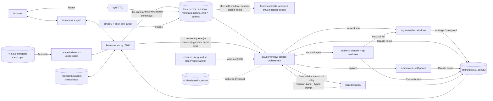

# Atlas — architecture and state (Task 8)

Scope: live code at `~/agent-board` (branch `main`, `git branch --show-current`), `~/.local/bin`, `~/.claude`. Read-only. Paths below are relative to `~/agent-board` unless they start with `~`. Labels: Verified = read in code or observed by a command in this session; Measured = computed from a number; Hypothesis = inferred.

## Components

| Component | What it does | Evidence (file:line) |
| --- | --- | --- |
| Board backend | stdlib `ThreadingHTTPServer` on 127.0.0.1; `GET` routes `api/state`, `api/artifacts`, `api/ideas`, `api/runs`, `api/log`, `api/usage`, `api/artifact`, `api/dirs`; one `POST api/action` guarded by an `X-Dash-Token` header | `board/server.py:778-879` (do_GET), `board/server.py:880-889` (do_POST), `board/server.py:899-904` (`__main__`) |
| Board frontend | one static page `board/index.html` served with a CSP; terminals are ttyd iframes | `board/server.py:783-789`, `bin/tmux-dash:2-10` |
| Board state build | every poll runs `tmux list-panes -a` plus `capture-pane` per pane, reuses the result 1.5 s, classifies each pane, adds worktrees, usage alerts, delivers queued comments | `board/server.py:100` (`STATE_TTL`), `board/server.py:203-210`, `board/server.py:256-299` |
| Project switching | a project is a tmux session named after the repo top level. Board action `dev` runs `bin/dev` with `DEV_NO_ATTACH=1`; recent folders go to `recent-projects.json`; `dev` reattaches if the session exists | `board/server.py:513-517`, `board/dirs.py:42`, `bin/dev:14-23`, `bin/dev:32-44` |
| tmux session lifecycle | `dev` creates session `<name>` (windows `claude`, `shell`) then `tmux-dev-layout` builds hidden `<name>-bg`. Teammate panes are moved to `✦ <name>` windows by an `after-split-window` hook; `session-closed` hook deletes the project's state files | `bin/dev:18-23`, `bin/tmux-teammate-window:2-9`, `bin/tmux-session-closed:14-21`, `~/.tmux.conf:69,71` |
| `dev` and `tmux-ctl` | `~/.local/bin/dev` and `~/.local/bin/tmux-ctl` are symlinks to `~/agent-board/bin/` (`ls -l`). `tmux-ctl` subcommands: list read feed run send keys new agent tell agents artifact idea relay | `bin/tmux-ctl:221-453`, `bin/agent-board:13-15` |
| tmux server resolver | one resolver for zsh and Python; legacy mode when `~/.tmux.conf` has agent-board hook lines and no `agent-board` socket exists | `bin/_tc_bins.zsh:31-35`, `board/paneclass.py:71-81` |
| Claude launch (lead) | `claude-orchestrator`: `claude --name orchestrator --model opus --settings claude/session-settings.json --plugin-dir claude/plugin --append-system-prompt-file <~/.config/agent-board/orchestrator.md or claude/orchestrator.md>` | `bin/claude-orchestrator:14-27`, `bin/_ab_claude.zsh:3` |
| Claude launch (worker) | `tmux-ctl agent` types a `claude --model M --effort E -w NAME -n NAME …` line into a new `@tc_agent` window; refuses briefs under 8 words | `bin/tmux-ctl:341-391` (line built at 381, typed at 389) |
| Agent spawn / termination | teammates: Claude Code splits a pane, the tmux hook retags it `@tc_teammate`. Workers: window by `tmux-ctl agent`; board `stop_agent` does `kill-window` (worktree stays). Teammate shutdown is a request typed to the lead via the comment queue | `bin/tmux-teammate-window:27-43`, `board/server.py:598-622` |
| Task queue | none in board code. Tasks are Claude Code's agent-team task list, which the board never reads: `grep -rn '\.claude/tasks\|\.claude/teams' board bin claude/plugin` → no hits. A worker's task is the string typed on its command line | `bin/tmux-ctl:381,389`; grep result (this session) |
| Ideas | `board/ideas.py` owns `~/.local/state/agent-board/ideas/<project>.md`, `- [ ] date · text` lines under a file lock. Agents add via `tmux-ctl idea` | `board/ideas.py:1-14`, `board/ideas.py:23`, `bin/tmux-ctl:431` |
| Handoff | `/handoff` skill writes a doc, then `tmux-ctl relay <doc>` schedules `relay.py` via `tmux run-shell -b`; relay waits for two idle polls (2 s apart, 120 s cap), respawns the pane, types `claude-orchestrator "Read <doc> and continue…"`, appends `lineage-
.jsonl`. Trigger is the global hook `context-size-guard.sh` at 300000 tokens | `claude/plugin/skills/handoff/SKILL.md:3,61`, `bin/tmux-ctl:435-447`, `board/relay.py:6-8,28-29,32-43,65-70,73-84`, `claude/hooks/context-size-guard.sh:4,10,19-22` |
| Persistent state | durable: `~/.local/state/agent-board/ideas/`, handoff docs (in practice `~/.claude/handoffs/`), `~/.claude/projects/*.jsonl` (Claude's own transcripts), `usage.sqlite`. Runtime: `$TMPDIR/tmux-ctl-$UID/` | `docs/ARCHITECTURE.md:234-251`; `ls` results in State table |
| Logs and telemetry | `tmux-ctl run` writes `runs-
.jsonl` and `logs/
/<id>.log`; hooks `bash-mirror.sh` write `feed-
-*.log`; `artifact-register.sh` writes `artifacts-
.jsonl`; the usage indexer scans transcripts every 5 s into sqlite | `bin/tmux-ctl:149-155,267,294-296`, `claude/plugin/hooks/hooks.json:11-31`, `board/usage.py:317-345` |
| Completion detection | three separate mechanisms: (a) `tmux-ctl run` appends `; tmux-ctl _done <id> $?` to the typed line and polls for `<id>.rc`; (b) board pane status: regex on the last 12 pane rows (`esc to interrupt` = working, prompt regex = waiting, else ready); (c) relay uses (b) twice in a row | `bin/tmux-ctl:281-296,311-313`, `board/paneclass.py:20-21,51-65`, `board/relay.py:32-43` |

## Diagram

## State sources of truth

| State | Where it lives | Writer | Reader | Survives tmux loss |
| --- | --- | --- | --- | --- |
| Project | A tmux session name (derived from repo folder) is the identity; `recent-projects.json` is only a convenience list; per-project files keyed by that name | `bin/dev:14-20`; board `dev` action `board/server.py:513`; `session-closed` hook deletes the files `bin/tmux-session-closed:18-20` | board `open_projects()` `board/server.py:442-443`, every script via `FEEDKEY` | **No.** The board's record of the project (session, `runs`/`lineage`/`artifacts` files) is gone with the session; the files are deleted on close and the directory is under `$TMPDIR`. (The repo and worktrees stay on disk but nothing in the board tracks them.) |
| Task | Claude Code's agent-team task list under `~/.claude/tasks/` (105 entries, `ls`), the plan/spec files in the repo, a worker's brief typed on its command line. No board record | Claude Code (lead/teammates); plans by Write hook → `artifacts-
.jsonl` | lead and teammates; the board does **not** read it (grep above) | **Yes** (task files and plans are files). Note: a worker's brief is not kept anywhere but the typed command line and the transcript, so that part is no |
| Agent | Window tags `@tc_agent` (worker), `@tc_teammate` (teammate) plus pane process; Claude's transcript `~/.claude/projects/**.jsonl` holds its history; `~/.claude/teams/` (17 entries) holds team config | tmux-ctl `bin/tmux-ctl:386-387`, `bin/tmux-teammate-window:42`; Claude Code | board `build_state` (`board/server.py:256-299`); usage indexer for role | **No** for the live agent record: tags and status are gone (status is computed from the screen each poll, never stored). Note: transcripts and team config are files and stay |
| Terminal / session | The tmux server (sessions, windows, panes, scrollback); `_web-NNN` grouped sessions per browser terminal; run output copied to `logs/
/<id>.log` | tmux; `tmux-ctl run` | board capture, `tmux-ctl read/feed`, ttyd | **No** (scrollback gone; only copied run logs under `$TMPDIR` survive until reboot or session close) |
| Usage / telemetry | Claude's transcripts are the source; derived index `usage.sqlite` in the state dir; run records `runs-
.jsonl`; hook feeds `feed-
-*.log` | Claude Code (transcripts); `board/usage.py:317-345` (index) | `api/usage`, card alerts `board/usage.py:457-470`; the audit toolkit | **Yes** (transcripts and sqlite are files). The index is rebuildable from transcripts. **Quota/limits: out of scope** — `grep -rniE 'quota\|rate_limit\|subscription\|usage_limit\|five_hour\|oauth' board bin claude/plugin` (excluding tests) returned no hits. `usage.py` computes API-equivalent dollars from token counts times `board/prices.json` (`board/usage.py:126-135`) and reads no account limit |

Live check (Verified): `tmux -L default list-sessions` shows the project sessions (`agent-board`, `Desktop`, `francisco_ruiz`, `master-gcp-repo` and their `-bg`); socket `/private/tmp/tmux-503/agent-board` does not exist; `~/.tmux.conf:69,71` still holds the legacy hook lines. So `tc_tmux_legacy` is true (`bin/_tc_bins.zsh:31-35`) and the install runs on the user's default server, not the dedicated one that README.md:23 and docs/ARCHITECTURE.md:9 describe.

## Implicit state

State that exists only in tmux output, conversation history or prompt convention:

1. **Agent status** (working / waiting / ready) exists only as regex matches on the last 12 screen rows: `board/paneclass.py:20-21,55-65`. Nothing stores it.
2. **Run completion** is a marker string echoed into a pane (`@@TCSTART-<id>`) and the output is cut back out of `capture-pane` with awk; a `.rc` file carries only the exit code: `bin/tmux-ctl:281-294`. The log is reconstructed from scrollback offsets (`history_size`, `cursor_y`): `bin/tmux-ctl:271-272`.
3. **Handoff delivery** is a typed prompt string, `Read <doc> and continue from where the previous session left off.` (`board/relay.py:28-29`), typed with `send-keys` into a fresh shell (`board/relay.py:65-70`). What the new lead knows is whatever the doc says.
4. **Pending board comments and shutdown requests** live in a Python dict (`board/artifacts.py:159-174`) and are delivered by typing one line into the lead's prompt (`board/server.py:245-253`). A board restart drops undelivered items (Hypothesis on loss; the dict is never persisted — Verified by reading the class).
5. **Teammate identity and tag**: the `--agent-name` is scraped from `ps` args of the pane's tty (`bin/tmux-teammate-window:27`), then written as tmux option `@tc_teammate`.
6. **Worker brief**: a task is a shell command line typed into a window (`bin/tmux-ctl:381,389`); the "decide, don't ask" worker behaviour is the appended prompt `claude/worker.md`.
7. **Team structure and routing rules** (team of 2–3, never more than 4, tier→model map) are prompt convention in `claude/orchestrator.md` per README/ARCHITECTURE (`docs/ARCHITECTURE.md:122-128`); the board has no model of a team beyond window tags.
8. **Handoff checkpoint**: teammates' state is gathered by SendMessage replies "with exactly these fields" and, if silent, the last 40 pane lines: `claude/plugin/skills/handoff/SKILL.md:14-18`. It exists in conversation history until written into the doc.
9. **Handoff trigger threshold** (300000 tokens) is computed by the hook from the last 400 transcript lines, then handed to the model as an `additionalContext` instruction to "begin your reply with…" (`claude/hooks/context-size-guard.sh:4-10,19-22`). Whether the lead obeys is not recorded.
10. **Busy-window arbitration** between agents: lock dirs `lock-
-<win>/`, lane windows `tests·<agent>` and `@tc_lane_used` timestamp tags (`bin/tmux-ctl:77-100`, README table in `docs/ARCHITECTURE.md:50,61,247`); lost when the window or session goes.
11. **"Needs you" attention** is derived from the pane's bell flag and the screen prompt match (`board/paneclass.py:63-65`).
12. **Task intake**: the user's request to the lead is conversation text only; the first durable artefact is whatever plan/spec file the lead later writes (registered by the Write hook).

## Findings

### F-atlas-1: Live install runs the "legacy" shared tmux server; the documented dedicated server is not in use
Label: Verified
Evidence: `ls /private/tmp/tmux-503` has no `agent-board` socket; `tmux -L default list-sessions` lists the project sessions; `~/.tmux.conf:69,71` contain `tmux-teammate-window` / `tmux-session-closed` hooks; `bin/_tc_bins.zsh:31-35` makes that combination "legacy"; README.md:23 and docs/ARCHITECTURE.md:9 say agent-board runs its own server; legacy mode is documented at docs/ARCHITECTURE.md:259.
Component: tmux server resolver, session lifecycle · Root cause: (Hypothesis) migration (`install.sh --migrate`) not run on this machine · Impact: unmeasured — needs an instrument that records which server each hook and board poll hit. Consequence by design: the board and every project share the server of the user's own tmux, so a prompt-regex or hook change affects the user's own sessions too.
Confidence: high · Candidate change: run the migration, or document legacy mode as the supported mode · How to validate: after migration `tmux -L agent-board list-sessions` lists projects and `~/.tmux.conf` has no agent-board lines.

### F-atlas-2: Agent completion and attention rest on screen regexes with no stored status
Label: Verified
Evidence: `board/paneclass.py:20-21` (`esc to interrupt` = working; `TC_PROMPT_RE` = waiting), `board/paneclass.py:55-65` (last 12 rows), `board/relay.py:32-43` (relay switches on two consecutive idle/ready reads).
Component: completion detection, handoff · Root cause: Claude Code exposes no machine-readable turn state to the board; the only signal is the rendered terminal · Impact: unmeasured — needs a count of misclassifications (e.g. a pane scrolled past 12 rows, a changed Claude Code UI string). A false "ready" lets `relay` respawn a pane mid-turn; relay's 120 s cap and two-poll rule bound the risk but do not remove it.
Confidence: med · Candidate change: use a hook-written status file (Stop / UserPromptSubmit) as the primary signal, keep the regex as fallback · How to validate: compare hook status against `classify()` over a day of polls and count disagreements.

### F-atlas-3: The board has no view of the task list; task state is split between Claude's task files, plan files and typed briefs
Label: Verified
Evidence: `grep -rn '\.claude/tasks\|\.claude/teams' board bin claude/plugin` → no hits; `ls ~/.claude/tasks | wc -l` → 105; `ls ~/.claude/teams | wc -l` → 17; worker brief is a typed command line `bin/tmux-ctl:381,389`.
Component: task queue, board backend · Root cause: the board was built on tmux windows as the unit of work (`board/server.py:256-299`), not on tasks · Impact: unmeasured — needs a count of tasks whose owning window had gone, which the board then could not show. Board "agent" cards cannot say what task an agent is on.
Confidence: high · Candidate change: read the team task directory read-only into `api/state`; show owner and status per task · How to validate: card for a teammate shows its in-progress task id matching `TaskList`.

### F-atlas-4: Runtime state that carries handoff lineage lives in `$TMPDIR` and is deleted on session close
Label: Verified
Evidence: state dir `/var/folders/2p/…/T/tmux-ctl-503` holds `lineage-agent-board.jsonl` (7 lines), `lineage-francisco_ruiz.jsonl` (8), `lineage-master-gcp-repo.jsonl` (12) (`wc -l`); `bin/tmux-session-closed:18-20` removes `lineage-$n.jsonl`, `runs-$n.jsonl`, `artifacts-$n.jsonl` and logs on close; `docs/ARCHITECTURE.md:236` states the location.
Component: persistent state, handoff · Root cause: runtime and durable data share one directory rule · Impact: Measured for the live files above (27 lineage lines across three projects). Project close erases these files (Verified: `bin/tmux-session-closed:18-20`). That a reboot also clears them and that they are the only machine record of handoff epochs (Hypothesis — not checked: macOS `$TMPDIR` cleaning and other lineage sources). `audit-out` handoff tracing has to rebuild links from transcripts instead (`handoff_trace.json` link_method doc|time).
Confidence: med · Candidate change: write lineage to `~/.local/state/agent-board/` · How to validate: close a scratch project and confirm `lineage-*.jsonl` is still readable.

### F-atlas-5: Quota and subscription limits are not read anywhere; "usage" means API-equivalent dollars from transcripts
Label: Verified
Evidence: the no-hit grep for `quota|rate_limit|subscription|usage_limit|five_hour|oauth` over `board`, `bin`, `claude/plugin`; `board/usage.py:126-135` (price table × tokens); `~/.claude/settings.json` has `autoContinueAtUsageLimit: False`.
Component: logs and telemetry · Root cause: (Hypothesis) Claude Code writes no remaining-quota figure to the transcripts the indexer reads · Impact: unmeasured — the board's burn alert (`burn_per_hour` default 15 USD, `docs/ARCHITECTURE.md:219`) is a dollar proxy and cannot show how close the account is to a plan limit. Quota is out of scope for this audit and needs a source (e.g. a statusline or API response header) before it can be measured.
Confidence: high · Candidate change: none until a quota source exists · How to validate: find any file or command that exposes remaining quota, then add a reader.

### F-atlas-6: Handoff docs are still read and written at the legacy `~/.claude/handoffs/`; the documented new directory does not exist
Label: Verified
Evidence: `ls ~/.claude/handoffs | wc -l` → 35; `ls ~/.local/state/agent-board/handoffs` → "No such file or directory"; `docs/ARCHITECTURE.md:228` names the new path as the target.
Component: handoff, persistent state · Root cause: the legacy fall-back is the path that is in use, so docs, skill text and reality differ · Impact: unmeasured — an audit or recovery script that follows the documented path finds no handoffs. This audit's own handoff tracing must use `~/.claude/handoffs`.
Confidence: med · Candidate change: pick one path and migrate · How to validate: after the change `ls` shows docs under only one directory.

### F-atlas-7: Two registrations of the same hooks exist (global `~/.claude/settings.json` and the plugin), kept apart by a runtime guard
Label: Verified
Evidence: `~/.claude/settings.json` registers `bash-mirror.sh`, `artifact-register.sh`, `kill-guard.sh` under PostToolUse/PreToolUse; `claude/plugin/hooks/hooks.json:3-31` registers the same scripts with `--scoped`; `claude/plugin/scripts/bash-mirror.sh:13-14` exits the global copy when `AGENT_BOARD=1`.
Component: hooks, Claude launch · Root cause: the global setup predates the plugin and both are still wired · Impact: unmeasured — needs the per-session hook invocation counts (sieve area owns hook cost). One extra process spawn per Bash and Write call when the guard fires; correctness depends on `AGENT_BOARD=1` being exported into every pane, which `claude/session-settings.json:4` sets only for sessions launched through agent-board.
Confidence: med · Candidate change: remove the global registrations once all sessions go through the plugin · How to validate: count hook runs per tool call in a session before and after.
