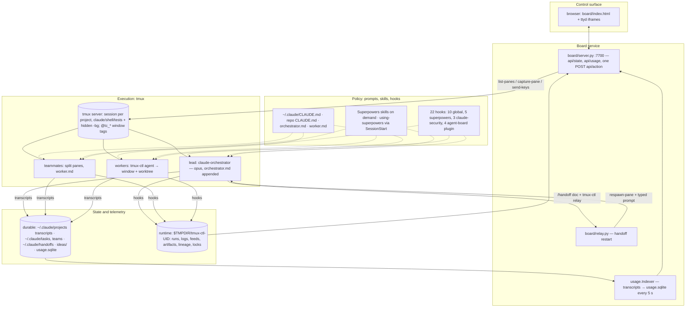
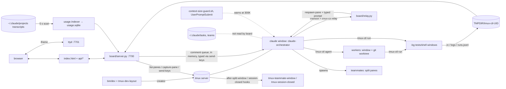

# Claude Code Runtime Audit — Baseline 2026-10

Sub-project 1 of the runtime-optimisation brief. Read-only. Window 2026-09-26..2026-10-25 over `master-gcp-repo` and `agent-board` (plus their worktrees); toolkit `tools/audit/` at a58d81b; metrics in `audit-out/2026-10-25/` (`session_metrics.json`, `waste_signals.json`, `injection_costs.json`, `handoff_trace.json`, `manifest.json`). Sources: the three area reports `atlas.md` (architecture and state), `sieve.md` (hooks, skills, observer) and `relay.md` (routing, orchestration, parallelism, handoff), their reviews, and the metric files. Paths are relative to `~/agent-board` unless they start with `~` or `/`.

Labels follow the spec: **Verified** (code, logs, reproducible test), **Measured** (observed metric), **Hypothesis**, **Recommendation**. "est." means chars/4, a derived figure, never a measurement. No estimated saving is presented as measured.

> Status of this draft: atlas and sieve are final and reviewed. relay.md is still under review; every verdict that depends on it (H2, H4, H6, the orchestrator-share interpretation, the parallelism and handoff findings) is marked **pending relay** and will be folded in before publication.

## Summary

1. The setup is a sound tmux-based execution model with a board that reads the screen: the costs that dominate are not the Opus orchestrator's reasoning but always-on text and idle machinery — a 34,016-token median first request (Measured, `injection_costs.json`), of which the skill listing (31,218 chars median, est. 7,800 tokens) is the largest controllable item, and a 44,715-char observer skill loaded in about half of lead sessions.
2. Two global Stop hooks cost about 2.1 s per Stop and never blocked in the window (Measured, 2,207 runs each); most Superpowers gates are dormant; three hooks are registered twice and kept apart by an environment guard.
3. Handoff works mechanically (24 traced relays, context at handoff median 342,003, zero compactions) but its trigger is an advisory estimate, completion detection is a screen regex, and lineage lives in `$TMPDIR` and is deleted on session close — so handoff recovery cannot yet be measured.
4. Deterministic waste signals inside sessions are small (11 identical re-reads and 9 cross-agent duplicate reads over 357 sessions); the measurable waste is per-session boilerplate and never-firing checks, not repeated exploration.
5. The observer produced 85 observations and three review rounds in ten days, but its biggest round (24 observations) is staged and not installed, and the scheduled review died on the weekly usage limit — its value is real and currently blocked by an install step.

Next actions (concrete engineering tasks; relay may add or reorder one):

1. **Trim the skill listing.** Add `skillOverrides` entries (`name-only` or `off`) in `~/.claude/settings.json:43` for skills with long descriptions and zero Skill calls in the window; shorten the descriptions of the `-extras` and task-observer skills. Validate: re-run `python3 tools/audit/injection_costs.py` and compare `attachment:skill_listing` median chars and `first_request_prompt_tokens` median (34,016 today); confirm the Skill-call counts for kept skills do not fall.
2. **Make the observer's session-start cheap.** Change `claude/hooks/task-observer-session-start.sh` to emit a short protocol stub (storage check, open count, review-due flag) and restructure the task-observer `SKILL.md` so the 44,715-char body loads only when a review or an observation write is due. Validate: per-call `tool_result` size of the task-observer Skill call and `hook:SessionStart` median chars (8,393 today) in the next `injection_costs.json`.
3. **Short-circuit the two Stop hooks.** In the `superpowers-hook.sh` dispatch for `stop-revalidate-user-gates.sh` and `stop-wait-guard.sh` (`~/.claude/settings.json:84-88`), test a cheap marker (an armed-plan file or user-gate task present) before scanning the transcript. Validate: `stop_hook_summary.durationMs` medians (1,064 / 1,038 ms today) and the trace-log block counts (0 today) over the next window.
4. **Install or drop the staged 2026-10-21 observer round and guard the review job.** Apply `~/.task-observer/PENDING.md`'s round, and give `com.user.task-observer-review` a retry or a budget check before it starts. Validate: `~/.claude/skills/writing-plans-extras/SKILL.md` shows sections 8–10; `last-review-date.txt` advances; `scheduled-review.log` shows no usage-limit exit.
5. **Store agent status and lineage outside the screen and `$TMPDIR`.** Add a Stop/UserPromptSubmit hook that writes `status-<pane>.json`, make `board/paneclass.py:classify()` and `board/relay.py:32-43` read it first with the regex as fallback, and write `lineage-
.jsonl` under `~/.local/state/agent-board/`. Validate: one day of polls comparing hook status with `classify()` (count disagreements); close a scratch project and confirm the lineage file survives.

## Current-state architecture

Deliverable D1. Facts below are Verified in `atlas.md` and `sieve.md` unless marked otherwise.

### Layered view

### Component flow (from atlas)

[chart: component count by layer]

### Component table

| Component | What runs | Evidence | Status |
| --- | --- | --- | --- |
| Board backend | stdlib `ThreadingHTTPServer` on 127.0.0.1; GET `api/state|artifacts|ideas|runs|log|usage|artifact|dirs`, one POST `api/action` with `X-Dash-Token` | `board/server.py:778-889,899-904` | Verified |
| Board state build | each poll: `tmux list-panes -a` + `capture-pane` per pane, cached 1.5 s, pane classified by regex, worktrees and usage alerts added, queued comments typed to the lead | `board/server.py:100,203-210,256-299` | Verified |
| Project switching | a project is a tmux session named after the repo top level; `bin/dev` creates `claude`/`shell` windows, `tmux-dev-layout` the hidden `-bg`; `recent-projects.json` is a convenience list only | `bin/dev:14-23`, `board/server.py:513-517` | Verified |
| tmux server | legacy mode: the user's default server, hooks in `~/.tmux.conf:69,71`; the dedicated `agent-board` socket documented in README.md:23 does not exist | `bin/_tc_bins.zsh:31-35`, `ls /private/tmp/tmux-503` | Verified (F-atlas-1) |
| Lead launch | `claude --name orchestrator --model opus --settings claude/session-settings.json --plugin-dir claude/plugin --append-system-prompt-file claude/orchestrator.md` (16,221 chars) | `bin/claude-orchestrator:14-27`; `IC static_files` | Verified |
| Worker launch | `tmux-ctl agent` types `claude --model M --effort E -w NAME -n NAME …` into a new `@tc_agent` window; brief must be ≥ 8 words; `worker.md` (3,420 chars) appended | `bin/tmux-ctl:341-391` | Verified |
| Teammates | Claude Code agent teams split a pane; `tmux-teammate-window` retags it `@tc_teammate` by scraping `--agent-name` from `ps`; shutdown is a request typed to the lead | `bin/tmux-teammate-window:27-43`, `board/server.py:598-622` | Verified |
| Model routing | prompt convention in `orchestrator.md:85-94` (tier → model), enforced by two Superpowers gates (`pre-taskcreate-model-tier`, `pre-agent-model-routing`: 18 + 24 blocks in the trace log, one known false block, observation #55) | sieve H12, H14 | Verified; routing correctness **pending relay** |
| Skills | Superpowers injects `using-superpowers` (7,973 chars probe) via SessionStart; other skills load on demand through the Skill tool; `-extras` companions load as separate calls (TDD 83 / extras 65; code-review 26 / 22; writing-plans 23 / 16) | sieve "Superpowers loading" | Verified / Measured |
| Hooks | 22 hook entries, all scripts, none calls a model: 10 in `~/.claude/settings.json`, 5 superpowers, 3 claude-security, 4 agent-board plugin (duplicates of 4 global ones, guarded by `AGENT_BOARD=1`) | sieve hook count (inline script) | Verified |
| Observer | `task-observer-session-start.sh` (SessionStart, 1,378 chars) asks the lead to invoke the task-observer skill (44,715 chars) and run its protocol; a launchd job runs a headless weekly review | sieve H1, O1, O2 | Verified |
| Task queue | none in board code; Claude Code's own task list under `~/.claude/tasks/` (105 entries), plan files, and the worker's typed brief. The board never reads it | `grep` no hits; `bin/tmux-ctl:381,389` | Verified (F-atlas-3) |
| Ideas | `board/ideas.py` owns `~/.local/state/agent-board/ideas/<project>.md` under a file lock; agents add via `tmux-ctl idea` | `board/ideas.py:1-23`, `bin/tmux-ctl:431` | Verified |
| Handoff | `context-size-guard.sh` (UserPromptSubmit) estimates main context from the last 400 transcript lines with jq and, at ≥ 300,000, injects an instruction to begin the reply with a handoff notice; `/handoff` writes a doc; `tmux-ctl relay` schedules `relay.py`, which waits for two idle polls (2 s apart, 120 s cap), respawns the pane and types `claude-orchestrator "Read <doc> and continue…"` | `claude/hooks/context-size-guard.sh:4-22`, `board/relay.py:28-84`, `claude/plugin/skills/handoff/SKILL.md` | Verified |
| Completion detection | (a) `tmux-ctl run` appends `; tmux-ctl _done <id> $?` and polls `<id>.rc`; (b) board pane status is a regex over the last 12 rows (`esc to interrupt` = working, prompt = waiting); (c) relay uses (b) twice | `bin/tmux-ctl:281-313`, `board/paneclass.py:20-21,51-65` | Verified (F-atlas-2) |
| Telemetry | transcripts are the source; `usage.Indexer` scans them every 5 s into `usage.sqlite` and prices tokens with `board/prices.json`; runs, feeds and artifacts are JSONL under `$TMPDIR`. No code reads quota or plan limits | `board/usage.py:126-135,317-345`; grep no hits | Verified (F-atlas-5) |

### State: source of truth per type

| State | Lives in | Survives tmux loss | Note |
| --- | --- | --- | --- |
| Project | tmux session name; per-project files keyed by it under `$TMPDIR`; `recent-projects.json` | **No** | `tmux-session-closed:18-20` deletes runs/lineage/artifacts on close |
| Task | `~/.claude/tasks/` (Claude Code), plan/spec files, worker's typed command line | **Yes** for files; **No** for the typed brief | board has no task model |
| Agent | tmux window tags `@tc_agent`/`@tc_teammate`; status computed from the screen each poll; transcript and `~/.claude/teams/` on disk | **No** for live status | nothing stores status |
| Terminal | tmux scrollback; run output copied to `logs/
/<id>.log` | **No** | |
| Usage | transcripts (source), `usage.sqlite` (rebuildable index), run records | **Yes** | API-equivalent dollars, no quota |

Implicit state (exists only in screen text, conversation or prompt convention; atlas lists twelve): agent status, run completion markers, the handoff prompt string, pending board comments in a Python dict, teammate identity scraped from `ps`, the worker brief on a command line, team-size and routing rules as prose, the handoff checkpoint gathered by `SendMessage`, the 300K threshold as an `additionalContext` instruction the lead may or may not obey, lock dirs for busy windows, "needs you" from the bell flag, and task intake as conversation text.

### Verified vs assumed

Verified: everything in the tables above (file:line cites re-checked by the Task 8 and Task 9 reviews; 38 of 38 changed atlas cites and about 45 sieve cites held). Assumed or Hypothesis: that the legacy server is the result of `install.sh --migrate` not having run (atlas F-1 root cause); that a reboot clears `$TMPDIR` lineage (atlas F-4); that Claude Code writes no quota figure into transcripts (atlas F-5); that `hook_success` duplicates the SessionStart text in the model request (sieve F-8). The whole picture of routing decisions, teammate payoff and handoff recovery is **pending relay**.

## Baseline measurements

Deliverable D6, part. All figures are from `audit-out/2026-10-25/` unless marked otherwise; `source: measured` unless "derived". The window nominally starts 2026-09-26, but the earliest lead session's first request is 2026-10-12 15:28 (`session_metrics.json` `agents[].first_ts`, Measured), so the lead-session figures describe about 13 days of use.

### Scale

- 357 sessions, 65 with a `main` agent (lead sessions), 292 teammate-only sessions; 15,914 model requests; 443 transcript files in scope of 1,088 in the window (`manifest.json`).
- Tokens over the window (`totals.tokens`): input 62,564; output 12,450,761; cache_read 2,617,780,450; cache_creation 60,259,735. Almost every prompt token is a cache read: fresh input is 0.002% of context processed.

### Usage by model and agent kind

| Model | Output tokens | Output share (derived) | Cache-read share (derived) |
| --- | --- | --- | --- |
| claude-opus-5-5 | 6,379,006 | 51.2% | 68.1% |
| claude-sonnet-5-5 | 3,795,886 | 30.5% | 23.9% |
| claude-fable-5-1 | 1,949,393 | 15.7% | 6.6% |
| claude-haiku-5-5 | 326,476 | 2.6% | 1.4% |

| Agent kind | Output tokens | Output share | Cache-read share | Agent entries by model |
| --- | --- | --- | --- | --- |
| main (lead) | 4,776,739 | 38.4% | 60.9% | opus 59, sonnet 5, haiku 2 |
| team (teammates) | 6,979,027 | 56.1% | 35.7% | sonnet 192, opus 44, haiku 25, fable 25 |
| sub (Agent tool) | 694,995 | 5.6% | 3.4% | sonnet 58, opus 16, fable 6, haiku 6 |

[chart: totals.by_model output tokens by model]
[chart: totals.by_agent_kind cache_read by agent kind]

The lead kind processes 61% of all cached context while producing 38% of output: lead sessions are long and re-read a large context every turn. Whether that is the orchestrator "consuming substantial usage" (brief §5.3) depends on what those turns decided — **pending relay**.

### Lead sessions (n = 65)

| Metric | min | p25 | median | p75 | max |
| --- | --- | --- | --- | --- | --- |
| peak_context (main, tokens) | 29,524 | 86,311 | 313,977 | 352,042 | 666,520 |
| wall_clock (min, derived) | 0.1 | 15.7 | 107.6 | 498.8 | 4,066 |
| turns | 0 | 6 | 16 | 52 | 123 |
| agents in session (main + sub) | 1 | 1 | 1 | 2 | 20 |
| orchestrator_share | 0.47 | 0.996 | 1.0 | 1.0 | 1.0 |

33 of 65 lead sessions peaked above 300,000 tokens; 7 above 400,000. `orchestrator_share` is main's tokens over all tokens *in the same session file*; teammates run in their own session files, so this metric sees only Agent-tool subagents and reads 1.0 for most sessions. For the 17 lead sessions with more than one agent it is min 0.47, median 0.92, max 0.996. A cross-session orchestrator share is the kind table above (main = 38.4% of output). Interpretation **pending relay**.

[chart: peak_context by lead session, ordered by start time]
[chart: orchestrator_share distribution for multi-agent lead sessions]

### Always-on and injected text (`injection_costs.json`)

- `first_request_prompt_tokens`: 351 non-null of 357; median 34,016 tokens; lead sessions median 52,300; teammate sessions median 33,802 (n = 286).
- Static prompt files (chars, measured): `~/.claude/CLAUDE.md` 2,672; `master-gcp-repo/CLAUDE.md` 2,405; `agent-board/CLAUDE.md` 1,347; `claude/orchestrator.md` 16,221; `claude/worker.md` 3,420. A lead in agent-board carries about 20,240 chars (est. 5,060 tokens); a teammate about 7,439 chars (est. 1,860 tokens).
- Largest injected sources, median chars per session: `attachment:skill_listing` 31,218 (332 sessions, 11.66 M chars total); `attachment:deferred_tools_delta` 9,102; `attachment:deferred_tools_record` 8,264; `attachment:hook_success` 9,481; `hook:SessionStart` 8,393 (340 sessions); `attachment:instructions` 4,739; `attachment:mcp_instructions_delta` 3,968. `attachment:prompt_snapshot` is the largest by chars (126,633 median) but is a record of the prompt, not an addition to it.
- `hook:UserPromptSubmit` (the 300K guard's warning): 34 sessions, median 3 warnings per session, max 7.

[chart: injection_costs sources median_chars_per_session by key]

### Hook runtime

- Stop hooks (`stop_hook_summary.durationMs`, 2,378 Stop events in scope): `stop-revalidate-user-gates` median 1,064 ms (max 14,236; 2,207 runs); `stop-wait-guard` median 1,038 ms (max 11,934; 2,207 runs); `revise-claude-md-nudge` median 115 ms (1,991 runs). Blocks: 0, 0, 3. Over the window that is 39–77 minutes of Stop latency (derived: 2,207 × 1.04 s if parallel, × 2.1 s if sequential; whether they run in parallel is unmeasured).
- Probes (dummy stdin, scratch dir, floor 0.15 s subtracted): `task-observer-session-start.sh` 0.11 s; superpowers session-start 0.42 s; `context-size-guard.sh` about 0.1 s on a 13.5 MB transcript; `kill-guard.sh` 0.08 s (0.02 s on the dedupe exit); claude-security metrics 0.13 s.
- PreToolUse/PostToolUse durations are not recorded anywhere: unmeasured.

### Waste signals (`waste_signals.json`, 357 sessions)

- `repeat_reads`: 10 entries in 9 sessions; identical re-reads (same args) sum to 11.
- `repeat_commands` (same Bash command, same result): 6 entries.
- `repeat_failures` (same tool + args failing again): 26 entries, led by `SendMessage` pairs.
- `cross_agent_duplicate_reads`: 9 entries in 5 sessions (e.g. two subagents of 2ac6a941 each reading `task-4-brief.md` and `task-5-brief.md`).
- `tool_output_share` of context: median 0.197, p75 0.397, max 0.960.
- `idle_tail_s` (last useful output to end): teammates (n = 286) median 1.8 s, p75 19.7 s, max 4,217 s; the docstring notes the tail includes the agent's final answer.

[chart: tool_output_share distribution across sessions]

### Handoffs (`handoff_trace.json`)

- 24 handoffs detected: trigger `relay` 22 (exact `tmux-ctl relay` wording), `keyword` 2; link `doc` 23, `time` 1; `previous_context` at handoff min 229,457, median 342,003, max 508,135. Zero compactions by either detection rule (context drop ≥ 50%, or "This session is being continued" prompt).
- Resumed sessions (n = 24; 22 with an edit): `seconds_to_first_edit` median 2,211 s (p75 16,494; max 198,200); `reads_before_first_edit` median 0.5, max 3; `reread_overlap` (share of pre-edit reads that repeat the previous session's reads) median 0.0, max 0.5 over the 11 sessions that read before editing; `tokens_to_first_edit` median 2.22 M, but this includes cache reads of the replayed context, so it is total tokens processed, not new work.
- **Caveat (Measured, synthesis probe):** 32 of the 65 lead sessions begin with the exact relay wording ("Read … and continue from where the previous session left off"), against 24 in `handoff_trace.handoffs`. The 10 unlinked relay starts are 8 sessions whose transcript directory is the home-directory project (`-Users-francisco-ruiz`: d205e439, b96190ce, bfb71e82, 8eba3dc6, 48822fd2, 84b315fb, ccbeeda3, 9c585650) and 2 whose doc path is the older `/var/folders/…/T/handoff-*.md` without a `/handoffs/` segment (7d49985a, 9483d411). Treat 24 as a lower bound; the chain and recovery statistics are over the linked 24. The count came from reading each lead session's first plain user prompt in `~/.claude/projects/*/<session>.jsonl`, read-only. Reason for the gap: Hypothesis (handoff detection keys on the transcript's project directory and on `/handoffs/` in the path, per the `handoff_trace.py` docstring).

[chart: handoff_trace previous_context by handoff, ordered by session start]
[chart: resumed seconds_to_first_edit by session]

### Observer (from sieve, counts from frontmatter)

85 observations (59 actioned and archived, 25 open, 1 parked); 11 are split-carriers. Reviews completed 10-16 (three runs), 10-19, 10-21; the 10-23 run ended with "You've hit your weekly limit", exit 1. Skill invocations in scope: 45 in 44 sessions (29 in 28 of 65 lead sessions; 16 in teammate sessions, all on 10-16 before the exemption text existed).

### Not observable today, and the instrument each gap needs

| Gap | Why it is not in the data | Instrument |
| --- | --- | --- |
| Task outcome (success, first-pass, rework, manual intervention) | no record ties a session or agent to a task and its acceptance result | per-task outcome record (brief §7.5 schema) written at task close by a `TaskUpdate` PostToolUse hook or by the lead's completion step, keyed by task id and session id |
| Usage per task | usage is per session and per agent; tasks span sessions and teammates | the same record, plus the task id in teammate briefs so `session_metrics` can join on it |
| Quota / plan limit remaining | nothing reads it; transcripts carry no quota field (atlas F-5) | find a source (statusline, API response header, CLI output) before adding a reader; until then only API-equivalent dollars exist |
| PreToolUse / PostToolUse hook durations and block counts | `stop_hook_summary` exists only for Stop; the superpowers trace log is unscoped and starts 10-15 | a hook timer wrapper writing `(hook, event, ms, decision)` to a JSONL under the state dir |
| Whether Stop hooks run in parallel | `stop_hook_summary` has no total-duration field | a wall-clock Stop timer (UserPromptSubmit timestamp minus last assistant stop) |
| Status misclassification rate | status is computed from the screen and never stored (atlas F-2) | a hook-written status file compared against `classify()` per poll |
| Handoff recovery success and rework | lineage is in `$TMPDIR` and deleted on close; docs are unstructured; 10 relay starts are unlinked | durable lineage under `~/.local/state`, a handoff doc header (previous session id, task id, checkpoint), and a "redone work" measure (files edited by both sessions) |
| Observer headless-review usage | the launchd run's transcript is outside the repo scope | include its project dir in the toolkit scope, or have the job log its usage |
| Reference-file loads of the observer (500,758 chars) | per-call `tool_result` sizes by skill are not aggregated | extend `injection_costs.py` with tool_result size by Skill name |
| Whether the lead obeys the 300K instruction | the hook injects advice; obedience is not recorded (atlas implicit state 9) | log the guard's firings and the next assistant message's first line |
| Teammate payoff (elapsed-time reduction) | no baseline for the same task done single-agent | the benchmark suite below, run in both configurations |
| Routing accuracy | gate pass/block is logged; tier vs actual model vs outcome is not | the outcome record carries `modelTier`, model, and result; **pending relay** for what exists today |

## Efficiency audit

Deliverable D2. Findings keep their area id and label (one synthesis finding, F-lens-1, carries the handoff-count caveat). Ranked by expected benefit to verified useful work per unit of usage, elapsed time and attention; relay findings will be merged into this ranking when final. Each finding follows the common format; "Impact" is measured or says what instrument it needs.

### F-sieve-1: The skill listing, not CLAUDE.md, is the largest controllable always-on item
Label: Measured
Evidence: `injection_costs.json` `attachment:skill_listing` 332 sessions, median 31,218 chars, total 11,659,146; `static_files` sum 26,065 chars; `first_request_prompt_tokens` median 34,016 (351 non-null); `~/.claude/settings.json:43` `skillOverrides` already turns 16 skills off and 1 to name-only
Component: skill_listing injection · Root cause: every installed skill's name and description is listed in each session and several descriptions run to paragraphs (observer, `-extras`, dataviz, claude-api) · Impact: est. 7,800 tokens of a 34,016-token first request, in every session, cached after the first turn; est. 2.9 M tokens of prompt text over the window (derived from chars/4, not measured)
Confidence: med (token share is an estimate) · Candidate change: more `name-only`/`off` overrides for skills with no Skill calls in the window; shorten the longest descriptions · How to validate: re-run `injection_costs.py`; compare `skill_listing` median chars and `first_request_prompt_tokens` median; confirm Skill-call counts of kept skills hold
Rank rationale: largest controllable per-session cost, lowest effort, reversible by editing one settings key.

### F-sieve-3: The observer costs every session a little and each lead session a lot
Label: Measured
Evidence: probe of `task-observer-session-start.sh` output 1,378 chars; task-observer `SKILL.md` 44,715 chars; Skill calls in scope 45 in 44 sessions (29 in 28 lead sessions of 65; 16 teammate calls, all 2026-10-16 01:20–11:40, before the exemption in commit d73eca2 and the `worker.md` rule in 841282c); `hook:SessionStart` 340 sessions
Component: H1, O1 · Root cause: the hook asks for a full skill load plus a protocol run before the first tool call, and the skill body is 44.7K chars (Verified); the teammate calls pre-date the exemption and none occur after it (Verified) · Impact: est. 11,179 tokens per invocation, est. 503K tokens over the window (derived from file size); reference-file loads and the headless review's usage unmeasured — needs per-call `tool_result` sizes and the review job's usage
Confidence: med · Candidate change: a short protocol stub from the hook; load the full `SKILL.md` only when a review or observation write is due · How to validate: task-observer Skill calls in teammate sessions stay 0; `hook:SessionStart` median and per-call Skill `tool_result` size fall
Rank rationale: roughly a third of the median first request again, in half of lead sessions; the value side (F-sieve-4) is preserved by the change.

### F-sieve-4: Observer output is real but mostly staged, not live
Label: Verified
Evidence: frontmatter counts 59 actioned (archive), 25 open, 1 parked, 85 total; `~/.task-observer/PENDING.md` "One round awaiting install: 2026-10-21"; live `~/.claude/skills/writing-plans-extras/SKILL.md` headings end at section 7 (lines 49–65) while the 10-21 review staged sections 8–10; `scheduled-review.log` 2026-10-23 run ended "You've hit your weekly limit", exit 1, no `reviews/2026-10-23/REVIEW.md`
Component: O2, install step · Root cause: staging and installing are separate manual steps (installer defaults to a dry run) and the scheduled job shares the user's usage limit · Impact: the 24 observations actioned on 10-21 have no effect on live skills; one review round is missing; value delivered so far is the 10-19 round (18 observations)
Confidence: high · Candidate change: apply or drop the 10-21 round; give the review job a retry or a budget check · How to validate: live skill headings and `last-review-date.txt` after the next run
Rank rationale: the cheapest way to recover value already paid for; it decides whether H1's cost side is justified.

### F-sieve-2: Two Stop hooks add about 2.1 s per Stop and have never blocked
Label: Measured
Evidence: `stop_hook_summary.durationMs` in scope (2,378 Stop events): stop-revalidate median 1,064 ms (max 14,236; 2,207 runs), stop-wait-guard median 1,038 ms (max 11,934; 2,207 runs); `/tmp/claude-hooks/user-gate-trace.log` (unscoped, since 10-15) 3,002 pass, 0 block; `wait-guard-trace.log` 0 block lines
Component: H3, H4 (`~/.claude/settings.json:84-88` via `superpowers-hook.sh`) · Root cause: both are registered globally and scan the transcript on every Stop, but act only when a plan or user-gate is in play · Impact: 1.04–2.1 s per Stop depending on parallelism (unmeasured — needs a wall-clock Stop timer); 39–77 min over the window (derived); no block in the window
Confidence: med · Candidate change: short-circuit on a cheap marker before scanning, or register only in sessions that run executing-plans · How to validate: Stop `durationMs` before and after; trace block counts unchanged
Rank rationale: pure elapsed-time waste on every turn of every session, with no observed benefit; the guard logic stays available.

### F-atlas-2: Agent completion and attention rest on screen regexes with no stored status
Label: Verified (the mechanism; the misclassification rate is unmeasured)
Evidence: `board/paneclass.py:20-21` (`esc to interrupt` = working; `TC_PROMPT_RE` = waiting), `board/paneclass.py:55-65` (last 12 rows), `board/relay.py:32-43` (two consecutive idle reads, 120 s cap)
Component: completion detection, handoff · Root cause: Claude Code exposes no machine-readable turn state to the board; the only signal is the rendered terminal · Impact: unmeasured — needs a count of misclassifications; a false "ready" lets `relay` respawn a pane mid-turn
Confidence: med · Candidate change: a hook-written status file (Stop / UserPromptSubmit) as the primary signal, regex as fallback · How to validate: compare hook status with `classify()` over a day of polls
Rank rationale: it is the reliability floor under handoff, "needs you" and relay; the instrument it needs is also the one the measurement plan needs.

### F-atlas-3: The board has no view of the task list; task state is split between Claude's task files, plan files and typed briefs
Label: Verified
Evidence: `grep -rn '\.claude/tasks\|\.claude/teams' board bin claude/plugin` → no hits; `ls ~/.claude/tasks | wc -l` → 105; `ls ~/.claude/teams | wc -l` → 17; worker brief is a typed command line `bin/tmux-ctl:381,389`
Component: task queue, board backend · Root cause: the board was built on tmux windows as the unit of work (`board/server.py:256-299`), not tasks · Impact: unmeasured — needs a count of tasks whose owning window had gone; cards cannot say what task an agent is on
Confidence: high · Candidate change: read the team task directory read-only into `api/state`; show owner and status per task · How to validate: a teammate's card shows its in-progress task id matching `TaskList`
Rank rationale: the main human-attention gap and the prerequisite for a durable queue (brief §8.6); benefit high, effort medium.

### F-atlas-4: Runtime state that carries handoff lineage lives in `$TMPDIR` and is deleted on session close
Label: Verified
Evidence: `lineage-agent-board.jsonl` 7 lines, `lineage-francisco_ruiz.jsonl` 8, `lineage-master-gcp-repo.jsonl` 12 under `/var/folders/…/T/tmux-ctl-503`; `bin/tmux-session-closed:18-20` removes `lineage-$n.jsonl`, `runs-$n.jsonl`, `artifacts-$n.jsonl` and logs on close; `docs/ARCHITECTURE.md:236`
Component: persistent state, handoff · Root cause: runtime and durable data share one directory rule · Impact: Measured for the live files (27 lineage lines); project close erases them (Verified); reboot clearing and "only machine record" are Hypothesis
Confidence: med · Candidate change: write lineage to `~/.local/state/agent-board/` · How to validate: close a scratch project; the lineage file is still readable
Rank rationale: tiny change that makes handoff recovery measurable (see Measurement plan).

### F-sieve-5: The same rule is written in 3–4 places for pkill and task-observer
Label: Verified
Evidence: pkill in `claude/orchestrator.md:132`, `claude/worker.md:43`, `claude/hooks/kill-guard.sh:1-3` (and the plugin copy); task-observer in `orchestrator.md:64,139`, `worker.md:15`, `task-observer-session-start.sh:10`, and the skill description in the listing
Component: orchestrator.md, worker.md, hooks · Root cause: rules are added to prose first and a hook later, and the prose is not removed · Impact: duplicated text in a 16,221-char lead prompt and a 3,420-char worker prompt; token share unmeasured — needs per-rule char counts. Observation #86 (a parallel teammate ran `git stash` in a shared worktree) shows a rule with no hook and no prose that was violated
Confidence: med · Candidate change: keep the hook for hard rules and drop the prose copy; add a one-line stash rule where it was violated · How to validate: diff the prompt files; watch for repeats of #86
Rank rationale: small token saving, larger maintainability gain; the #86 incident is the real cost signal.

### F-sieve-7: Superpowers gates mostly sit idle; the routing gates are the only ones that block
Label: Measured
Evidence: `/tmp/claude-hooks/user-gate-trace.log` (11,898 lines, since 2026-10-15): pre-routing 584 pass, 24 block; pre-taskcreate-tier 222 pass, 18 block; pre-taskcreate-commit-strategy 265 skip, 0 block; pre-handoff 194 not-armed; post-complete 145 pass, 389 skip, 0 block; stop-revalidate 0 block; observation #55: one false block of a valid frontier dispatch
Component: H8, H12–H15 · Root cause: the gates are generic and dormant unless a project opts in; the two active ones enforce what the routing notice (H11) already states · Impact: 42 blocks, at least one false; runtime unmeasured — needs PreToolUse durations
Confidence: med · Candidate change: keep the routing gates; review whether H13, H15 and H3/H8 are needed in this setup · How to validate: blocks and false blocks per gate over the next window
Rank rationale: the active gates are doing their job; the idle ones cost little but add process spawns and a false-block risk.

### F-atlas-1: Live install runs the "legacy" shared tmux server; the documented dedicated server is not in use
Label: Verified
Evidence: `ls /private/tmp/tmux-503` has no `agent-board` socket; `tmux -L default list-sessions` lists the project sessions; `~/.tmux.conf:69,71` hold the agent-board hooks; `bin/_tc_bins.zsh:31-35` calls that combination legacy; README.md:23 and `docs/ARCHITECTURE.md:9` describe a dedicated server; `docs/ARCHITECTURE.md:259` documents legacy detection until `install.sh --migrate`
Component: tmux server resolver, session lifecycle · Root cause: (Hypothesis) the migration was not run on this machine · Impact: unmeasured — needs an instrument recording which server each hook and poll hit; by design, a prompt-regex or hook change affects the user's own tmux sessions too
Confidence: high · Candidate change: run the migration, or make legacy the documented supported mode · How to validate: `tmux -L agent-board list-sessions` lists projects and `~/.tmux.conf` has no agent-board lines
Rank rationale: a blast-radius and maintainability issue rather than a usage one.

### F-atlas-6: Handoff docs are still read and written at the legacy `~/.claude/handoffs/`; the documented new directory does not exist
Label: Verified
Evidence: `ls ~/.claude/handoffs | wc -l` → 35; `ls ~/.local/state/agent-board/handoffs` → no such directory; `docs/ARCHITECTURE.md:228` names the new path
Component: handoff, persistent state · Root cause: the legacy fall-back is the path in use, so docs, skill text and reality differ · Impact: unmeasured — a recovery script following the documented path finds nothing; this audit's handoff tracing had to use the legacy path
Confidence: med · Candidate change: pick one path and migrate · How to validate: docs under one directory only
Rank rationale: cheap correctness fix that unblocks a structured handoff store (D5).

### F-atlas-7: Two registrations of the same hooks exist (global `~/.claude/settings.json` and the plugin), kept apart by a runtime guard
Label: Verified
Evidence: `~/.claude/settings.json` registers `bash-mirror.sh`, `artifact-register.sh`, `kill-guard.sh`; `claude/plugin/hooks/hooks.json:3-31` registers the same with `--scoped`; the global copies exit when `AGENT_BOARD=1` (`claude/hooks/bash-mirror.sh:13-14`, the file the global hook actually runs — review Minor 5); `claude/session-settings.json:4` sets the variable only for board-launched sessions
Component: hooks, Claude launch · Root cause: the global setup predates the plugin and both are still wired · Impact: unmeasured — needs per-session hook invocation counts; one extra process spawn per Bash and Write call
Confidence: med · Candidate change: remove the global registrations once all sessions go through the plugin · How to validate: hook runs per tool call before and after
Rank rationale: see F-sieve-6; the two findings describe one mechanism from two sides.

### F-sieve-6: In agent-board sessions every Bash and Write call spawns duplicate hook processes
Label: Measured
Evidence: `settings.json:110-156` and `claude/plugin/hooks/hooks.json` register the same three scripts; dedupe exits at `kill-guard.sh:5`, `bash-mirror.sh:14`, `artifact-register.sh:32`; probe dedupe-exit 0.17 s vs 0.15 s floor; Bash tool_use 11,193, Write 419, Edit 505
Component: H6, H7, H9, H10, H19–H22 · Root cause: the global registration is kept for non-board sessions and defers by environment variable · Impact: about 0.02 s per duplicate (floor-adjusted), 3 extra spawns per Bash call; small, no tokens
Confidence: high on the duplication, low on the impact · Candidate change: leave as is unless Bash-heavy sessions show wall-clock cost · How to validate: PreToolUse/PostToolUse durations (needs a hook timer)
Caveat: the Task 9 review (Minor 4) suggested Verified for the duplication and Measured only for the 0.02 s; the label was kept as given.

### F-atlas-5: Quota and subscription limits are not read anywhere; "usage" means API-equivalent dollars from transcripts
Label: Verified
Evidence: no hits for `quota|rate_limit|subscription|usage_limit|five_hour|oauth` over `board`, `bin`, `claude/plugin` (the review widened it to the whole repo: prose hits only); `board/usage.py:126-135`; `~/.claude/settings.json` `autoContinueAtUsageLimit: false`
Component: logs and telemetry · Root cause: (Hypothesis) Claude Code writes no remaining-quota figure to the transcripts · Impact: unmeasured — the burn alert (`burn_per_hour` default 15 USD) cannot show distance to a plan limit; the 10-23 observer review died on that limit without warning (F-sieve-4)
Confidence: high · Candidate change: none until a quota source exists · How to validate: find a file or command that exposes remaining quota, then add a reader
Rank rationale: blocks subscription-aware scheduling (brief §6.10) but has no fix inside this codebase today.

### F-sieve-8: hook_success may duplicate the SessionStart text in the transcript
Label: Hypothesis
Evidence: `attachment:hook_success` 349 sessions, 3,660,729 chars, median 9,481; `hook:SessionStart` 340 sessions, 2,920,928 chars, median 8,393
Component: hook output handling · Root cause: unknown; similar sizes suggest the same output recorded twice · Impact: unmeasured — needs a check of whether `hook_success` text reaches the model request
Confidence: low · Candidate change: none until confirmed · How to validate: diff one session's `hook_success` against its `hook:SessionStart`; test first-request tokens with the observer hook disabled in a scratch run

### F-lens-1: `handoff_trace` undercounts relay restarts; 24 is a lower bound
Label: Measured
Evidence: 32 of 65 lead sessions in `session_metrics.json` open with the exact relay prompt wording (first plain user prompt of each `~/.claude/projects/*/<session>.jsonl`, read-only); `handoff_trace.handoffs` has 24; the 10 unlinked relay starts are 8 home-directory-project sessions (d205e439, b96190ce, bfb71e82, 8eba3dc6, 48822fd2, 84b315fb, ccbeeda3, 9c585650) and 2 older `/var/folders/…/T/handoff-*.md` paths (7d49985a, 9483d411)
Component: audit toolkit `handoff_trace.py` · Root cause: (Hypothesis) detection keys on the transcript's project directory being a scoped repo and on `/handoffs/` in the doc path (module docstring) · Impact: handoff statistics describe 24 of at least 32 relay restarts; the context-at-handoff distribution may shift when the rest are linked
Confidence: high on the count, med on the cause · Candidate change: accept any first prompt with the relay wording as a handoff and link it by doc basename across all project dirs · How to validate: re-run `handoff_trace.py`; `handoffs` ≥ 32 with `link_method` non-null

Well-designed components (no finding): the `tmux-ctl run` completion contract (`_done` marker plus atomic `.rc`); ideas under a file lock with one owner; hooks that fail open and never call a model; on-demand skill loading with `skillOverrides` already in use; the usage indexer rebuilding from transcripts rather than keeping its own truth; the routing gates, which are the only gates that have changed a decision (42 blocks).

## Hypotheses

Verdicts: **confirmed**, **refuted**, **unmeasured**, or **partly** with the split stated. H2, H4 and H6 are **pending relay**; the evidence listed under them is what atlas and sieve already establish.

### H1 — The always-running observer may be unnecessarily expensive: **partly confirmed**
- "Invokes a model repeatedly when nothing has changed": **refuted** as stated. The observer is not a continuously running model. It is a SessionStart hook (1,378 chars, script only) that asks the lead to run a skill protocol once at session start, plus a weekly headless review (sieve H1, O1, O2; Verified). Nothing runs between turns.
- "Consumes meaningful context": **confirmed** (Measured, derived size). 44,715-char `SKILL.md` per invocation (est. 11,179 tokens), 45 invocations in 44 sessions, est. 503K tokens over the window; plus 345 est. tokens of hook text in every session (F-sieve-3).
- "Duplicates the orchestrator's responsibilities": **refuted**. Its outputs are observation files and staged skill patches, not task decisions (sieve Observer value).
- "Produces observations that do not change subsequent actions": **partly confirmed**. 59 of 85 actioned, but the 10-21 round (24 observations) is staged and not live, and the 10-23 review did not run (F-sieve-4). Effect on outcomes is unmeasured — needs the outcome record.
- "Can be partly replaced with deterministic logic": **unmeasured**, but the toolkit already computes the deterministic signals the brief lists (repeat reads, repeat failures, idle tails) at near-zero model cost, which supports the direction. Recommendation, not a finding.

### H2 — The orchestrator may use expensive reasoning for routine decisions: **pending relay**
Established so far: the lead kind processes 60.9% of cache reads and produces 38.4% of output (Measured, totals); 59 of 66 main-agent entries are opus; within-session `orchestrator_share` is 1.0 for 48 of 65 lead sessions because teammates live in separate session files (Measured). What the lead decided per token, and whether routine decisions were made with Opus reasoning, is relay's trace.

### H3 — Agents may repeatedly load or rediscover the same context: **partly confirmed**
- Repeated repository exploration within a session: **refuted at the measured scale**. 10 repeat-read entries (11 identical re-reads), 6 repeat commands, 9 cross-agent duplicate reads in 5 sessions over 357 sessions (Measured, `waste_signals.json`). The signals are deterministic and narrow (Read/Grep/Glob and `cat`/`sed`/`head`/`grep` Bash targets), so model-level rediscovery through different commands is **unmeasured**.
- Repeated skill instructions and always-on boilerplate: **confirmed** (Measured). 34,016-token median first request; skill listing 31,218 chars median in 332 sessions; `using-superpowers` injected whole via SessionStart in every session (7,973 chars); the observer body in half of lead sessions (F-sieve-1, F-sieve-3).
- Context lost or redone across handoffs: **unmeasured**. `reread_overlap` median 0.0 (n = 11) suggests little re-reading before the first edit, but the first edit is a crude proxy and 10 relay restarts are unlinked (F-lens-1). Pending relay for the traced task.
- Context passed to workers that is irrelevant: teammates carry a 33,802-token median first request (Measured), of which about 7,439 chars is agent-board prose and the rest is the same listing/tool boilerplate as the lead. Whether the brief itself is oversized is **unmeasured**.

### H4 — The fixed handoff threshold may be suboptimal: **pending relay**
Established so far (Verified, atlas): the 300K figure is a *warning* threshold, a *custom estimate* computed by `context-size-guard.sh` from the last 400 transcript lines with jq, delivered as an `additionalContext` instruction; it is not a hard limit and not native Claude Code usage information. Measured: 24 handoffs at context min 229,457 / median 342,003 / max 508,135; 33 of 65 lead sessions peaked above 300K, 7 above 400K; zero compactions observed. The judgement on early/late and on milestone-based triggers is relay's.

### H5 — Skills and hooks may overlap: **confirmed**
Verified (sieve overlap matrix): the pkill rule is in `orchestrator.md:132`, `worker.md:43` and the kill-guard hook (twice registered); the task-observer rule is in `orchestrator.md:64,139`, `worker.md:15`, the hook text and the skill description; the model-routing rule is in `orchestrator.md:85-94`, the H11 notice and two gates; three hooks are registered twice (F-atlas-7 / F-sieve-6); H3 and H8 cover the same user-gate check at two times. Measured: two Stop hooks run on every Stop and have never blocked (F-sieve-2); four gates are dormant (F-sieve-7). Also confirmed in the other direction: the one rule that was violated (observation #86, `git stash` in a shared worktree) was enforced nowhere. Superpowers' actual loading (on demand via the Skill tool, `using-superpowers` by hook) was respected in the analysis.

### H6 — Parallel agents may not consistently pay for their overhead: **pending relay**
Established so far (Measured): 17 of 65 lead sessions used more than one agent in-session (max 20); 286 teammate sessions ran in the window, 192 of them on sonnet; cross-agent duplicate reads are 9 entries in 5 sessions; teammate `idle_tail_s` median 1.8 s, p75 19.7 s, max 4,217 s; `repeat_failures` are led by `SendMessage` pairs. Elapsed-time payoff and file overlap are relay's.

## Expanded ideas

Deliverable D3. Shortlist first (problem · mechanism in this system · complexity · downside · success metric), then ideas not pursued. Each is a Recommendation unless it cites a finding.

1. **Hook-written turn state** (F-atlas-2). Problem: status, "needs you" and relay's respawn decision depend on a screen regex. Mechanism: Stop and UserPromptSubmit hooks write `status-<pane>.json` (state, ts, session id) under the state dir; `paneclass.classify()` and `relay.py` read it first. Complexity: low (two small hooks, two readers). Downside: a hook that fails leaves a stale file — keep the regex as fallback and an age limit. Metric: disagreements per day between file and regex; relay respawns with a non-ready file (target 0).
2. **Per-task outcome record** (brief §7.5). Problem: no metric joins usage to a task or its result. Mechanism: a PostToolUse hook on `TaskUpdate` (status → completed) appends `{task_id, session, project, modelTier, model, agents, handoffs, verification, outcome}` to `~/.local/state/agent-board/outcomes.jsonl`; the lead fills `verification` from the task's Verify command exit. Complexity: medium (one hook plus a convention in executing-plans). Downside: self-reported `outcome` — treat it as a claim until the Verify exit is recorded. Metric: share of completed tasks with a record (target > 90%); then first-pass rate, rework rate, usage per successful task become computable.
3. **Skill-listing diet with per-project profiles** (F-sieve-1). Problem: 31K chars of listing per session. Mechanism: `skillOverrides` in `~/.claude/settings.json` for globally unused skills, and repo-level `.claude/settings.json` overrides for skills only one project uses. Complexity: low. Downside: a skill set to `off` cannot be discovered by description — keep `name-only` for anything invoked in the window. Metric: `skill_listing` median chars; Skill-call counts unchanged for kept skills.
4. **Three-layer observer** (H1, brief §8.3). Problem: one 44.7K-char skill load per lead session for a protocol that is mostly bookkeeping. Mechanism: layer 1, `tools/audit/waste_signals.py` run per session at Stop (deterministic, no model); layer 2, the SessionStart hook emits only a stub and a review-due flag; layer 3, the full skill loads when a flag is set or an observation is written; the weekly review checks a budget before starting. Complexity: medium. Downside: fewer spontaneous observations if the stub is too terse — compare observation counts before and after. Metric: observations per week (hold), est. tokens per lead session for the observer (fall), review runs completed (rise).
5. **Board task view, then a durable queue** (F-atlas-3, brief §8.6). Problem: the board cannot say what task an agent is on, and a task dies with its window. Mechanism, step 1: `api/state` reads `~/.claude/tasks/<team>/` read-only and shows task id, owner, status on each card. Step 2: `tmux-ctl agent` writes the worker brief to `~/.local/state/agent-board/briefs/<id>.md` and types the path instead of the text; the board lists briefs without a live window as "interrupted". Complexity: step 1 low, step 2 medium. Downside: two task stores (Claude's and the board's) if step 2 grows into a queue — keep the board a reader of Claude's task files for as long as possible. Metric: tasks visible on the board / tasks in `TaskList` (target 1.0); interrupted tasks recovered without retyping.
6. **Durable lineage and a handoff header** (F-atlas-4, F-atlas-6; D5 implication). Problem: handoff recovery cannot be measured; docs are unstructured. Mechanism: lineage to `~/.local/state/agent-board/`; one handoff directory; a YAML header in each handoff doc (previous session id, task ids, git head, checkpoint, next action) written by the `/handoff` skill. Complexity: low. Downside: none material; the skill text changes. Metric: linked handoffs / relay restarts (target 1.0 from 24/32 today); redone-work measure (files edited in both sessions).
7. **Stop-hook short-circuit** (F-sieve-2). Problem: 1–2 s per Stop with no block. Mechanism: the dispatcher tests an armed-plan marker or a user-gate task file before running the transcript scan. Complexity: low. Downside: a marker that is never set disables the guard — add a trace line when it skips. Metric: Stop `durationMs` median under 100 ms; block counts unchanged.
8. **Instruction regression tests** (brief §6.11). Problem: boilerplate and duplicate rules grow silently. Mechanism: a unittest in `tools/audit/tests/` asserts budgets (first-request median under N tokens on the fixture set, `orchestrator.md` under N chars) and that each hard rule appears in exactly one enforcement place (hook or prose, not both); run with the repo tests. Complexity: low. Downside: budgets need re-basing when features land — fail with the figure, not silently. Metric: test present and green; `static_files` and `skill_listing` trends flat or falling.
9. **Scheduled baseline and an efficiency view** (brief §9). Problem: this audit is a one-off. Mechanism: `tools/audit/run_baseline.sh` on a weekly launchd job into `audit-out/<date>/`; the board's `api/usage` serves the last two runs' medians and the outcome-record aggregates. Complexity: medium (a job plus one board panel). Downside: another scheduled job sharing the machine — it uses no model, so no usage. Metric: weekly deltas visible for first-request median, Stop latency, handoff count, tasks with records.
10. **Repo-scoped deterministic tools before model exploration** (brief §6.7). Problem: `tool_output_share` median 0.197, p75 0.397 of context. Mechanism: small scripts under `tools/` (test-result summariser, git-diff-by-area, log tail by pattern) listed in the repo CLAUDE.md, so agents call them instead of raw `pytest`/`git log` dumps. Complexity: low per tool. Downside: tools drift from the code they summarise — test them. Metric: `tool_output_share` p75 falls; tool_result median size falls for the replaced commands.

Ideas not pursued (one line each):
- A semantic cache or vector index of the repos: ordinary files and the existing `skillOverrides`/CLAUDE.md mechanisms are not yet exhausted (brief §6.4 guard).
- A persistent agent pool: teammate idle tails are short (median 1.8 s) and there is no setup-cost measurement to justify it.
- A second dashboard or a new orchestration framework: the board and tmux model are assets; every idea above extends them.
- Model-based observer on every turn: the deterministic signals cover the listed patterns and H1 found no continuous model loop to replace.
- Learned task classifier or RL routing: no outcome records exist yet to learn from; revisit after Phase 2.
- Replacing the Opus lead: judgement deferred to relay and sub-project 3 (D4); the evidence so far does not show the lead's reasoning as the dominant cost.
- Subscription-limit workarounds: out of scope by the brief.

## Roadmap

Deliverable D7. Phases per the brief. Each item: benefit · effort · risk · dependencies · validation · rollback. "pending relay" items are placeholders whose content relay will set.

### Phase 1 — low-risk, high-value

| Item | Benefit | Effort | Risk | Dependencies | Validation | Rollback |
| --- | --- | --- | --- | --- | --- | --- |
| 1.1 Skill-listing overrides and shorter descriptions (F-sieve-1) | est. several thousand tokens off every first request; faster first turn | hours | low: a needed skill set to `off` is undiscoverable | Skill-call counts per skill from the toolkit | `injection_costs.py` re-run: `skill_listing` median and first-request median fall; kept skills still called | revert the `skillOverrides` key |
| 1.2 Observer stub at session start; full skill on demand (F-sieve-3) | est. ~11K tokens off half of lead sessions; keeps observations | 1 day | low–med: fewer observations if the stub is too terse | 1.4 to keep the review loop alive | per-call Skill `tool_result` size; observations per week hold | restore the hook and `SKILL.md` from the dated backup |
| 1.3 Stop-hook short-circuit (F-sieve-2) | 1–2 s off every Stop; 39–77 min per fortnight (derived) | hours | low: a wrong marker disables a guard that has never fired | none | `stop_hook_summary.durationMs` medians; trace block counts | revert `superpowers-hook.sh` dispatch |
| 1.4 Install or drop the staged 10-21 round; budget check for the review job (F-sieve-4) | recovers value already paid for; no more silent limit deaths | hours | low: a staged patch may conflict with live files — `patch --dry-run` first | none | live skill headings; `last-review-date.txt`; `scheduled-review.log` | `.bak-YYYYMMDD` copies the installer already makes |
| 1.5 Lineage to `~/.local/state`; one handoff directory (F-atlas-4, F-atlas-6) | handoff recovery becomes measurable; docs match reality | hours | low | none | close a scratch project, file survives; `ls` one directory | revert two path constants |
| 1.6 Remove duplicated prose rules; add the stash rule (F-sieve-5) | smaller lead/worker prompts; one place per rule | hours | low | none | diff `orchestrator.md`, `worker.md`; no #86 repeat | git revert |
| 1.7 Fix `handoff_trace.py` detection (F-lens-1) | correct handoff statistics for Phase 2 | hours | none (toolkit only) | none | `handoffs` ≥ 32, all linked | toolkit commit revert |

### Phase 2 — instrumentation and controlled experiments

| Item | Benefit | Effort | Risk | Dependencies | Validation | Rollback |
| --- | --- | --- | --- | --- | --- | --- |
| 2.1 Hook-written status file + readers (F-atlas-2; idea 1) | reliable completion/attention; the misclassification rate becomes measurable | 1–2 days | med: a stale file must not override a live regex — age limit | 1.5 (state dir) | day of polls: disagreements counted; relay respawns only on file-ready | feature flag in `paneclass.py`: regex-only |
| 2.2 Per-task outcome record (idea 2) | the primary metric (verified useful work per usage) becomes computable | 2–3 days | med: self-reported fields; enforce Verify exit capture | TaskUpdate hook; executing-plans convention | share of completed tasks with a record > 90% | disable the hook; records are append-only files |
| 2.3 Hook timer (durations and decisions per hook) | PreToolUse/PostToolUse costs stop being "unmeasured" | 1 day | low | none | JSONL present; per-hook medians in the next baseline | remove the wrapper |
| 2.4 Weekly `run_baseline.sh` job and board efficiency panel (idea 9) | trends instead of a one-off audit | 2 days | low (no model use) | 2.2, 2.3 for the new keys | two consecutive weekly outputs; panel shows deltas | unload the job |
| 2.5 Instruction regression tests (idea 8) | boilerplate creep caught at test time | 1 day | low | fixture set from Task 1 | tests green; budgets recorded | delete tests |
| 2.6 Benchmark suite first run (Measurement plan) | a baseline per task class for A/B of policies | 3–5 days of runs | med: usage cost of re-running real tasks — run in worktrees, cap concurrency | 2.2 for records | 10 tasks with records in both current config and one alternative | none needed |
| 2.7 Routing decision log (tier, model, effort, outcome) | H2 and routing accuracy measurable | 1 day | low | 2.2 | each dispatch has a row joined to an outcome | remove the log line |
| 2.8 Quota source investigation (F-atlas-5) | prerequisite for subscription-aware scheduling | 1 day of research | low | none | a documented source or a documented "none" | n/a |

### Phase 3 — architectural improvements

| Item | Benefit | Effort | Risk | Dependencies | Validation | Rollback |
| --- | --- | --- | --- | --- | --- | --- |
| 3.1 Board reads `~/.claude/tasks` into `api/state` (F-atlas-3; idea 5 step 1) | attention: what each agent is doing, from the board | 2–3 days | low (read-only) | none | card task id matches `TaskList` | hide the panel |
| 3.2 Worker briefs as files; interrupted-task listing (idea 5 step 2) | recoverable worker tasks independent of tmux | 3 days | med: two task stores — board stays a reader | 3.1, 1.5 | kill a scratch worker window; brief listed as interrupted and resumable | `tmux-ctl agent` falls back to typing the brief |
| 3.3 Structured handoff doc and checkpoint validation (D5; idea 6) | recovery rate measurable; stale-state checks at resume | 3–5 days | med: a schema the lead does not fill is noise — validate in the skill | 1.5, 2.2; **pending relay** for triggers | linked handoffs 1.0; redone-work measure falls | skill text revert |
| 3.4 Deterministic-first routing for known task classes (D4; brief §8.1) | fewer Opus turns on bounded tasks, if H2 confirms | 1–2 weeks | high if routed-down tasks fail — escalate on Verify failure | 2.2, 2.7, benchmark results; **pending relay** | benchmark A/B: usage per successful task falls, first-pass rate holds | policy file revert |
| 3.5 Milestone-based handoff alongside the 300K ceiling (H4) | continuity without the late-handoff tail (max 508K today) | 1 week | med | 3.3; **pending relay** | context-at-handoff distribution; recovery rate | keep the guard only |
| 3.6 Three-layer observer (idea 4) | observer cost falls, detection kept | 1 week | med | 1.2, 2.3 | observations per week hold; cost per lead session falls | restore the single-skill protocol |

### Phase 4 — advanced autonomy (only what 1–3 justify)

| Item | Benefit | Effort | Risk | Dependencies | Validation | Rollback |
| --- | --- | --- | --- | --- | --- | --- |
| 4.1 Queue-driven background execution with approval gates (brief §6.3, §6.9) | work proceeds without the user present, within explicit policies | 2–3 weeks | high: review burden and usage if gates are wrong | 3.2, 2.2, risk classification | tasks completed unattended with Verify passing; approvals per task | disable the scheduler |
| 4.2 Subscription-aware scheduling (brief §6.10) | capacity used when available, deferred when constrained | 1 week | med | 2.8 (a quota source) | no usage-limit deaths; deferred-task log | disable |
| 4.3 Adaptive routing from outcome records (brief §6.1) | routing tuned by measured outcomes per task class | 2 weeks | high: overfitting to few records — simple statistics first | 2.2, 2.7, 3.4 with months of records | A/B against the static policy on the benchmark | static policy |
| 4.4 Session-recovery view on the board (brief §9) | one-click resume/retry/cancel after an interruption | 1–2 weeks | med | 3.1–3.3 | interrupted sessions resumed from the board without retyping | hide the view |

What the evidence implies for the deferred deliverables (notes only; designs belong to sub-project 3):
- **D4 (routing policy):** the gates work and are the only hooks that change decisions (42 blocks, 1 false); the mapping is prose plus `model-routing.json`; what is missing is any record of tier → model → outcome. A policy should first be *recorded*, then made deterministic for the task classes the records show are safe. Lead-model choice: **pending relay**.
- **D5 (context and handoff):** the 300K trigger is an advisory estimate; handoff docs are unstructured and at a legacy path; lineage is deleted on close; completion is a screen regex; 10 of at least 32 relay restarts are invisible to the trace. Any design must start by making handoffs observable (1.5, 1.7, 2.1, 3.3) before changing the threshold.

## Measurement plan

Deliverable D6.

### Telemetry available now
Per session and agent: tokens by model (input, output, cache_read, cache_creation), peak main context, turns, wall-clock, agents and lifetimes (`session_metrics.py`); deterministic waste signals (`waste_signals.py`); injected text by source and the first-request prompt size (`injection_costs.py`); handoffs, context at handoff, time and reads to first edit (`handoff_trace.py`); Stop-hook durations (`stop_hook_summary`); gate pass/block counts (superpowers trace log, unscoped); API-equivalent dollars (`usage.sqlite`). All from transcripts, rebuildable, no live change.

### Missing instrumentation, in the order to add it
1. Per-task outcome record (Phase 2.2) — without it none of the brief's primary metrics (success, first-pass, rework, usage per successful task, human intervention) exist.
2. Hook-written status file (2.1) — completion detection and relay safety.
3. Hook timer (2.3) — the "unmeasured" cells in the hook table.
4. Durable lineage + handoff header (1.5, 3.3) and the `handoff_trace.py` fix (1.7) — handoff recovery rate.
5. Routing decision log (2.7) — routing accuracy.
6. Quota source (2.8) — subscription-aware anything.

### Metrics to add first (and their definition)
- Task success rate = tasks whose Verify command exited 0 at close / tasks closed (from outcome records).
- First-pass success = tasks closed with no reopen and no second implementation round in the plan ledger.
- Usage per successful task = sum of output + cache_creation tokens of the sessions and agents joined to the task, divided by successful tasks (cache_read reported separately; it dominates and measures context size, not work).
- Handoff recovery rate = resumed sessions that reach a first edit within N minutes without re-editing files the previous session already edited / handoffs.
- Stop latency = `stop_hook_summary.durationMs` median per session.
- Always-on cost = `first_request_prompt_tokens` median; `skill_listing` median chars.
- Observer utility = observations that reach a live skill / observer est. tokens.

### Benchmark suite (real tasks from the window)

Ten tasks drawn from lead sessions in `session_metrics.json` (ids verified present). Initial state: the repo at the commit the session started from (recoverable from the transcript's first `git` output or the plan file). Procedure for each: run in a fresh worktree under the current configuration and under one alternative (Phase 2.6), record the outcome record, Verify exit, wall-clock, tokens by agent, and human interventions. Run each configuration at least twice before reading a difference; a one-run difference is not evidence.

| # | Class (brief §7.3) | Source session | Task prompt (as given) | Acceptance criteria | Verification | Risk | Expected deliverable |
| --- | --- | --- | --- | --- | --- | --- | --- |
| B1 | Simple, bounded code change; should stay single-agent | f357ef9b-… (master-gcp-repo worktree, sonnet, < 1 min) | "Add a docstring to the Lease class in lib/monorail_common/lease.py and run its tests" | docstring present; tests pass; no other file changed | `python -m pytest lib/monorail_common/tests/test_lease.py -q` exit 0; `git diff --stat` one file | low | one commit |
| B2 | Routine debugging | eeac1aac-… (master-gcp-repo, sonnet, 2 min) | "why is chrome crashing?" (with a screenshot) | a stated cause with the evidence that supports it; no edits unless asked | reviewer confirms the cause is in the cited log/config | low | written diagnosis |
| B3 | Bounded analysis, git history | 1c45862e-… (master-gcp-repo, 9 min) | "i have a lot of uncommitted work on dev 3. classify that work so I know what to do with it" | every uncommitted file classified with a recommended action; nothing committed or discarded | `git status` unchanged after the run | low | classification table |
| B4 | Config change that should trigger approval | b44545e3-… (master-gcp-repo, 26 min) | "…after 150K tokens its a good idea to compact or move to a new session. I want to create a hook that strongly urges me to do so when I reach 150K tokens in a session" | a hook proposal and a dry-run; no write to `~/.claude/settings.json` without an explicit approval step | settings file hash unchanged until approval recorded | med (edits live settings) | hook script + settings diff for approval |
| B5 | Routine bug fixes, several files | 97826501-… (master-gcp-repo, 112 min, handed off to 20f37e48) | "implement fixes for all three of these: the session restart… the routing gate…" | each of the three items has a test that failed before and passes after | repo test suites (`board/tests`, `tools/tests`) green | med | three commits with tests |
| B6 | Multi-file feature; parallel discovery candidate | b09c500f-… (master-gcp-repo, 67 min, 55 turns) | "the shell and tests window seem under utilized… build everything with a plan and a decent sized team" | plan with tasks; feature in `bin/tmux-ctl` and the board; tests | `zsh tools/tests/run-all.zsh` and `board/tests` green | med | plan + implementation |
| B7 | Infrastructure change with shared dependencies; ambiguous requirements; escalation expected | b43baa4d-… (master-gcp-repo, 556 min, 7 agents, chain through 2ac6a941 → 4595c79e → 3188685a → 6efeb4f4 → 67fcb127 → a443b79d → 2da2ff16 → 89b5a70c → f00eedb4) | "another engineer is working on setting up the shared mougii project… I need to give him a hand" | an explicit scope agreed with the user before edits; every infra change has a plan/apply record; no apply without approval | plan file exists before first edit; approval recorded for each apply | high | spec + plan + staged changes |
| B8 | Task that benefits from parallel discovery; SDD execution | 2ac6a941-… (master-gcp-repo, 146 min, 18 agents; 2 cross-agent duplicate reads of task briefs) | "Read ~/.claude/handoffs/2026-10-17-sdd-snapshot-projector.md and continue" | the plan's remaining tasks complete with each task's Verify green; no two agents edit the same file | per-task Verify exits; `git log --name-only` shows disjoint files per agent | med | completed plan tasks |
| B9 | Independent review valuable | 816bca83-… (master-gcp-repo worktree, 23 min, 4 agents) | "…perform a deep security review of master gcp repo dev ops posture…" | findings with file:line evidence; a second reviewer confirms or drops each | review file lists reviewer verdicts per finding | low (read-only) | review report |
| B10 | Handoff recovery; long session; approval on threshold behaviour | 20f37e48-… (master-gcp-repo, 243 min, 99 turns, peak 509,538, handed off to fcbb7e65 at 508,135) | "Read ~/.claude/handoffs/2026-10-15-team-reliability.md and give me a short summary…" then "if this session reaches the 300k context guard how does it automatically handoff" | summary matches the doc; a handoff is produced when the guard fires; the next session reaches a first edit without re-editing the previous session's files | handoff doc header complete; lineage row present; redone-work measure 0 | med | summary + handoff doc + resumed session |

Also usable as controls: 460c3aeb-… ("agent team with exactly ONE teammate named probe, model haiku…", a routing probe, 4 min) and 0343f6b7-… ("create a remote repo and push… documentation for other engineers", 43 min, 4 agents, the origin of the 760621d5 chain with 20 agents) for the parallelism comparison.

Full ids: f357ef9b-…, eeac1aac-…, 1c45862e-…, b44545e3-…, 97826501-…, b09c500f-…, b43baa4d-…, 2ac6a941-…, 816bca83-…, 20f37e48-… are the 8-char prefixes of session ids in `session_metrics.json`; each prefix is unique in the file.

### How to compare alternative policies
- One variable at a time (brief §7.4): current vs deterministic-first routing (B1–B5); current vs stub observer (all); current handoff vs structured/milestone handoff (B10, B7 chain); current vs selective skill listing (all, read first-request tokens); single-agent vs parallel discovery + single owner (B6, B8).
- Same initial state (worktree at the recorded commit), same prompt, same acceptance criteria; at least two runs per configuration; report medians and ranges, not single numbers.
- Version the configuration under test: `orchestrator.md` and `worker.md` git sha, `model-routing.json` hash, `skillOverrides` hash, plugin versions, model ids — in the outcome record.

### Decision rule for "did it improve"
A change is adopted when, over the benchmark set and the following week of real sessions: (1) task success and first-pass rates do not fall (quality constraint); (2) at least one of usage per successful task, wall-clock per task, or human interventions per task falls by more than the run-to-run spread observed in the baseline runs; (3) no new failure class appears in the outcome records. Otherwise it is rolled back by the item's rollback column.

[chart: benchmark usage per successful task by configuration]

---

Caveats carried from the area reviews (minor, residual): atlas F-7 cites the plugin copy of `bash-mirror.sh` while the global hook runs `claude/hooks/bash-mirror.sh` (same guard, same lines); atlas F-2 is Verified for the mechanism with an unmeasured impact; sieve's H2 row still says "3 blocks in 2,184 runs" beside the scoped 1,991; sieve's `scope.py` is a scratchpad script described in prose, so its Skill and Stop counts are not re-runnable from the report text alone (the reviewer reproduced them independently); whether the two Stop hooks run in parallel cannot be read from `stop_hook_summary`; "lead session" means a session with a `main` request (65), two more have a main prompt and no request (67). Window note: lead sessions start 2026-10-12, so "the window" is effectively 13 days for lead-session figures.
