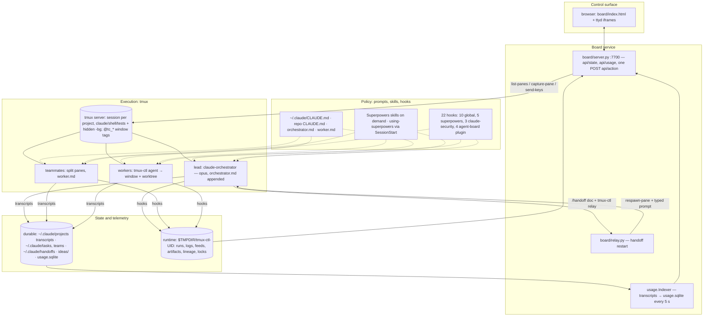
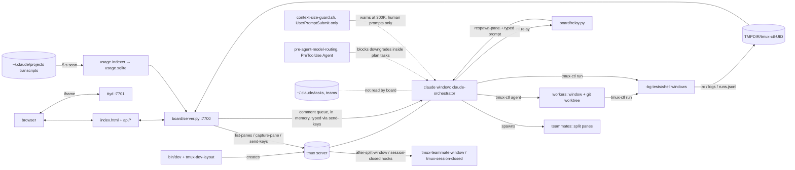

# Claude Code Runtime Audit — Baseline 2026-10

Sub-project 1 of the runtime-optimisation brief. Read-only. Window 2026-09-26..2026-10-25 over `master-gcp-repo` and `agent-board` (plus their worktrees); toolkit `tools/audit/`; metrics in `audit-out/2026-10-25/` (`session_metrics.json`, `waste_signals.json`, `injection_costs.json`, `handoff_trace.json`, `manifest.json`). Two data vintages, stated once here: handoff figures come from the toolkit c24ce6b regeneration (`manifest.json generated 2026-10-25T02:24`, after the Task 5b fix to `handoff_trace.py`); every other figure comes from the earlier a58d81b run of the same files, as cited in the three area reports. The json on disk has since moved slightly (357 → 360 sessions, 443 → 446 files in scope, 15,914 → 15,953 requests, `totals.by_agent_kind.main.output` 4,776,739 → 4,792,882) because two lead sessions started after the a58d81b run (`b4eb2c48` 2026-10-25 02:19, `d0c63844` 02:21, both 0 turns) and live sessions kept growing — not because the toolkit changed. The a58d81b figures were not refreshed, so that this report agrees with its sources; to reproduce them from the current json, restrict to the 65 lead sessions whose main agent started before 2026-10-25 02:00 (the first 65 by `agents[].first_ts`) — the Task 11 review did so and reproduced the lead-session table exactly; model and kind shares differ by at most 0.1 pp. Sources: the three area reports `atlas.md` (architecture and state), `sieve.md` (hooks, skills, observer) and `relay.md` (routing, orchestration, parallelism, handoff), their reviews, and the metric files. Paths are relative to `~/agent-board` unless they start with `~` or `/`.

Labels follow the spec: **Verified** (code, logs, reproducible test), **Measured** (observed metric), **Hypothesis**, **Recommendation**. "est." means chars/4, a derived figure, never a measurement. "derived" means a join or count the toolkit does not make, computed by an area author and reproduced by its reviewer. No estimated saving is presented as measured.

## Summary

1. The setup is a sound tmux-based execution model with a board that reads the screen; the costs that dominate are structural, not judgement: always-on text — a 34,016-token median first request (Measured, `injection_costs.json`), of which the skill listing (31,218 chars median, est. 7,800 tokens) is the largest controllable item, and a 44,715-char observer skill loaded in about half of lead sessions — and the Opus lead's turn count: window-wide 0.295% of the lead kind's tokens are output (Measured, c24ce6b json), and in the one traced session `48822fd2` 0.26% of its 37.7M tokens were output and 43 of the 49 messages that started a lead turn came from agents (Measured, derived; the agent-sent share across the other multi-agent leads is unmeasured; F-relay-12).
2. Routing is deterministic where it can be and the gates fail safe: 584 passes, 24 blocks — 20 of them a missing effort pin, 4 downgrade attempts (Measured, F-relay-4); but outside a plan task the gate sees nothing, 74% of teammate briefs name no tier, and the Opus fallback for "frontier" teammates is recorded only where a lead wrote it into the brief (Verified, F-relay-5).
3. Handoff works mechanically — 32 traced relays, 30 of them with a context and 28 of those at ≥300K (30 of 32 counting the 2 keyword rows), context at handoff median 347,033, max 666,520, zero compactions; whether the next lead re-explores is unmeasured — nothing was observed in the one tool the metric sees (Read tool, main agent only: 34 of 192 pre-edit reads, null for 17 of 34) — but the trigger is a warning that fires only on human-typed prompts: a quarter of lead requests (23.9%) and 39.1% of lead tokens run past 300K, no teammate ever sees it, and the plan's rulings ledger was deleted with its worktree (F-relay-2, F-relay-3, F-relay-9).
4. Parallel teammates duplicate almost nothing (0 repeat reads in the four traced teammates, 9 cross-agent duplicate reads over 357 sessions) and paid off on disjoint plan branches, not on review loops; the spawn path lost 5 of ~300 starts and one lead→teammate message arrived 38 minutes late (F-relay-11, F-relay-7).
5. Two global Stop hooks cost about 2.1 s per Stop and never blocked (Measured, 2,207 runs each); the observer produced 85 observations in ten days but its biggest round (24) is staged and not installed and the scheduled review died on the weekly usage limit (F-sieve-2, F-sieve-4).

Next actions (concrete engineering tasks, ranked):

1. **Trim the skill listing.** Add `skillOverrides` entries (`name-only` or `off`) in `~/.claude/settings.json:43` for skills with long descriptions and zero Skill calls in the window; shorten the descriptions of the `-extras` and task-observer skills. Validate: re-run `python3 tools/audit/injection_costs.py` and compare `attachment:skill_listing` median chars and `first_request_prompt_tokens` median (34,016 today); confirm the Skill-call counts for kept skills do not fall.
2. **Cut the lead's agent-driven turns and let the context warning reach them.** In `claude/orchestrator.md` (teammate brief template) and `claude/worker.md`, make teammates report once at the end and carry interview answers in the brief; route reviewer results through the SDD review package instead of a hand-back message; register `claude/hooks/context-size-guard.sh` on a second event (Stop, or PostToolUse for `SendMessage`/`Agent`) in `~/.claude/settings.json` so agent-driven turns and teammates see it. Validate: replay the three traced transcripts (`8eba3dc6`, `48822fd2`, `84b315fb`) through the new registration and count warnings per agent; turns per task and tokens per task on the next three plans (49 messages / 37.7M tokens for the traced 102-minute session today).
3. **Make the observer cheap and live.** Change `claude/hooks/task-observer-session-start.sh` to emit a short protocol stub (storage check, open count, review-due flag) and restructure the task-observer `SKILL.md` so the 44,715-char body loads only when a review or an observation write is due; apply or drop the staged `~/.task-observer/skill-updates/PENDING.md` round and give `com.user.task-observer-review` a budget check before it starts. Validate: per-call `tool_result` size of the task-observer Skill call and `hook:SessionStart` median chars (8,393 today); `~/.claude/skills/writing-plans-extras/SKILL.md` shows sections 8–10; `~/.task-observer/skill-observations/last-review-date.txt` advances with no usage-limit exit in `skill-observations/scheduled-review.log`.
4. **Record what routing and handoff lose today.** A PostToolUse hook on `Agent` appends `{teammate, intended tier, model, reason, lead session}` to `~/.local/state/agent-board/spawns.jsonl`; `finishing-a-development-branch` archives `.superpowers/sdd/<plan>/` into `docs/superpowers/ledgers/` before the worktree is removed; `board/relay.py:80-82` writes `lineage-
.jsonl` under `~/.local/state/agent-board/`. Validate: after a week every Opus teammate has a logged reason and `session_metrics.py` can join teammates to their lead; every completed plan has a ledger file beside its `.tasks.json`; close a scratch project and the lineage file survives.
5. **Short-circuit the two Stop hooks.** In the `superpowers-hook.sh` dispatch for `stop-revalidate-user-gates.sh` and `stop-wait-guard.sh` (`~/.claude/settings.json:84-88`), test a cheap marker (an armed-plan file or user-gate task present) before scanning the transcript. Validate: `stop_hook_summary.durationMs` medians (1,064 / 1,038 ms today) and the trace-log block counts (0 today) over the next window.

## Current-state architecture

Deliverable D1. Facts below are Verified in `atlas.md`, `sieve.md` and `relay.md` unless marked otherwise.

### Layered view

### Component flow (from atlas)

### Component table

| Component | What runs | Evidence | Status |
| --- | --- | --- | --- |
| Board backend | stdlib `ThreadingHTTPServer` on 127.0.0.1; GET `api/state|artifacts|ideas|runs|log|usage|artifact|dirs`, one POST `api/action` with `X-Dash-Token` | `board/server.py:778-889,899-904` | Verified |
| Board state build | each poll: `tmux list-panes -a` + `capture-pane` per pane, cached 1.5 s, pane classified by regex, worktrees and usage alerts added, queued comments typed to the lead | `board/server.py:100,203-210,256-299` | Verified |
| Project switching | a project is a tmux session named after the repo top level; `bin/dev` creates `claude`/`shell` windows, `tmux-dev-layout` the hidden `-bg`; `recent-projects.json` is a convenience list only | `bin/dev:14-23`, `board/server.py:513-517` | Verified |
| tmux server | legacy mode: the user's default server, hooks in `~/.tmux.conf:69,71`; the dedicated `agent-board` socket documented in README.md:23 does not exist | `bin/_tc_bins.zsh:31-35`, `ls /private/tmp/tmux-503` | Verified (F-atlas-1) |
| Lead launch | `claude --name orchestrator --model opus --settings claude/session-settings.json --plugin-dir claude/plugin --append-system-prompt-file claude/orchestrator.md` (16,221 chars); every lead is Opus by construction | `bin/claude-orchestrator:14-27`; `IC static_files` | Verified |
| Worker launch | `tmux-ctl agent` types `claude --model M --effort E -w NAME -n NAME …` into a new `@tc_agent` window; brief must be ≥ 8 words; `worker.md` (3,420 chars) appended | `bin/tmux-ctl:341-391` | Verified |
| Teammates | Claude Code agent teams split a pane; `tmux-teammate-window` retags it `@tc_teammate` by scraping `--agent-name` from `ps`; shutdown is a request typed to the lead; a teammate transcript carries no lead session id; messages to a busy teammate queue until its turn ends | `bin/tmux-teammate-window:27-43`, `board/server.py:598-622`; relay F-relay-1, F-relay-7 | Verified |
| Model routing | plan time: `modelTier` per task or `TaskCreate` is blocked; mapping `model-routing.json` `{mechanical: haiku, standard: sonnet, frontier: fable, enforceEffort: true}`; dispatch time: `pre-agent-model-routing` allows {resolve(in-progress tiers)} ∪ {standard}, checks the `effort:` pinned by the agent type, fails open on parse errors, and allows anything when no tiered task is in progress; outside plans the lead picks tiers by role (prose, `orchestrator.md:95-103`); escalation on retry is prose only | `hooks/pre-taskcreate-model-tier`; `pre-agent-model-routing:19-39,58,412-415,543-598`; `orchestrator.md:95-111` | Verified (F-relay-4, F-relay-5, F-relay-6) |
| Skills | Superpowers injects `using-superpowers` (7,973 chars probe) via SessionStart; other skills load on demand through the Skill tool; `-extras` companions load as separate calls (TDD 83 / extras 65; code-review 26 / 22; writing-plans 23 / 16); two skill loads at a lead's start cost ~51K tokens before any work (traced session: 51,567 → 102,677 by the third request) | sieve "Superpowers loading"; relay Task trace | Verified / Measured |
| Hooks | 22 hook entries, all scripts, none calls a model: 10 in `~/.claude/settings.json`, 5 superpowers, 3 claude-security, 4 agent-board plugin (duplicates of 4 global ones, guarded by `AGENT_BOARD=1`) | sieve hook count (inline script) | Verified |
| Observer | `task-observer-session-start.sh` (SessionStart, 1,378 chars) asks the lead to invoke the task-observer skill (44,715 chars) and run its protocol; a launchd job runs a headless weekly review | sieve H1, O1, O2 | Verified |
| Task queue | none in board code; Claude Code's own task list under `~/.claude/tasks/` (105 entries), plan files, and the worker's typed brief. The board never reads it; each lead session re-creates its task list (plan "Task 3" became id 1 in `48822fd2`, "Task 9" id 1 in `84b315fb`) | `grep` no hits; `bin/tmux-ctl:381,389`; relay Task trace | Verified (F-atlas-3) |
| Ideas | `board/ideas.py` owns `~/.local/state/agent-board/ideas/<project>.md` under a file lock; agents add via `tmux-ctl idea` | `board/ideas.py:1-23`, `bin/tmux-ctl:431` | Verified |
| Handoff | `context-size-guard.sh` (UserPromptSubmit only) reads from the transcript's last 400 lines the exact usage of the latest main-thread assistant turn (`input + cache_read + cache_creation`) and, at ≥ 300,000, injects a system message and an `additionalContext` instruction to recommend `/handoff` — native usage of the previous request, a warning, never a block; `/handoff` checkpoints the team, writes a doc, shuts the team down and asks the user ("never skip"); `tmux-ctl relay` schedules `relay.py`, which waits for two idle polls (2 s apart, 120 s cap), respawns the pane and types `claude-orchestrator "Read <doc> and continue…"`, appending a lineage line | synthesis probe of `claude/hooks/context-size-guard.sh:4-21`; `board/relay.py:28-84`; `claude/plugin/skills/handoff/SKILL.md:12-68` | Verified |
| Completion detection | (a) `tmux-ctl run` appends `; tmux-ctl _done <id> $?` and polls `<id>.rc`; (b) board pane status is a regex over the last 12 rows (`esc to interrupt` = working, prompt = waiting); (c) relay uses (b) twice; (d) a dead teammate pane is detected by the lead by hand (`orchestrator.md:14-16`) | `bin/tmux-ctl:281-313`, `board/paneclass.py:20-21,51-65`; relay F-relay-11 | Verified (F-atlas-2) |
| Telemetry | transcripts are the source; `usage.Indexer` scans them every 5 s into `usage.sqlite` and prices tokens with `board/prices.json`; runs, feeds and artifacts are JSONL under `$TMPDIR`; the routing gate's trace log is under `/tmp/claude-hooks/` (volatile, unscoped). No code reads quota or plan limits; no record pairs intended tier, actual model and reason | `board/usage.py:126-135,317-345`; grep no hits; relay "Is model selection recorded?" | Verified (F-atlas-5, F-relay-5) |

### State: source of truth per type

| State | Lives in | Survives tmux loss | Note |
| --- | --- | --- | --- |
| Project | tmux session name; per-project files keyed by it under `$TMPDIR`; `recent-projects.json` | **No** | `tmux-session-closed:18-20` deletes runs/lineage/artifacts on close |
| Task | `~/.claude/tasks/` (Claude Code), plan/spec files, worker's typed command line | **Yes** for files; **No** for the typed brief; task ids restart at 1 per lead session | board has no task model |
| Agent | tmux window tags `@tc_agent`/`@tc_teammate`; status computed from the screen each poll; transcript and `~/.claude/teams/` on disk | **No** for live status | nothing stores status; nothing links a teammate to its lead session |
| Decisions | SDD ledger `.superpowers/sdd/<plan>/progress.md` in the worktree (untracked); handoff docs name it "source of truth" | **No** — deleted with the worktree at finish (F-relay-9) | the docs-architecture plan's 24 rulings are gone |
| Terminal | tmux scrollback; run output copied to `logs/
/<id>.log` | **No** | |
| Usage | transcripts (source), `usage.sqlite` (rebuildable index), run records | **Yes** | API-equivalent dollars, no quota |

Implicit state (exists only in screen text, conversation or prompt convention; atlas lists twelve, relay adds three): agent status, run completion markers, the handoff prompt string, pending board comments in a Python dict, teammate identity scraped from `ps`, the worker brief on a command line, team-size and routing rules as prose, the handoff checkpoint gathered by `SendMessage`, the 300K threshold as an `additionalContext` instruction the lead may or may not obey, lock dirs for busy windows, "needs you" from the bell flag, task intake as conversation text; and from relay: the intended tier of a teammate (in the brief, if at all — 214 of 290 briefs name none), the reason for a model fallback (4 of 8 explicit Opus dispatches say why), and the lead↔teammate relationship (names in Agent calls matched by hand).

### Verified vs assumed

Verified: everything in the tables above (file:line cites re-checked by the Task 8, 9 and 10 reviews; 38 of 38 changed atlas cites, about 45 sieve cites and all 11 relay dispatch classifications held). Assumed or Hypothesis: that the legacy server is the result of `install.sh --migrate` not having run (atlas F-1 root cause); that a reboot clears `$TMPDIR` lineage (atlas F-4); that Claude Code writes no quota figure into transcripts (atlas F-5); that `hook_success` duplicates the SessionStart text in the model request (sieve F-8); that the two Fable teammates' invisible context growth comes from tool schemas, images and Docs payloads (relay F-10). One conflict between area reports was settled by a read-only probe: atlas called the 300K guard's figure "a custom estimate"; `context-size-guard.sh:9-14` sums the usage fields of the latest non-sidechain assistant line, so the number is the exact API usage of the previous request (relay's reading), one turn stale and only as fresh as the last human prompt.

## Baseline measurements

Deliverable D6, part. All figures are from `audit-out/2026-10-25/` unless marked otherwise; `source: measured` unless "derived". The window nominally starts 2026-09-26, but the earliest lead session's first request is 2026-10-12 15:28 (`session_metrics.json` `agents[].first_ts`, Measured), so the lead-session figures describe about 13 days of use.

### Scale

- 357 sessions, 65 with a `main` agent (lead sessions), 292 teammate-only sessions; 15,914 model requests; 443 transcript files in scope of 1,088 in the window (`manifest.json`, a58d81b run; the c24ce6b regeneration reads 360 / 446 / 1,102 and 15,953 usage events).
- Tokens over the window (`totals.tokens`): input 62,564; output 12,450,761; cache_read 2,617,780,450; cache_creation 60,259,735. Almost every prompt token is a cache read: fresh input is 0.002% of context processed.

### Usage by model and agent kind

| Model | Output tokens | Output share (derived) | Cache-read share (derived) |
| --- | --- | --- | --- |
| claude-opus-5-5 | 6,379,006 | 51.2% | 68.1% |
| claude-sonnet-5-5 | 3,795,886 | 30.5% | 23.9% |
| claude-fable-5-1 | 1,949,393 | 15.7% | 6.6% |
| claude-haiku-5-5 | 326,476 | 2.6% | 1.4% |

| Agent kind | Output tokens | Output share | Cache-read share | Agent entries by model |
| --- | --- | --- | --- | --- |
| main (lead) | 4,776,739 | 38.4% | 60.9% | opus 59, sonnet 5, haiku 2 |
| team (teammates) | 6,979,027 | 56.1% | 35.7% | sonnet 192, opus 44, haiku 25, fable 25 (none 4) |
| sub (Agent tool) | 694,995 | 5.6% | 3.4% | sonnet 58, opus 16, fable 6, haiku 6 |

The lead kind processes 61% of all cached context while producing 38% of output: lead sessions are long and re-read a large context every turn. Relay's trace says what those turns were (Measured, derived): in lead `48822fd2` (102 minutes, 163 requests) 49 messages started a turn — 30 teammate messages, 13 subagent hand-backs, 3 typed prompts, one `/handoff`, two `!` shell lines — and each turn re-read 100–352K of context, 37,677,609 tokens in all for 97,994 output tokens (0.26%). Window-wide (Measured, c24ce6b `session_metrics.json` `totals.by_agent_kind.main`: output / (input + output + cache_read + cache_creation)) output is 4,792,882 of 1,624,573,973 tokens, 0.295%, and 98.4% are cache reads; per lead session the output share over the first 65 leads is median 0.367% (min 0.159%, max 1.153%). The lead's bill is reading, not thinking (F-relay-12). What drove the turns is measured for `48822fd2` only: the agent-sent share of lead turns across the other 16 multi-agent leads is not in the toolkit (see the not-observable table). The brief's "orchestrator consuming substantial usage" (§5.3) is true in tokens and, for the traced session, false in reasoning.

### Lead sessions (n = 65)

| Metric | min | p25 | median | p75 | max |
| --- | --- | --- | --- | --- | --- |
| peak_context (main, tokens) | 29,524 | 86,311 | 313,977 | 352,042 | 666,520 |
| wall_clock (min, derived) | 0.1 | 15.7 | 107.6 | 498.8 | 4,066 |
| turns | 0 | 6 | 16 | 52 | 123 |
| agents in session (main + sub) | 1 | 1 | 1 | 2 | 20 |
| orchestrator_share | 0.47 | 0.996 | 1.0 | 1.0 | 1.0 |

33 of 65 lead sessions peaked above 300,000 tokens; 7 above 400,000. `orchestrator_share` is main's tokens over all tokens *in the same session file*; teammates run in their own session files, so this metric sees only Agent-tool subagents and reads 1.0 for 48 of 65 sessions. For the 17 lead sessions with more than one agent it is min 0.47, median 0.92, max 0.996. Relay's derived join for lead `48822fd2` (its 13 subagents plus the four teammates it spawned, matched by `name` in the lead's Agent calls = `agentName` in the teammate transcript, same hour) gives main 37,677,609 of 90,962,772 tokens (41.4%), subagents 2.2%, teammates 56.3%; output 97,994 of 629,778 (15.6%); the in-session metric for the same session reads 0.949. **The in-session `orchestrator_share` overstates the lead by about 2.3× for team sessions** (F-relay-1); the cross-session view is the kind table above (main = 38.4% of output, 60.9% of cache reads).

Requests above the warning line (Measured, derived by relay through `transcripts.iter_events`, filter stated in relay.md "Above-the-line work"; reviewer reproduced to within a few requests of live growth): toolkit scope 1,710 of 7,144 lead requests (23.9%) and 633,489,745 of 1,621,855,199 tokens (39.1%) at ≥300K, 33 sessions crossed; whole files 1,903 of 7,732 (24.6%), 40.1%, 34 sessions. Heaviest: `50668da3` 124 of 124 in-scope requests above, `20f37e48` 189/250, `ccbeeda3` 148/283, `b96190ce` 132/231 — each with 2–3 warnings seen and no stop.

[chart in the Claude Doc: peak_context by lead session, ordered by start time]

### Always-on and injected text (`injection_costs.json`)

- `first_request_prompt_tokens`: 351 non-null of 357; median 34,016 tokens; lead sessions median 52,300; teammate sessions median 33,802 (n = 286).
- Static prompt files (chars, measured): `~/.claude/CLAUDE.md` 2,672; `master-gcp-repo/CLAUDE.md` 2,405; `agent-board/CLAUDE.md` 1,347; `claude/orchestrator.md` 16,221; `claude/worker.md` 3,420. A lead in agent-board carries about 20,240 chars (est. 5,060 tokens); a teammate about 7,439 chars (est. 1,860 tokens).
- Largest injected sources, median chars per session: `attachment:skill_listing` 31,218 (332 sessions, 11.66 M chars total); `attachment:deferred_tools_delta` 9,102; `attachment:deferred_tools_record` 8,264; `attachment:hook_success` 9,481; `hook:SessionStart` 8,393 (340 sessions); `attachment:instructions` 4,739; `attachment:mcp_instructions_delta` 3,968. `attachment:prompt_snapshot` is the largest by chars (126,633 median) but is a record of the prompt, not an addition to it.
- `hook:UserPromptSubmit` (the 300K guard's warning): 34 sessions, median 3 warnings per session, max 7. Teammate transcripts: 0 warnings (the two Fable teammates at 474K and 498K peak included).
- A relayed lead's first request: 51,567 tokens in `48822fd2` against the ~33.6K always-on median — the 5,290-byte handoff doc plus `orchestrator.md`; two skill loads took it to 102,677 by the third request (Measured, relay Task trace).

[chart in the Claude Doc: injection_costs sources median_chars_per_session by key]

### Hook runtime and gate activity

- Stop hooks (`stop_hook_summary.durationMs`, 2,378 Stop events in scope): `stop-revalidate-user-gates` median 1,064 ms (max 14,236; 2,207 runs); `stop-wait-guard` median 1,038 ms (max 11,934; 2,207 runs); `revise-claude-md-nudge` median 115 ms (1,991 runs). Blocks: 0, 0, 3. Over the window that is 39–77 minutes of Stop latency (derived: 2,207 × 1.04 s if parallel, × 2.1 s if sequential; whether they run in parallel is unmeasured).
- Probes (dummy stdin, scratch dir, floor 0.15 s subtracted): `task-observer-session-start.sh` 0.11 s; superpowers session-start 0.42 s; `context-size-guard.sh` about 0.1 s on a 13.5 MB transcript; `kill-guard.sh` 0.08 s (0.02 s on the dedupe exit); claude-security metrics 0.13 s.
- Routing gate (`/tmp/claude-hooks/user-gate-trace.log`, unscoped, since 10-15): `pre-agent-model-routing` 584 pass / 24 block / 46 skip / 1 error; resolved routed dispatches 255 `effort-medium`+`sonnet`, 30 `effort-low`+`haiku`, 1 `effort-medium`+`opus`; blocks = 20 `effort-mismatch … got=none` (the dispatch carried no effort pin), 2 `effort-mismatch … got=low` where medium was required, 2 `tier-mismatch … got=haiku` during a frontier task (Task 12 probe census of all 24); the gap from each block to the next `pre-routing` pass is 0–63 s for 17 blocks, then 278, 299, 315, 349, 393, 9,703 and 9,713 s, and the lines carry no session id, so whether the same session corrected the dispatch cannot be read from the log; 221 `no-tier-requirement` passes. `pre-taskcreate-model-tier` 222 pass / 18 block. These counts are a snapshot of the live log at about 2026-10-25T05:40–05:54Z (the 584th `pre-routing` pass is at 05:40:18Z, the 3,002nd `stop-revalidate` pass at 05:42:37Z); both logs were copied into `audit-out/2026-10-25/claude-hooks-snapshot/` at 03:17 local (592 / 3,090 passes by then), because `/tmp` is volatile.
- PreToolUse/PostToolUse durations are not recorded anywhere: unmeasured.

### Waste signals (`waste_signals.json`, 357 sessions)

- `repeat_reads`: 10 entries in 9 sessions; identical re-reads (same args) sum to 11; the four traced teammates each have `repeat_reads = []`.
- `repeat_commands` (same Bash command, same result): 6 entries.
- `repeat_failures` (same tool + args failing again): 26 entries, led by `SendMessage` pairs.
- `cross_agent_duplicate_reads`: 9 entries in 6 of the 20 multi-agent sessions (task briefs read by implementer and reviewer in `2ac6a941`, `760621d5`, `b43baa4d`; 3 PNG renders in `48822fd2`; one skill reference read by 4 deep-research subagents in `4792288a`).
- `tool_output_share` of context: median 0.197, p75 0.397, max 0.960; the two Fable teammates of the traced task 0.90 and 0.91.
- `idle_tail_s` (last useful output to end): 372 agents, median 0.41 s, p90 54 s, max 4,217 s; teammates (n = 286) median 1.8 s, p75 19.7 s; the top ten tails are all teammates (`ci-vars` 4,217 s, `ingest-build` 948 s, `env-fix` 665 s). The docstring notes the tail includes the agent's final answer.
- Teammate peak context: median 97,226, p90 218,707, 13 of 286 ≥ 300K, max 564,638 (`f2c537a5`). Peak simultaneously alive teammates across all projects: 11 (2026-10-16 16:14) against `orchestrator.md:18` "never more than 4" per lead; several leads ran at once, so the per-lead bound is not testable from the metrics.
- Dead spawns: 4 of 290 teammates made 0 requests (`c62e8ec0`, `0ccd14ce`, `5e774f41`, `7ea88bef`); three were `model: "fable"` dispatches re-issued on `model: "opus"` within 6 minutes; one double dispatch of `grammar` 17 s apart left one transcript.

[chart in the Claude Doc: tool_output_share distribution across sessions]

### Handoffs (`handoff_trace.json`, toolkit c24ce6b)

- 34 handoff sessions: trigger `relay` 32 (first non-command main prompt is the exact `tmux-ctl relay` wording) and `keyword` 2 (`20f37e48` "Read ~/.claude/handoffs/… and give me a short summary", `760621d5` "follow the handoff file" — user-typed, not relays, so relay-only figures are the ones to quote); link `doc` 31, `time` 3, null 0.
- `previous_context` at handoff (n = 32; the two time-linked relay rows `bfb71e82`, `d205e439` have none): min 229,457 (`bd791cc6`→`64677154`), median 347,033, max 666,520 (`50668da3`→`7d49985a`, a single main-context request: input 2 + cache_read 662,791 + cache_creation 3,727); 30 of 32 at ≥300K, 5 at ≥400K, 2 at ≥500K. Relay-only n = 30: same min/median/max, 28 at ≥300K, 5 at ≥400K. Zero compactions by either detection rule (context drop ≥ 50%, or "This session is being continued" prompt) although `autoCompactEnabled: true`.
- Resumed sessions (n = 34; 32 with an edit, `a5e840a8` and `fcbb7e65` made none): `seconds_to_first_edit` median 1,839 s (min 89 `2da2ff16`; p75 9,374; max 198,200 `ba543161`, resumed two days later); `reads_before_first_edit` median 1, max 6 (`48822fd2`) and `reread_overlap` (share of pre-edit reads that repeat the previous session's reads) non-null for 17, median 0.0, max 0.5 (`4635cd60`, the only non-zero) — both count the `Read` tool only, for the main agent only (`handoff_trace.py:130`); `tokens_to_first_edit` median 2.55 M (min 700,786; max 52.3 M `67fcb127`), which includes cache reads of the replayed context, so it is total tokens processed, not new work. Relay-only (n = 30): seconds median 1,733, reads median 0.5, overlap non-null for 15. In Read-tool reads the next lead repeats almost nothing (16 of 17 overlaps 0.0; `48822fd2` made 6 Reads before its first edit, none of a file its predecessor had read), but the metric sees a minority of the reading: before the first edit the 34 leads made 34 `Read` calls against 158 Bash read-family calls (`cat`/`sed -n`/`head`/`grep`, the toolkit's own rule), 866 other Bash calls (545 of them with a read command later in the line, e.g. `cd …; cat …`) and 135 `Agent` dispatches, whose teammates' reads it cannot see at all; it is null for 17 of 34. Re-exploration after handoff is therefore unmeasured (re-derived from the transcripts: main-agent `tool_use` before the first Edit/Write/NotebookEdit, the two no-edit sessions counting all their tool uses).
- Chains: the eight sessions this report first flagged as unlinked (home-directory project dir) now form one chain `d205e439`→`b96190ce`→`bfb71e82`→`8eba3dc6`→`48822fd2`→`84b315fb`→`ccbeeda3`→`9c585650`: doc-linked from `bfb71e82`→`8eba3dc6` onward (354,186 / 348,281 / 352,042 / 330,137 / 458,729), `d205e439`→`b96190ce` doc-linked (350,672), while `b96190ce`→`bfb71e82` comes from the lineage file only — the trace time-links `bfb71e82` to `46485bc2` and `d205e439` to `6871deb4`, both wrong (next bullet); the master-gcp-repo chain `b43baa4d`→`2ac6a941`→`4595c79e`→`3188685a`→`6efeb4f4`→`67fcb127`→`a443b79d`→`2da2ff16`→`89b5a70c`→`f00eedb4` is nine doc-linked relays (343,721 / 352,929 / 457,492 / 439,688 / 338,180 / 357,206 / 318,501 / 345,785 / 237,460).
- **Residual gap (Measured, Ruling 15):** the `time` link picks the latest-ending earlier session of the same repo; for both time-linked relay rows that is a file with no main-agent requests (`46485bc2`, `6871deb4`), whereas `lineage-francisco_ruiz.jsonl` names `b96190ce` (peak 497,771) → `bfb71e82` and `f6897cef` (peak 227,095) → `d205e439`. The distribution therefore lacks two true predecessor peaks. Lineage files hold 29 records against 32 relay rows (25 shared; 2 lineage-only mislinked above; 2 lineage-only with no relay-opened transcript; 6 transcript-only, mostly pre-10-16 relays before the lineage files start) — neither source is complete.

[chart in the Claude Doc: handoff_trace previous_context by handoff, ordered by session start]

### Observer (from sieve, counts from frontmatter)

85 observations (59 actioned and archived, 25 open, 1 parked); 11 are split-carriers. Reviews completed 10-16 (three runs), 10-19, 10-21; the 10-23 run ended with "You've hit your weekly limit", exit 1. Skill invocations in scope: 45 in 44 sessions (29 in 28 of 65 lead sessions; 16 in teammate sessions, all on 10-16 before the exemption text existed).

### Not observable today, and the instrument each gap needs

| Gap | Why it is not in the data | Instrument |
| --- | --- | --- |
| Task outcome (success, first-pass, rework, manual intervention) | no record ties a session or agent to a task and its acceptance result | per-task outcome record (brief §7.5 schema) written at task close by a `TaskUpdate` PostToolUse hook or by the lead's completion step, keyed by task id and session id |
| Usage per task | usage is per session and per agent; tasks span sessions and teammates | the same record, plus the task id in teammate briefs so `session_metrics` can join on it |
| Lead ↔ teammate join (true orchestrator share) | teammates are separate session files; `teammate-message teammate_id="team-lead"` carries no session id (F-relay-1) | the lead session id written at spawn (Agent prompt header or `tmux-teammate-window`), and a join in `session_metrics.py`; today the join is by hand (names in Agent calls, same hour) |
| Intended tier, actual model and reason per teammate | the gate logs pass/block only inside plan tasks; 214 of 290 briefs name no tier; the Opus fallback is written in 4 of 8 briefs (F-relay-5) | a PostToolUse hook on `Agent` appending `{teammate, intended tier, model, reason, lead session}`; then tier → model → outcome once the outcome record exists |
| Lead → teammate message delivery latency | no join between the lead's `SendMessage` timestamp and the teammate's receipt (one case measured by hand: 38 min, F-relay-7) | a toolkit join of `SendMessage` tool_use ts to the matching `teammate-message` ts across the window |
| Why a teammate's context grew (schemas, images, Docs payloads) | the transcript does not size tool schemas or image payloads; less than half of the two Fable teammates' growth is visible as text (F-relay-10) | per-request context delta logged with the preceding tool names |
| Quota / plan limit remaining | nothing reads it; transcripts carry no quota field (atlas F-5) | find a source (statusline, API response header, CLI output) before adding a reader; until then only API-equivalent dollars exist |
| PreToolUse / PostToolUse hook durations and block counts | `stop_hook_summary` exists only for Stop; the superpowers trace log is unscoped and starts 10-15 | a hook timer wrapper writing `(hook, event, ms, decision)` to a JSONL under the state dir |
| Whether Stop hooks run in parallel | `stop_hook_summary` has no total-duration field | a wall-clock Stop timer (UserPromptSubmit timestamp minus last assistant stop) |
| Status misclassification rate | status is computed from the screen and never stored (atlas F-2) | a hook-written status file compared against `classify()` per poll |
| Handoff recovery success and rework | lineage is in `$TMPDIR` and deleted on close; docs are unstructured; 2 of 34 trace rows are time-linked to the wrong predecessor; the rulings ledger that recorded decisions is gone (F-relay-9) | durable lineage under `~/.local/state`, a handoff doc header (previous session id, task ids, ledger path, checkpoint), the ledger archived at finish, and a "redone work" measure (files edited by both sessions) |
| Degraded reasoning past 300K | no quality measure split by lead context band (F-relay-3) | per-task review-fix-round counts (from SDD ledgers while they exist) joined to the lead's context at the time |
| Observer headless-review usage | the launchd run's transcript is outside the repo scope | include its project dir in the toolkit scope, or have the job log its usage |
| Reference-file loads of the observer (500,758 chars) | per-call `tool_result` sizes by skill are not aggregated | extend `injection_costs.py` with tool_result size by Skill name |
| Whether the lead obeys the 300K instruction | the hook injects advice; obedience is not recorded (atlas implicit state 9); relay saw warnings shown and sessions continue (`50668da3` 124/124 requests above with 3 warnings) | log the guard's firings and the next assistant message's first line |
| Re-exploration after handoff across the read family and teammates | `reread_overlap`/`reads_before_first_edit` count the `Read` tool only for the main agent (34 of 192 pre-edit reads; null for 17 of 34); 158 Bash read-family calls, 545 compound Bash lines and 135 `Agent` dispatches before the first edit are invisible to it | extend `_resumed` to the read family (Read/Grep/Glob plus Bash `cat`/`sed`/`head`/`grep` targets, including compound lines) and join the dispatched teammates' reads to their lead; report overlap over that set |
| Teammate payoff (elapsed-time reduction) | no baseline for the same task done single-agent; the traced overlap windows (7, 14, 9, 17 min) are the only measure | the benchmark suite below, run in both configurations |
| Agent-sent share of lead turns across the multi-agent leads | counted by hand for one session (`48822fd2`: 43 of 49); teammate messages and `queued_command` hand-backs arrive wrapped inside user messages and the toolkit has no turn-origin classifier (the Task 11 review's naive prefix classifier found 0 for that session) | a `transcripts.py` event `turn_start` with `origin ∈ {human, teammate-message, task-notification, command}` parsed from the wrapper tags, validated against the 30 / 13 / 6 hand count for `48822fd2`, then aggregated over the 17 multi-agent leads in `session_metrics.py` |

## Efficiency audit

Deliverable D2. Findings keep their area id and label as given by the area author (one synthesis finding, F-lens-1). Ranked by expected benefit to verified useful work per unit of usage, elapsed time and attention; F-relay-4 (a mechanism that works, no change proposed) closes the list. Each finding follows the common format; "Impact" is measured or says what instrument it needs. The independent Task 12 probe review (`probe-review.md`) re-checked 16 of the 28 from raw sources: 14 hold, 2 are relabelled here (F-relay-4 and F-sieve-8 → Measured), 0 dropped.

### F-sieve-1: The skill listing, not CLAUDE.md, is the largest controllable always-on item
Label: Measured
Evidence: `injection_costs.json` `attachment:skill_listing` 332 sessions, median 31,218 chars, total 11,659,146; `static_files` sum 26,065 chars; `first_request_prompt_tokens` median 34,016 (351 non-null); `~/.claude/settings.json:43` `skillOverrides` already turns 16 skills off and 1 to name-only
Component: skill_listing injection · Root cause: every installed skill's name and description is listed in each session and several descriptions run to paragraphs (observer, `-extras`, dataviz, claude-api) · Impact: est. 7,800 tokens of a 34,016-token first request, in every session, cached after the first turn; est. 2.9 M tokens of prompt text over the window (derived from chars/4, not measured)
Confidence: med (token share is an estimate) · Candidate change: more `name-only`/`off` overrides for skills with no Skill calls in the window; shorten the longest descriptions · How to validate: re-run `injection_costs.py`; compare `skill_listing` median chars and `first_request_prompt_tokens` median; confirm Skill-call counts of kept skills hold
Rank rationale: largest controllable per-session cost, lowest effort, reversible by editing one settings key.

### F-relay-3: A quarter of lead requests and 39% of lead tokens run past the warning line; the warning is advisory and often outlived
Label: Measured
Evidence: derived via `transcripts.iter_events` under toolkit scope (filter stated in Handoff and recovery): 1,710 / 7,144 lead requests (23.9%) and 633,489,745 / 1,621,855,199 tokens (39.1%) at ≥300K, 33 sessions crossed; whole-file basis 1,903 / 7,732 (24.6%) and 708,157,137 / 1,767,939,996 (40.1%), 34 sessions; `50668da3` 124/124 in-scope requests above with 3 warnings seen; `20f37e48` 189/250 with 2; `ccbeeda3` 148/283 with 3; `b96190ce` 132/231 with 3. `handoff_trace.json context_at_handoff` n=32, median 347,033, max 666,520, 30 of 32 at ≥300K; `compactions: []`.
Component: context-size-guard.sh (`:16-21`, warn-only) and `/handoff` (`SKILL.md:50-57`, user must say Yes) · Root cause: H4 — the threshold is a soft ceiling with no milestone trigger; when the user is absent the lead keeps working · Impact: measured tokens above; degraded-reasoning impact unmeasured — needs per-task review-fix-round counts split by lead context band.
Confidence: high · Candidate change: keep 300K as the hard recommendation but add a milestone trigger in `subagent-driven-development` (hand off at the next task boundary once ≥250K) and let `/handoff` run without the question when no human has typed for N minutes · How to validate: compare requests-above-300K and fix-round counts before/after over two weeks.
Rank rationale: 39% of the lead kind's tokens are spent above a line the user set; the fix is a skill rule and a hook condition.

### F-relay-12: The Opus lead's cost is turn count, not reasoning — in the traced session `48822fd2`, 0.26% of its tokens are output and 43 of 49 incoming messages were agent-sent
Label: Measured
Evidence: lead `48822fd2`: 163 requests (toolkit scope), 37,677,609 tokens processed, 97,994 output; derived count of non-tool user messages that started a turn: 49 = 30 teammate messages + 13 subagent hand-backs + 3 typed prompts + 1 `/handoff` + 2 `!` shell lines; `totals.by_agent_kind.main` cache_read 1,593,926,784 of 1,619,134,637 (98.4%); decisions listed under "Orchestrator cost" were all consistent with the plan and the gates.
Component: orchestrator mode (`bin/claude-orchestrator`, `claude/orchestrator.md`) · Root cause: every agent message is a full-context turn; shutdown confirmations and hand-back acknowledgements cost as much as a ruling · Impact: measured — 37.7M tokens for one 102-minute session, 41% of the joined task.
Confidence: high · Candidate change: do not replace the Opus lead; reduce its turns (teammates report once at the end, reviewers return through the SDD review package instead of a hand-back message, shutdown handled by the harness) and consider a sonnet lead only for plans whose tasks are all mechanical/standard · How to validate: turns per task and tokens per task on the next three plans.
Rank rationale: the cost side is window-wide — the lead kind holds 60.9% of all cache reads and emits 0.295% of its tokens as output (Measured, c24ce6b json; per-lead median 0.367% over the first 65 leads) — but the turn mix (43 of 49 agent-sent) is one session of 65 and the share across the other 16 multi-agent leads is unmeasured, so this ranks below the two window-wide findings above it; the change is a briefing convention plus one hook, not a model swap.

### F-relay-2: The 300K guard is silent for agent-driven turns and for every teammate
Label: Verified
Evidence: `~/.claude/settings.json` registers `context-size-guard.sh` on UserPromptSubmit only; lead `48822fd2` at ≥300K from 13:01:37 (301,792), 11 requests and 2 incoming teammate messages (13:10:35, 13:11:15) before the first warning at 13:12:00, then 13:13:27, 13:15:52 (all human prompts); teammates `984afea4` peak 473,995 and `ddd65627` peak 498,409 with 0 `CONTEXT AT` strings; 13 of 286 teammates ≥300K; 43 of the 49 incoming messages that started a lead turn in `48822fd2` came from agents (30 teammate messages, 13 subagent hand-backs; derived count).
Component: claude/hooks/context-size-guard.sh + hook registration · Root cause: teammate messages and subagent hand-backs do not raise UserPromptSubmit · Impact: unmeasured in quality terms — needs a per-turn context log for teammates; in cost terms the two Fable teammates alone processed 40.4M tokens.
Confidence: high · Candidate change: also run the check on Stop (or PostToolUse for SendMessage/Agent) and give teammates a lighter rule (checkpoint + report at N tokens) · How to validate: replay the three traced transcripts through the new hook and count warnings per agent.
Rank rationale: the mechanism under F-relay-3 and F-relay-10; an hours-long registration change that makes the existing guard reach the turns that dominate a lead's session.

### F-sieve-3: The observer costs every session a little and each lead session a lot
Label: Measured
Evidence: probe of `task-observer-session-start.sh` output 1,378 chars; task-observer `SKILL.md` 44,715 chars; Skill calls in scope 45 in 44 sessions (29 in 28 lead sessions of 65; 16 teammate calls, all 2026-10-16 01:20–11:40, before the exemption in commit d73eca2 and the `worker.md` rule in 841282c); `hook:SessionStart` 340 sessions
Component: H1, O1 · Root cause: the hook asks for a full skill load plus a protocol run before the first tool call, and the skill body is 44.7K chars (Verified); the teammate calls pre-date the exemption and none occur after it (Verified) · Impact: est. 11,179 tokens per invocation, est. 503K tokens over the window (derived from file size); reference-file loads and the headless review's usage unmeasured — needs per-call `tool_result` sizes and the review job's usage
Confidence: med · Candidate change: a short protocol stub from the hook; load the full `SKILL.md` only when a review or observation write is due · How to validate: task-observer Skill calls in teammate sessions stay 0; `hook:SessionStart` median and per-call Skill `tool_result` size fall
Rank rationale: roughly a third of the median first request again, in half of lead sessions; the value side (F-sieve-4) is preserved by the change.

### F-relay-10: Two Fable teammates reached ~475–500K context; less than half of the growth is visible as text in their transcripts
Label: Measured
Evidence: `984afea4 grammar` peak 473,995 / 116 requests / 28,370,263 tokens (31% of the joined task); `ddd65627 e2e` peak 498,409 / 215,097 output tokens; grammar's tool results total 317,087 chars (23 image results) and its tool-call inputs 290,000 chars; 115 context-growth steps sum to 439,436 tokens, the 15 steps that follow an image result account for 52,243; `waste_signals.json` `tool_output_share` 0.90 (grammar) and 0.91 (e2e).
Component: teammate runtime (Fable implementers doing render-check loops with Claude Docs and Chrome tools) · Root cause: hypothesis — long single turns accumulate tool schemas, images and Docs payloads that the transcript does not size; no per-request delta is logged · Impact: measured cost above; attribution unmeasured — needs per-request context-delta logging with the preceding tool names.
Confidence: med · Candidate change: cap teammate turns (report and wait every N tool calls), route large renders through `tmux-ctl run` with file outputs, and add a teammate-side context budget · How to validate: re-measure peak and tokens for the next render-heavy frontier teammate.
Rank rationale: two teammates were 44% of a 91M-token task on the most expensive tier; a turn cap is cheap and the attribution instrument is one log line.

### F-relay-1: In-session `orchestrator_share` overstates the lead's share of team work by ~2×
Label: Measured
Evidence: `session_metrics.json` `48822fd2` `orchestrator_share.value` 0.949 vs derived join (lead + 13 subagents + teammates `d34ef111`, `984afea4`, `ddd65627`, `947dde66`): main 37,677,609 / 90,962,772 = 0.414; output 97,994 / 629,778 = 0.156. Window `totals.by_agent_kind`: main 60.2% of tokens, 38.4% of output; team 36.2% / 56.1%.
Component: tools/audit/session_metrics.py (teammate sessions are separate files, `session_metrics.py` docstring last line) · Root cause: no lead↔teammate link in transcripts (`teammate-message teammate_id="team-lead"` carries no session id) · Impact: measured above; H2 cannot be answered from the metric as shipped.
Confidence: high · Candidate change: record the lead session id in each teammate's spawn (Agent prompt header or `tmux-teammate-window`), and have `session_metrics.py` join team sessions to their lead · How to validate: re-run the join for the 5 team-heavy leads and compare with the per-session value.
Rank rationale: every per-task usage figure in the measurement plan depends on this join; without it the lead looks 2.3× heavier than it is.

### F-sieve-4: Observer output is real but mostly staged, not live
Label: Verified
Evidence: frontmatter counts 59 actioned (archive), 25 open, 1 parked, 85 total; `~/.task-observer/skill-updates/PENDING.md` "One round awaiting install: 2026-10-21"; live `~/.claude/skills/writing-plans-extras/SKILL.md` headings end at section 7 (lines 49–65) while the 10-21 review staged sections 8–10; `~/.task-observer/skill-observations/scheduled-review.log` 2026-10-23 run ended "You've hit your weekly limit", exit 1, no `skill-observations/reviews/2026-10-23/` (paths corrected by the Task 12 probe review)
Component: O2, install step · Root cause: staging and installing are separate manual steps (installer defaults to a dry run) and the scheduled job shares the user's usage limit · Impact: the 24 observations actioned on 10-21 have no effect on live skills; one review round is missing; value delivered so far is the 10-19 round (18 observations)
Confidence: high · Candidate change: apply or drop the 10-21 round; give the review job a retry or a budget check · How to validate: live skill headings and `skill-observations/last-review-date.txt` after the next run
Rank rationale: the cheapest way to recover value already paid for; it decides whether H1's cost side is justified.

### F-sieve-2: Two Stop hooks add about 2.1 s per Stop and have never blocked
Label: Measured
Evidence: `stop_hook_summary.durationMs` in scope (2,378 Stop events): stop-revalidate median 1,064 ms (max 14,236; 2,207 runs), stop-wait-guard median 1,038 ms (max 11,934; 2,207 runs); `/tmp/claude-hooks/user-gate-trace.log` (unscoped, since 10-15) 3,002 pass, 0 block; `wait-guard-trace.log` 0 block lines
Component: H3, H4 (`~/.claude/settings.json:84-88` via `superpowers-hook.sh`) · Root cause: both are registered globally and scan the transcript on every Stop, but act only when a plan or user-gate is in play · Impact: 1.04–2.1 s per Stop depending on parallelism (unmeasured — needs a wall-clock Stop timer); 39–77 min over the window (derived); no block in the window
Confidence: med · Candidate change: short-circuit on a cheap marker before scanning, or register only in sessions that run executing-plans · How to validate: Stop `durationMs` before and after; trace block counts unchanged
Rank rationale: pure elapsed-time waste on every turn of every session, with no observed benefit; the guard logic stays available.

### F-relay-9: The SDD rulings ledger — named "source of truth" — was deleted with the worktree
Label: Verified
Evidence: handoff docs `2026-10-20-docs-architecture-sdd-t3.md` and `-t9.md` ("SDD ledger (source of truth: progress, 24 rulings R1–R24, deferred minors): `…/.claude/worktrees/docs-architecture/.superpowers/sdd/…/progress.md`"); `ls ~/agent-board/.claude/worktrees/docs-architecture` → No such file or directory; `grep -rl "Ruling R" ~/agent-board/docs` → none; the t9 doc's own plan: "then delete the SDD workspace".
Component: subagent-driven-development workspace + finishing-a-development-branch · Root cause: the ledger is kept in the worktree's untracked `.superpowers/` and the finish step removes the worktree · Impact: unmeasured — the next session that touches the skill cannot see why 24 decisions were made; rework risk needs a count of re-asked rulings.
Confidence: high · Candidate change: archive `.superpowers/sdd/<plan>/` into `docs/superpowers/ledgers/` (or the handoff dir) at finish, before the worktree is removed · How to validate: every completed plan has a ledger file next to its `.tasks.json`.
Rank rationale: a one-step copy prevents the only outright loss of decision state found in the window.

### F-relay-7: Lead→teammate messages are not delivered mid-turn; one went undelivered for 38 minutes and the teammate decided alone
Label: Verified
Evidence: lead `48822fd2` `SendMessage to: e2e` at 12:37:25 (1,169 chars); teammate `ddd65627` received `teammate-message … summary="Interview answers: all defaults accepted"` at 13:15:56, 51 s before its shutdown request at 13:16:47; its single turn ran 12:33→13:15 (41 requests); handoff doc `2026-10-20-docs-architecture-sdd-t9.md` "e2e says the lead's interview answers 'never arrived' … likely arrived late".
Component: agent-team messaging (Claude Code 2.1.310) + teammate briefing pattern · Root cause: a message to a busy teammate queues until its turn ends; the brief asked the teammate to interview the lead mid-task · Impact: one decision made on defaults; unmeasured frequency — needs a delivery-latency join (lead SendMessage ts vs teammate receipt ts) across sessions.
Confidence: high · Candidate change: briefs carry the answers up front (interview the user before dispatch), and teammates that need an answer end their turn and wait for it · How to validate: compute the latency join over the window; expect no delivery > 2 min for decision-bearing messages.
Rank rationale: a briefing-convention fix removes a failure mode that silently degrades a decision; the latency join is a day of toolkit work.

### F-relay-11: Parallel teammates duplicated almost nothing, but paid off only on disjoint plan branches; the spawn path lost 5 of ~300 starts
Label: Measured
Evidence: `waste_signals.json` `cross_agent_duplicate_reads` 9 entries in 6 of 20 multi-agent sessions (briefs read by implementer+reviewer, 3 PNGs, 1 skill reference); teammate `repeat_reads` = [] for all four traced teammates; overlap windows in `48822fd2`: edges∥grammar 14 min of 102; `idle_tail_s` 372 agents median 0.41 s, p90 54 s, max 4,217 s (`ci-vars`); 4 teammates with 0 requests (`c62e8ec0`, `0ccd14ce`, `5e774f41`, `7ea88bef`; three were `model: "fable"` dispatches re-issued on Opus within 6 min — 5 min 44 s and 67 s — see F-relay-5) and one double dispatch of `grammar` (11:36:09, 11:36:26); peak 11 concurrent teammates vs `orchestrator.md:18` "never more than 4" per lead.
Component: orchestrator.md team rules, `bin/tmux-teammate-window`, Agent-team spawn · Root cause: review loops are serial; spawn health is checked by prose (`orchestrator.md:15-16`) · Impact: measured — parallel saving ≈14 min in the traced session; 5 wasted spawns out of roughly 300 starts (290 teammate sessions plus spawns that left no transcript — the denominator is an estimate).
Confidence: med · Candidate change: keep "parallel discovery, single-owner implementation"; add a deterministic post-spawn liveness check in `tmux-teammate-window` (respawn once, then report) · How to validate: zero 0-request teammate sessions over the next window.
Rank rationale: confirms the current team rule is right and bounds the gain from more parallelism; the liveness check is the one mechanical fix.

### F-atlas-2: Agent completion and attention rest on screen regexes with no stored status
Label: Verified
Evidence: `board/paneclass.py:20-21` (`esc to interrupt` = working; `TC_PROMPT_RE` = waiting), `board/paneclass.py:55-65` (last 12 rows), `board/relay.py:32-43` (two consecutive idle reads, 120 s cap)
Component: completion detection, handoff · Root cause: Claude Code exposes no machine-readable turn state to the board; the only signal is the rendered terminal · Impact: Verified for the mechanism only; the misclassification rate is unmeasured — needs a count of misclassifications; a false "ready" lets `relay` respawn a pane mid-turn
Confidence: med · Candidate change: a hook-written status file (Stop / UserPromptSubmit) as the primary signal, regex as fallback · How to validate: compare hook status with `classify()` over a day of polls
Rank rationale: it is the reliability floor under handoff, "needs you" and relay; the instrument it needs is also the one the measurement plan needs.

### F-atlas-3: The board has no view of the task list; task state is split between Claude's task files, plan files and typed briefs
Label: Verified
Evidence: `grep -rn '\.claude/tasks\|\.claude/teams' board bin claude/plugin` → no hits; `ls ~/.claude/tasks | wc -l` → 105; `ls ~/.claude/teams | wc -l` → 17; worker brief is a typed command line `bin/tmux-ctl:381,389`
Component: task queue, board backend · Root cause: the board was built on tmux windows as the unit of work (`board/server.py:256-299`), not tasks · Impact: unmeasured — needs a count of tasks whose owning window had gone; cards cannot say what task an agent is on
Confidence: high · Candidate change: read the team task directory read-only into `api/state`; show owner and status per task · How to validate: a teammate's card shows its in-progress task id matching `TaskList`
Rank rationale: the main human-attention gap and the prerequisite for a durable queue (brief §8.6); benefit high, effort medium.

### F-relay-5: Outside a plan task the gate sees nothing, and the Opus fallback for "frontier" teammates is recorded only where a lead wrote it into the brief
Label: Verified
Evidence: dispatching leads' `Agent` calls for the 11 "frontier"-briefed Opus teammates — 8 explicit `model: "opus"` (`6efeb4f4` 10-20 15:40:44 `sa-review2`, 15:45:44 `vars2`, 15:46:50 `sa-fix`, 15:52:26 `ledger-url`, briefs "on Opus; Fable's limit is reached"; `67fcb127` 10-21 01:24:01 `ingest-build`, 01:44:51 `wif-race`, 02:04:17 `catalog-secrets`; `2da2ff16` 10-21 15:57:24 `shell-ar`, no reason stated) and 3 with no `model` param (whole-plan reviewers `final` `91fae0dd`, `final-review` `f5874592`/`4595c79e`/`94936f52`/`ba543161`/`ef31adbb`, `final-review2` `f5874592`, session-level by policy `orchestrator.md:95`); the three preceding `model: "fable"` dispatches (`sa-review` `6efeb4f4` 15:35:00; `sa-review2`, `url-review` `67fcb127` 16:03:51/16:03:54) produced 0-request sessions `c62e8ec0`, `0ccd14ce`, `5e774f41`; gate branch `pre-agent-model-routing:412-415` (221 `no-tier-requirement` passes); 214 of 290 briefs name no tier (regex in Model routing).
Component: dispatch gate scope + `claude/orchestrator.md:95-111` + agent-team spawn · Root cause: the gate only constrains dispatches serving a tiered in-progress task, and there is no routing-decision record, so a deliberate fallback (Fable unavailable → Opus) is indistinguishable after the fact from a drift unless the brief happens to say so — 4 of 8 did · Impact: no accidental inheritance found; the cost of the fallback is unmeasured — needs `{teammate, intended tier, model, reason}` logged at spawn, and a record of failed Fable spawns.
Confidence: high (every case classified from the dispatch call) · Candidate change: log `{teammate, intended tier, model, reason}` at every spawn (a PostToolUse hook on `Agent` can write it), make the Fable-limit fallback an explicit rule in `orchestrator.md` ("when a fable dispatch produces no transcript within N s, re-dispatch on opus and record it"), and have the gate warn — not block — on any `general-purpose` dispatch without `model` while a routing file is present · How to validate: after a week every Opus teammate has a logged reason; re-run the brief↔model check and the 0-request count.
Rank rationale: no cost was found, but 44 of 290 teammates ran on Opus and three quarters of briefs cannot say what tier they meant; the record is the prerequisite for D4.

### F-relay-6: Escalation on retry is prose, not mechanism; no escalation happened in the traced task
Label: Verified
Evidence: `claude/orchestrator.md:110-111` and `docs/model-routing-flow.md` "Escalation goes up, transparently" (TaskUpdate of `modelTier`); no hook implements it; in sessions `8eba3dc6`, `48822fd2`, `84b315fb` every fix round re-used the same teammate at the same tier (6/6 tasks needed a fix round in `48822fd2`; `e2e` respawned at the same tier).
Component: superpowers-extended-cc routing flow · Root cause: the gate can block a downgrade but has no view of "BLOCKED for reasoning depth" reports · Impact: unmeasured — needs fix-round counts per tier (available from SDD ledgers while they exist).
Confidence: high · Candidate change: have `subagent-driven-development` record the fix-round count in the task's metadata and raise the tier automatically on the second fix round of a mechanical/standard task · How to validate: count fix rounds per tier before and after.
Rank rationale: a fix round on 6 of 6 tasks is the review loop's cost signal; a recorded count is cheap and it is the input the routing policy (D4) needs.

### F-atlas-4: Runtime state that carries handoff lineage lives in `$TMPDIR` and is deleted on session close
Label: Verified
Evidence: 29 lineage records under `/var/folders/…/T/tmux-ctl-503` — `lineage-agent-board.jsonl` 7 lines, `lineage-francisco_ruiz.jsonl` 9, `lineage-master-gcp-repo.jsonl` 12, `lineage-Desktop.jsonl` 1 (27 across the first three when atlas read them; two records added 2026-10-25 02:11 and 02:17, relay Distributions); `bin/tmux-session-closed:18-20` removes `lineage-$n.jsonl`, `runs-$n.jsonl`, `artifacts-$n.jsonl` and logs on close; `docs/ARCHITECTURE.md:236`
Component: persistent state, handoff · Root cause: runtime and durable data share one directory rule · Impact: Measured for the live files (29 lineage records); project close erases them (Verified); reboot clearing and "only machine record" are Hypothesis
Confidence: med · Candidate change: write lineage to `~/.local/state/agent-board/` · How to validate: close a scratch project; the lineage file is still readable
Rank rationale: tiny change that makes handoff recovery measurable (see Measurement plan) and fixes the time-link gap (F-lens-1).

### F-relay-8: The toolkit under-counted handoffs — 22 of 32 relays detected — because leads started in `~` or opened with `/clear` had no in-scope first prompt; fixed in c24ce6b
Label: Measured
Evidence: before (toolkit a58d81b, the figures this report first carried): 24 handoffs = 22 relay + 2 keyword, 23 doc-linked / 1 time, `context_at_handoff` median 342,003, max 508,135. After (`audit-out/2026-10-25/handoff_trace.json`, toolkit c24ce6b): 34 = 32 relay + 2 keyword, 31 doc / 3 time / 0 null, n=32, median 347,033, max 666,520. The 10 relays gained: 8 leads whose transcripts live under `~/.claude/projects/-Users-francisco-ruiz/` and whose usage lines are in scope — `8eba3dc6`, `48822fd2`, `84b315fb`, `9c585650`, `b96190ce`, `bfb71e82`, `ccbeeda3`, `d205e439` — and 2 master-gcp-repo leads whose first prompt line is a `/clear` command with the relay prompt second, docs under `/var/folders/…/handoff-*.md` (`7d49985a`, `9483d411`). Their `previous_context` now: 354,186 / 348,281 / 352,042 / 458,729 / 350,672 / null / 330,137 / null and 666,520 / 329,851; the two nulls are the time-linked rows whose lineage predecessors are `f6897cef` (peak 227,095) and `b96190ce` (peak 497,771), see Distributions. The three docs-architecture handoffs traced above now appear doc-linked: `8eba3dc6`→`48822fd2` 348,281, `48822fd2`→`84b315fb` 352,042, `84b315fb`→`ccbeeda3` 330,137 (and `bfb71e82`→`8eba3dc6` 354,186 before them). This report's first list of 8 named `f6897cef` in place of `9c585650`: `f6897cef` is a predecessor (first prompt a typed request, 2026-10-16T14:52Z), not a relay start. `$TMPDIR/tmux-ctl-503/lineage-*.jsonl` holds 29 records vs 32 relay rows; reconciled under Distributions (25 shared, 4 lineage-only of which 2 are the mislinked time rows, 6 transcript-only).
Component: tools/audit/handoff_trace.py · Root cause: `trace()` keyed on the first prompt event whose own cwd was in scope and whose text contained "handoff"; a lead that starts in `~` or opens with `/clear` has none, although its usage lines are in scope. Fixed by `scan_meta()` (c24ce6b, Ruling 13 → Task 5b): session repo = first in-scope cwd with worktrees folded, relay = first non-command main prompt carrying the relay wording on any doc path · Impact: measured — 10 of 32 relays (31%) were missing before the fix, including the three traced docs-architecture handoffs; median context at handoff moved 342,003 → 347,033 and max 508,135 → 666,520.
Confidence: high · Candidate change: the detection fix is done; the remaining gap is `time` linking (`handoff_trace.py`, latest-ending earlier session of the same repo), wrong in both relay cases — join on `lineage-*.jsonl old_session_id` when a record exists and report `null` otherwise · How to validate: `trigger=relay` count equals the number of transcripts whose first non-command prompt is the relay wording (32 = 32 today); every lineage record whose successor transcript exists has a doc- or lineage-linked row with a `previous_context`.
Rank rationale: a measurement defect, already fixed inside this audit; it ranks here because every handoff figure above depends on it.

### F-lens-1: Residual handoff-trace gap after c24ce6b — 2 time-linked relay rows point at the wrong predecessor and 2 keyword rows are not handoffs
Label: Measured
Evidence: detection is closed — synthesis probe 32 relay-worded lead starts = `trigger=relay` 32 in `audit-out/2026-10-25/handoff_trace.json` (F-relay-8). Residual: (1) the two `time`-linked relay rows `bfb71e82` ← `46485bc2` and `d205e439` ← `6871deb4` name files with no main-agent requests (`previous_context` null), while `lineage-francisco_ruiz.jsonl` names `b96190ce` (peak 497,771) and `f6897cef` (peak 227,095) as the true predecessors; (2) the two `keyword` rows `20f37e48` ("Read … and give me a short summary") and `760621d5` ("follow the handoff file") are user-typed prompts, not relays, yet count in n = 34 and in the resumed-session metrics
Component: tools/audit/handoff_trace.py (`time` link = latest-ending earlier session of the same repo, no lineage join; `keyword` = bare "handoff" substring in the first 200 chars) · Root cause: the lineage files were never an input to the toolkit, and the keyword trigger pre-dates the relay trigger · Impact: measured — the context-at-handoff distribution lacks 2 true peaks (one of them 497,771, above today's p90) and the resumed metrics include 2 non-handoffs, so this report quotes relay-only figures (n = 30 with a context: 28 at ≥300K, 5 at ≥400K; seconds median 1,733)
Confidence: high · Candidate change: join `time` rows on `lineage-*.jsonl old_session_id` when a record exists and report null otherwise (Ruling 15 parks this for sub-project 3, which also needs durable lineage, 1.5); drop the bare keyword trigger or report it outside n · How to validate: `previous_context` for `bfb71e82` = 497,771 and `d205e439` = 227,095 after the change; `trigger=relay` still 32; `handoffs` n = 32
Rank rationale: 4 of 34 rows; it changes two tail values and nothing in the conclusions, but it is what sub-project 3 must fix before trusting the handoff distribution.

### F-sieve-5: The same rule is written in 3–4 places for pkill and task-observer
Label: Verified
Evidence: pkill in `claude/orchestrator.md:132`, `claude/worker.md:43`, `claude/hooks/kill-guard.sh:1-3` (and the plugin copy); task-observer in `orchestrator.md:64,139`, `worker.md:15`, `task-observer-session-start.sh:10`, and the skill description in the listing
Component: orchestrator.md, worker.md, hooks · Root cause: rules are added to prose first and a hook later, and the prose is not removed · Impact: duplicated text in a 16,221-char lead prompt and a 3,420-char worker prompt; token share unmeasured — needs per-rule char counts. Observation #86 (a parallel teammate ran `git stash` in a shared worktree) shows a rule with no hook and no prose that was violated
Confidence: med · Candidate change: keep the hook for hard rules and drop the prose copy; add a one-line stash rule where it was violated · How to validate: diff the prompt files; watch for repeats of #86
Rank rationale: small token saving, larger maintainability gain; the #86 incident is the real cost signal.

### F-sieve-7: Superpowers gates mostly sit idle; the routing gates are the only ones that block
Label: Measured
Evidence: `/tmp/claude-hooks/user-gate-trace.log` (11,898 lines, since 2026-10-15): pre-routing 584 pass, 24 block; pre-taskcreate-tier 222 pass, 18 block; pre-taskcreate-commit-strategy 265 skip, 0 block; pre-handoff 194 not-armed; post-complete 145 pass, 389 skip, 0 block; stop-revalidate 0 block; observation #55: one false block of a valid frontier dispatch
Component: H8, H12–H15 · Root cause: the gates are generic and dormant unless a project opts in; the two active ones enforce what the routing notice (H11) already states · Impact: 42 blocks, at least one false; runtime unmeasured — needs PreToolUse durations
Confidence: med · Candidate change: keep the routing gates; review whether H13, H15 and H3/H8 are needed in this setup · How to validate: blocks and false blocks per gate over the next window
Rank rationale: the active gates are doing their job (F-relay-4); the idle ones cost little but add process spawns and a false-block risk.

### F-atlas-1: Live install runs the "legacy" shared tmux server; the documented dedicated server is not in use
Label: Verified
Evidence: `ls /private/tmp/tmux-503` has no `agent-board` socket; `tmux -L default list-sessions` lists the project sessions; `~/.tmux.conf:69,71` hold the agent-board hooks; `bin/_tc_bins.zsh:31-35` calls that combination legacy; README.md:23 and `docs/ARCHITECTURE.md:9` describe a dedicated server; `docs/ARCHITECTURE.md:259` documents legacy detection until `install.sh --migrate`
Component: tmux server resolver, session lifecycle · Root cause: (Hypothesis) the migration was not run on this machine · Impact: unmeasured — needs an instrument recording which server each hook and poll hit; by design, a prompt-regex or hook change affects the user's own tmux sessions too
Confidence: high · Candidate change: run the migration, or make legacy the documented supported mode · How to validate: `tmux -L agent-board list-sessions` lists projects and `~/.tmux.conf` has no agent-board lines
Rank rationale: a blast-radius and maintainability issue rather than a usage one.

### F-atlas-6: Handoff docs are still read and written at the legacy `~/.claude/handoffs/`; the documented new directory does not exist
Label: Verified
Evidence: `ls ~/.claude/handoffs | wc -l` → 35; `ls ~/.local/state/agent-board/handoffs` → no such directory; `docs/ARCHITECTURE.md:228` names the new path; relay: `orchestrator.md:31` reads both
Component: handoff, persistent state · Root cause: the legacy fall-back is the path in use, so docs, skill text and reality differ · Impact: unmeasured — a recovery script following the documented path finds nothing; this audit's handoff tracing had to use the legacy path
Confidence: med · Candidate change: pick one path and migrate · How to validate: docs under one directory only
Rank rationale: cheap correctness fix that unblocks a structured handoff store (D5).

### F-atlas-7: Two registrations of the same hooks exist (global `~/.claude/settings.json` and the plugin), kept apart by a runtime guard
Label: Verified
Evidence: `~/.claude/settings.json` registers `bash-mirror.sh`, `artifact-register.sh`, `kill-guard.sh`; `claude/plugin/hooks/hooks.json:3-31` registers the same with `--scoped`; the global copies exit when `AGENT_BOARD=1` (`claude/hooks/bash-mirror.sh:13-14`, the file the global hook actually runs — review Minor 5); `claude/session-settings.json:4` sets the variable only for board-launched sessions
Component: hooks, Claude launch · Root cause: the global setup predates the plugin and both are still wired · Impact: unmeasured — needs per-session hook invocation counts; one extra process spawn per Bash and Write call
Confidence: med · Candidate change: remove the global registrations once all sessions go through the plugin · How to validate: hook runs per tool call before and after
Rank rationale: see F-sieve-6; the two findings describe one mechanism from two sides.

### F-sieve-6: In agent-board sessions every Bash and Write call spawns duplicate hook processes
Label: Measured
Evidence: `settings.json:110-156` and `claude/plugin/hooks/hooks.json` register the same three scripts; dedupe exits at `kill-guard.sh:5`, `bash-mirror.sh:14`, `artifact-register.sh:32`; probe dedupe-exit 0.17 s vs 0.15 s floor; Bash tool_use 11,193, Write 419, Edit 505
Component: H6, H7, H9, H10, H19–H22 · Root cause: the global registration is kept for non-board sessions and defers by environment variable · Impact: about 0.02 s per duplicate (floor-adjusted), 3 extra spawns per Bash call; small, no tokens
Confidence: high on the duplication, low on the impact · Candidate change: leave as is unless Bash-heavy sessions show wall-clock cost · How to validate: PreToolUse/PostToolUse durations (needs a hook timer)
Caveat: the Task 9 review (Minor 4) suggested Verified for the duplication and Measured only for the 0.02 s; the label was kept as given.
Rank rationale: real but tiny (0.02 s per duplicate, no tokens); it sits with F-atlas-7 as one mechanism seen from two sides.

### F-atlas-5: Quota and subscription limits are not read anywhere; "usage" means API-equivalent dollars from transcripts
Label: Verified
Evidence: no hits for `quota|rate_limit|subscription|usage_limit|five_hour|oauth` over `board`, `bin`, `claude/plugin` (the review widened it to the whole repo: prose hits only); `board/usage.py:126-135`; `~/.claude/settings.json` `autoContinueAtUsageLimit: false`
Component: logs and telemetry · Root cause: (Hypothesis) Claude Code writes no remaining-quota figure to the transcripts · Impact: unmeasured — the burn alert (`burn_per_hour` default 15 USD) cannot show distance to a plan limit; the 10-23 observer review died on that limit without warning (F-sieve-4), and three Fable dispatches produced empty sessions when "Fable's limit is reached" (F-relay-5)
Confidence: high · Candidate change: none until a quota source exists · How to validate: find a file or command that exposes remaining quota, then add a reader
Rank rationale: blocks subscription-aware scheduling (brief §6.10) but has no fix inside this codebase today.

### F-sieve-8: hook_success stores the SessionStart text a second time in the transcript; whether it reaches the model request is unmeasured
Label: Measured
Evidence: `attachment:hook_success` 349 sessions, 3,660,729 chars, median 9,481; `hook:SessionStart` 340 sessions, 2,920,928 chars, median 8,393; one-session check (Task 12 probe, `48822fd2`): two `hook_success` SessionStart attachments (stdout 1,376 chars from `task-observer-session-start.sh`, 7,947 from the plugin `session-start`) and one `hook_additional_context` attachment of two strings (1,297 + 7,570 chars); the parsed `additionalContext` of each stdout equals its context string (2 of 2) — the same text recorded twice in the transcript
Component: hook output handling · Root cause: the transcript records a hook's stdout (`hook_success`) and the context it injected (`hook_additional_context`) as separate attachments · Impact: measured for the transcript (one session; the window-wide sizes above are consistent with it); whether the `hook_success` copy also reaches the model request is unmeasured — needs a first-request token comparison with the hook disabled
Confidence: med for the duplication in the transcript (one session; relabelled Hypothesis → Measured by the Task 12 probe review), low for any token cost · Candidate change: none until the model-request question is settled · How to validate: first-request tokens in a scratch run with the observer hook disabled, against the same run with it enabled
Rank rationale: the only measured effect is transcript size; a one-run check settles whether it costs tokens, which decides whether it moves up or out.

### F-relay-4: Routing gates fail safe and blocked 24 dispatches, 4 of them downgrade attempts; whether each was corrected cannot be read from the log
Label: Measured
Evidence: `/tmp/claude-hooks/user-gate-trace.log`: pre-routing 584 pass / 24 block / 46 skip / 1 error; blocks = 20 `effort-mismatch … got=none` (no effort pin on the dispatch, not a downgrade) + 2 `tier-mismatch … got=haiku` (while `frontier` in progress) + 2 `effort-mismatch … got=low` on standard (Task 12 probe: all 24 listed); gap from each block to the next `pre-routing` pass 0–63 s for 17, then 278, 299, 315, 349, 393, 9,703 and 9,713 s — 6 of 24 exceed 278 s and the lines carry no session id, so "corrected" is shown only where a transcript was read: lead `48822fd2` 12:24:10 block → 12:24:17 sonnet re-dispatch ("Reviewers must be on Sonnet; re-dispatching."). Derived brief↔model check: standard→sonnet 47/47, mechanical→haiku 7/7. Decision order `pre-agent-model-routing:19-39`, ERR-trap allow `:58`.
Component: superpowers-extended-cc hooks `pre-agent-model-routing`, `pre-taskcreate-model-tier`; `claude/plugin/agents/effort-*.md` · Root cause: n/a — this is a well-designed mechanism · Impact: measured — every routed dispatch that passed was inside the allowed set for its in-progress tiers (gate log), and the two tier-mismatch blocks were haiku during frontier tasks; the share of blocks that were corrected in-session is unmeasured — needs a session id on the gate's log lines.
Confidence: high for the pass/block counts; low for "every block was corrected" (relabelled Verified → Measured by the Task 12 probe review, `probe-review.md`); the 47/47 and 7/7 figures come from a free-text brief↔model regex (stated in Model routing) and are med · Candidate change: none to the gate; keep `SUPERPOWERS_ROUTING_GUARD` and `enforceEffort` as is · How to validate: the existing `tests/claude-code/test-model-routing-hook.sh` matrix.
Rank rationale: last because nothing is to be changed; it is the evidence that the routing half of D4 already works inside plans.

Well-designed components (no finding): the `tmux-ctl run` completion contract (`_done` marker plus atomic `.rc`); ideas under a file lock with one owner; hooks that fail open and never call a model; on-demand skill loading with `skillOverrides` already in use; the usage indexer rebuilding from transcripts rather than keeping its own truth; the routing gates (F-relay-4), which are the only gates that have changed a decision (42 blocks); the handoff mechanics themselves — `/handoff` → `relay.py` → lineage line worked in every traced case and no Read-tool re-reading was observed (16 of 17 `reread_overlap` values are 0.0; a Read-only, main-only metric); disjoint file ownership in every teammate brief, with no integration conflict in the traced transcripts.

## Hypotheses

Verdicts: **confirmed**, **refuted**, **unmeasured**, or **partly** with the split stated. H2, H4 and H6 rest on relay's evidence (the traced task `8eba3dc6` → `48822fd2` → `84b315fb` and the window-wide joins), reproduced by the Task 10 reviews.

### H1 — The always-running observer may be unnecessarily expensive: **partly confirmed**
- "Invokes a model repeatedly when nothing has changed": **refuted** as stated. The observer is not a continuously running model. It is a SessionStart hook (1,378 chars, script only) that asks the lead to run a skill protocol once at session start, plus a weekly headless review (sieve H1, O1, O2; Verified). Nothing runs between turns.
- "Consumes meaningful context": **confirmed** (Measured, derived size). 44,715-char `SKILL.md` per invocation (est. 11,179 tokens), 45 invocations in 44 sessions, est. 503K tokens over the window; plus 345 est. tokens of hook text in every session (F-sieve-3). In the traced lead, the observer load was one of the two skill loads that took the context from 51,567 to 102,677 tokens before any work (relay).
- "Duplicates the orchestrator's responsibilities": **refuted**. Its outputs are observation files and staged skill patches, not task decisions (sieve Observer value).
- "Produces observations that do not change subsequent actions": **partly confirmed**. 59 of 85 actioned, but the 10-21 round (24 observations) is staged and not live, and the 10-23 review did not run (F-sieve-4). Effect on outcomes is unmeasured — needs the outcome record.
- "Can be partly replaced with deterministic logic": **unmeasured**, but the toolkit already computes the deterministic signals the brief lists (repeat reads, repeat failures, idle tails) at near-zero model cost, which supports the direction. Recommendation, not a finding.

### H2 — The orchestrator may use expensive reasoning for routine decisions: **partly confirmed — the cost is real, the mechanism is not reasoning**
- "Consumes substantial usage": **confirmed** (Measured). The lead kind processes 60.9% of all cache reads for 38.4% of output; lead `48822fd2` processed 37,677,609 tokens in 102 minutes, 41.4% of its joined task (derived join, F-relay-1), and 98.4% of main tokens window-wide are cache reads.
- "Expensive reasoning": **refuted for the traced session `48822fd2`; window-wide the token shape agrees, the decision content is unmeasured**. The lead emitted 97,994 output tokens in 163 requests (0.26% of what it processed); window-wide the lead kind's output is 0.295% of its tokens (Measured, c24ce6b json), but only this session's decisions were read. Its decisions in the traced session — tier and role per task (all matched the plan's `modelTier`), one combined reviewer per task, triage of 6 review reports into 6 fix briefs, one blocked dispatch corrected, a mid-plan side request briefed, 24 rulings, 4 shutdowns, a handoff within 90 s of the first warning — were not routine, and the tier decisions were already deterministic (plan-time `modelTier`, gate enforcement, SDD scripts for briefs and review packages; F-relay-4).
- "Routine decisions": **confirmed for the turn, not the decision — in the traced session**. 43 of 49 messages that started a lead turn in `48822fd2` came from agents (30 teammate messages, 13 hand-backs; the share across the other 16 multi-agent leads is unmeasured, see the not-observable table); shutdown confirmations and hand-back acknowledgements each cost a full-context re-read of 100–352K tokens (F-relay-12). In that session, replacing the model would have saved little; reducing agent-triggered turns would have saved most of it. Whether a Sonnet lead would hold quality on plans whose tasks are all mechanical/standard is **unmeasured** — needs the benchmark (B5, B6, B8) run in both configurations.

### H3 — Agents may repeatedly load or rediscover the same context: **partly confirmed**
- Repeated repository exploration within a session: **refuted at the measured scale**. 10 repeat-read entries (11 identical re-reads), 6 repeat commands, 9 cross-agent duplicate reads in 6 sessions over 357 sessions (Measured, `waste_signals.json`); the four traced teammates have `repeat_reads = []`. The signals are deterministic and narrow (Read/Grep/Glob and `cat`/`sed`/`head`/`grep` Bash targets), so model-level rediscovery through different commands is **unmeasured**. The Bash read rule matches only commands that begin with the reader (`waste_signals.py:14`), so compound lines such as `cd …; cat …` never count: 545 of the 866 "other" Bash calls before a first edit in the 34 handoff sessions carry a read command later in the line.
- Repeated skill instructions and always-on boilerplate: **confirmed** (Measured). 34,016-token median first request; skill listing 31,218 chars median in 332 sessions; `using-superpowers` injected whole via SessionStart in every session (7,973 chars); the observer body in half of lead sessions (F-sieve-1, F-sieve-3).
- Context lost or redone across handoffs: **partly confirmed**. Redone exploration is **unmeasured (not observed in Read-tool reads)**: `reread_overlap` is 0.0 for 16 of 17 resumed sessions that read before editing, `reads_before_first_edit` median 1, and `48822fd2` made 6 Reads before its first edit, none of a file its predecessor had read (Measured, n = 34) — but both metrics count the `Read` tool only, for the main agent only, and are null for 17 of 34; Read calls were 34 of 192 pre-edit reads (158 were Bash `cat`/`sed`/`head`/`grep`), and 135 `Agent` dispatches preceded the first edit, so most exploration happens outside the metric's view. Lost context is **confirmed** (Verified, relay trace): the plan's 24-ruling ledger was deleted with its worktree (F-relay-9), task ids restart at 1 in every lead session, and one set of interview answers never reached its teammate in time (F-relay-7).
- Context passed to workers that is irrelevant: teammates carry a 33,802-token median first request (Measured), of which about 7,439 chars is agent-board prose and the rest is the same listing/tool boilerplate as the lead; briefs were 4,390–5,629 chars and reviewer prompts 2,038–6,673 chars, scoped to the SDD review package (relay). Whether the brief itself is oversized is **unmeasured**; the two Fable teammates' context growth is mostly invisible in their transcripts (F-relay-10).

### H4 — The fixed handoff threshold may be suboptimal: **partly confirmed**
- What the trigger is (Verified, settled by probe): `context-size-guard.sh` reads the exact API usage of the previous main-thread request from the transcript (`input + cache_read + cache_creation`, `:9-14`) — native usage, one turn stale — and only when a human prompt is submitted; it injects a warning and an instruction to recommend `/handoff`, and never blocks (`:19-21`). `/handoff` asks the user before relaying (`SKILL.md:50-57`).
- "Triggers too late": **confirmed as a mechanism** (Measured). 30 of 32 handoffs with a context happened at ≥300K (median 347,033; 5 at ≥400K; max 666,520); 23.9% of lead requests and 39.1% of lead tokens ran at ≥300K; in `48822fd2` the lead sat above the line for 11 requests and two agent messages before a human prompt let the warning fire (F-relay-2, F-relay-3); no teammate ever saw a warning although 13 of 286 passed 300K and two Fable teammates reached 474K and 498K; zero compactions happened although autocompact is on.
- "Triggers too early / wrong number": **unmeasured**. No quality measure by context band exists (needs fix-round counts per context band); the 300K figure itself cannot be judged from this data.
- "Milestone-based triggering would help": **supported, not measured**. Handoffs that happened at task boundaries showed no Read-tool re-reading (16 of 17 overlaps 0.0, a Read-only, main-only measure; `48822fd2`'s first Agent call 99 s after start), which is the condition a milestone trigger would make the norm; the comparison is a measurement-plan item (B10, 3.5).
- Re-exploration after handoff: **unmeasured (not observed in Read-tool reads)**. `reread_overlap` median 0.0 counts the `Read` tool only, for the main agent only, and is null for 17 of 34 (coverage under H3); `seconds_to_first_edit` median 1,839 s, relay-only 1,733 s.

### H5 — Skills and hooks may overlap: **confirmed**
Verified (sieve overlap matrix): the pkill rule is in `orchestrator.md:132`, `worker.md:43` and the kill-guard hook (twice registered); the task-observer rule is in `orchestrator.md:64,139`, `worker.md:15`, the hook text and the skill description; the model-routing rule is in `orchestrator.md:85-94`, the H11 notice and two gates; three hooks are registered twice (F-atlas-7 / F-sieve-6); H3 and H8 cover the same user-gate check at two times. Measured: two Stop hooks run on every Stop and have never blocked (F-sieve-2); four gates are dormant (F-sieve-7). Also confirmed in the other direction: the one rule that was violated (observation #86, `git stash` in a shared worktree) was enforced nowhere, and relay found two more prose-only rules — escalation on retry (`orchestrator.md:110-111`, no hook, never happened; F-relay-6) and the team-size bound ("never more than 4", peak 11 concurrent across leads; F-relay-11). Superpowers' actual loading (on demand via the Skill tool, `using-superpowers` by hook) was respected in the analysis.

### H6 — Parallel agents may not consistently pay for their overhead: **partly confirmed**
- Duplicated work between parallel agents: **refuted at the measured scale**. `cross_agent_duplicate_reads` 9 entries in 6 of 20 multi-agent sessions, mostly briefs read by implementer and reviewer by design; the four traced teammates re-read nothing; file ownership was disjoint in every brief and no integration conflict appears in the transcripts (F-relay-11).
- Payoff: **partly confirmed**. Parallel teammates paid off where the plan had disjoint branches (`edges`∥`grammar` 14 min of a 102-min session; `icons`∥`inventory` 7 min; `e2e`∥`citree` 9 min; `tracer`∥`e2e#2` 17 min) and for independent reviewer dispatches; they did not pay for review loops, which were serial (6 of 6 tasks needed a fix round, each re-using the same teammate), and for most of the lead's wall clock a single teammate worked while the lead waited. In the traced session the lead's cost scaled with agent messages (43 of 49), not with the number of agents (F-relay-12).
- Overhead: **confirmed in two forms** (Measured). Each teammate costs a 33,802-token first request; 4 of 290 teammates made 0 requests and one was dispatched twice (5 of ~300 starts), and 13 reviewer dispatches for 6 tasks cost 2.04M tokens (2.2% of the task); idle tails are short (teammate median 1.8 s) except the top ten, all teammates (max 4,217 s). One lead→teammate message took 38 minutes to arrive (F-relay-7).
- Elapsed-time payoff against a single-agent run of the same task: **unmeasured** — needs the benchmark (B6, B8) in both configurations.

## Expanded ideas

Deliverable D3. Shortlist first (problem · mechanism in this system · complexity · downside · success metric), then ideas not pursued. Each is a Recommendation unless it cites a finding.

1. **Hook-written turn state** (F-atlas-2). Problem: status, "needs you" and relay's respawn decision depend on a screen regex. Mechanism: Stop and UserPromptSubmit hooks write `status-<pane>.json` (state, ts, session id) under the state dir; `paneclass.classify()` and `relay.py` read it first. Complexity: low (two small hooks, two readers). Downside: a hook that fails leaves a stale file — keep the regex as fallback and an age limit. Metric: disagreements per day between file and regex; relay respawns with a non-ready file (target 0).
2. **Per-task outcome record** (brief §7.5). Problem: no metric joins usage to a task or its result. Mechanism: a PostToolUse hook on `TaskUpdate` (status → completed) appends `{task_id, session, project, modelTier, model, agents, handoffs, verification, outcome}` to `~/.local/state/agent-board/outcomes.jsonl`; the lead fills `verification` from the task's Verify command exit. Complexity: medium (one hook plus a convention in executing-plans). Downside: self-reported `outcome` — treat it as a claim until the Verify exit is recorded. Metric: share of completed tasks with a record (target > 90%); then first-pass rate, rework rate, usage per successful task become computable.
3. **Skill-listing diet with per-project profiles** (F-sieve-1). Problem: 31K chars of listing per session. Mechanism: `skillOverrides` in `~/.claude/settings.json` for globally unused skills, and repo-level `.claude/settings.json` overrides for skills only one project uses. Complexity: low. Downside: a skill set to `off` cannot be discovered by description — keep `name-only` for anything invoked in the window. Metric: `skill_listing` median chars; Skill-call counts unchanged for kept skills.
4. **Three-layer observer** (H1, brief §8.3). Problem: one 44.7K-char skill load per lead session for a protocol that is mostly bookkeeping. Mechanism: layer 1, `tools/audit/waste_signals.py` run per session at Stop (deterministic, no model); layer 2, the SessionStart hook emits only a stub and a review-due flag; layer 3, the full skill loads when a flag is set or an observation is written; the weekly review checks a budget before starting. Complexity: medium. Downside: fewer spontaneous observations if the stub is too terse — compare observation counts before and after. Metric: observations per week (hold), est. tokens per lead session for the observer (fall), review runs completed (rise).
5. **Board task view, then a durable queue** (F-atlas-3, brief §8.6). Problem: the board cannot say what task an agent is on, and a task dies with its window. Mechanism, step 1: `api/state` reads `~/.claude/tasks/<team>/` read-only and shows task id, owner, status on each card. Step 2: `tmux-ctl agent` writes the worker brief to `~/.local/state/agent-board/briefs/<id>.md` and types the path instead of the text; the board lists briefs without a live window as "interrupted". Complexity: step 1 low, step 2 medium. Downside: two task stores (Claude's and the board's) if step 2 grows into a queue — keep the board a reader of Claude's task files for as long as possible. Metric: tasks visible on the board / tasks in `TaskList` (target 1.0); interrupted tasks recovered without retyping.
6. **Durable lineage, archived ledger and a handoff header** (F-atlas-4, F-atlas-6, F-relay-9; D5 implication). Problem: handoff recovery cannot be measured; docs are unstructured; the decisions ledger is deleted at finish. Mechanism: lineage to `~/.local/state/agent-board/`; one handoff directory; `finishing-a-development-branch` copies `.superpowers/sdd/<plan>/` to `docs/superpowers/ledgers/` before removing the worktree; a YAML header in each handoff doc (previous session id, task ids, ledger path, git head, checkpoint, next action) written by the `/handoff` skill. Complexity: low. Downside: none material; the skill text changes. Metric: linked handoffs / relay restarts (32/32 today, 2 time-links wrong); redone-work measure (files edited in both sessions); every completed plan has a ledger file.
7. **Stop-hook short-circuit** (F-sieve-2). Problem: 1–2 s per Stop with no block. Mechanism: the dispatcher tests an armed-plan marker or a user-gate task file before running the transcript scan. Complexity: low. Downside: a marker that is never set disables the guard — add a trace line when it skips. Metric: Stop `durationMs` median under 100 ms; block counts unchanged.
8. **Instruction regression tests** (brief §6.11). Problem: boilerplate and duplicate rules grow silently. Mechanism: a unittest in `tools/audit/tests/` asserts budgets (first-request median under N tokens on the fixture set, `orchestrator.md` under N chars) and that each hard rule appears in exactly one enforcement place (hook or prose, not both); run with the repo tests. Complexity: low. Downside: budgets need re-basing when features land — fail with the figure, not silently. Metric: test present and green; `static_files` and `skill_listing` trends flat or falling.
9. **Scheduled baseline and an efficiency view** (brief §9). Problem: this audit is a one-off. Mechanism: `tools/audit/run_baseline.sh` on a weekly launchd job into `audit-out/<date>/`; the board's `api/usage` serves the last two runs' medians and the outcome-record aggregates. Complexity: medium (a job plus one board panel). Downside: another scheduled job sharing the machine — it uses no model, so no usage. Metric: weekly deltas visible for first-request median, Stop latency, handoff count, tasks with records.
10. **Repo-scoped deterministic tools before model exploration** (brief §6.7). Problem: `tool_output_share` median 0.197, p75 0.397 of context. Mechanism: small scripts under `tools/` (test-result summariser, git-diff-by-area, log tail by pattern) listed in the repo CLAUDE.md, so agents call them instead of raw `pytest`/`git log` dumps. Complexity: low per tool. Downside: tools drift from the code they summarise — test them. Metric: `tool_output_share` p75 falls; tool_result median size falls for the replaced commands.
11. **Fewer lead turns: report-once teammates and package-returned reviews** (F-relay-12, F-relay-7). Problem: 43 of 49 lead turns in the traced session were agent messages, each a 100–352K re-read. Mechanism: the brief template in `orchestrator.md` asks teammates for one final report and carries the interview answers up front; reviewers write their verdict into the SDD review package and send a one-line pointer; shutdown confirmations are handled by `tmux-teammate-window` (pane gone → tag cleared) instead of a lead turn; teammates that need an answer end their turn and wait. Complexity: low (prose) to medium (shutdown by harness). Downside: fewer mid-task signals — keep the checkpoint message for `/handoff`. Metric: messages per task and lead tokens per task on the next three plans.
12. **Context guard for agent-driven turns and teammates** (F-relay-2, F-relay-3, F-relay-10). Problem: the warning fires only on human prompts; teammates never see it; a quarter of lead requests run past 300K. Mechanism: register `context-size-guard.sh` also on Stop (or PostToolUse for `SendMessage`/`Agent`); a teammate rule in `worker.md` — checkpoint and report once past N tokens; `/handoff` runs without the question after N minutes without a human prompt; `subagent-driven-development` hands off at the next task boundary once ≥250K. Complexity: low (registration) to medium (skill rule). Downside: noise if the warning repeats every turn — fire once per 50K band. Metric: share of lead requests ≥300K (23.9% today); teammate peaks ≥300K (13 of 286 today); warnings per agent in the replayed traced transcripts.
13. **Spawn record and liveness check** (F-relay-5, F-relay-11, F-relay-1). Problem: nothing records the intended tier, the model, the reason for a fallback or the lead a teammate belongs to; dead spawns are found by hand. Mechanism: a PostToolUse hook on `Agent` appends `{teammate, intended tier, model, reason, lead session, ts}` to `spawns.jsonl`; `orchestrator.md` makes the Fable-limit fallback an explicit rule ("no transcript within N s → re-dispatch on opus and record it"); `tmux-teammate-window` checks the pane is alive once after spawn and respawns once. Complexity: low. Downside: one more hook per Agent call (no model). Metric: every Opus teammate has a logged reason; 0-request teammate sessions (4 today) → 0; `session_metrics.py` joins teammates to leads.
14. **Fix-round-based escalation** (F-relay-6). Problem: escalation is prose and never happened; 6 of 6 tasks needed a fix round at the same tier. Mechanism: `subagent-driven-development` records the fix-round count in the task's metadata and re-dispatches one tier up on the second fix round of a mechanical/standard task. Complexity: low. Downside: an upgrade on a review nit — count only rounds whose review had an Important finding. Metric: fix rounds per tier before and after.

Ideas not pursued (one line each):
- A semantic cache or vector index of the repos: ordinary files and the existing `skillOverrides`/CLAUDE.md mechanisms are not yet exhausted (brief §6.4 guard), and measured re-exploration is negligible (H3).
- A persistent agent pool: teammate idle tails are short (median 1.8 s) and there is no setup-cost measurement to justify it.
- A second dashboard or a new orchestration framework: the board and tmux model are assets; every idea above extends them.
- Model-based observer on every turn: the deterministic signals cover the listed patterns and H1 found no continuous model loop to replace.
- Learned task classifier or RL routing: no outcome records exist yet to learn from; revisit after Phase 2.
- Replacing the Opus lead: relay's trace of one session (`48822fd2`) shows the lead's reasoning at 0.26% of its tokens with its decisions right, and window-wide the lead kind's output share is 0.295%; the cost there was turn count (H2). A Sonnet lead is worth one benchmark run only for plans whose tasks are all mechanical/standard; the design question belongs to sub-project 3 (D4).
- More parallelism: payoff came only from disjoint plan branches and the lead's cost scales with messages, not agents (H6); keep "parallel discovery, single-owner implementation".
- Subscription-limit workarounds: out of scope by the brief.

## Roadmap

Deliverable D7. Phases per the brief. Each item: benefit · effort · risk · dependencies · validation · rollback.

### Phase 1 — low-risk, high-value

| Item | Benefit | Effort | Risk | Dependencies | Validation | Rollback |
| --- | --- | --- | --- | --- | --- | --- |
| 1.1 Skill-listing overrides and shorter descriptions (F-sieve-1) | est. several thousand tokens off every first request; faster first turn | hours | low: a needed skill set to `off` is undiscoverable | Skill-call counts per skill from the toolkit | `injection_costs.py` re-run: `skill_listing` median and first-request median fall; kept skills still called | revert the `skillOverrides` key |
| 1.2 Observer stub at session start; full skill on demand (F-sieve-3) | est. ~11K tokens off half of lead sessions; keeps observations | 1 day | low–med: fewer observations if the stub is too terse | 1.4 to keep the review loop alive | per-call Skill `tool_result` size; observations per week hold | restore the hook and `SKILL.md` from the dated backup |
| 1.3 Stop-hook short-circuit (F-sieve-2) | 1–2 s off every Stop; 39–77 min per fortnight (derived) | hours | low: a wrong marker disables a guard that has never fired | none | `stop_hook_summary.durationMs` medians; trace block counts | revert `superpowers-hook.sh` dispatch |
| 1.4 Install or drop the staged 10-21 round; budget check for the review job (F-sieve-4) | recovers value already paid for; no more silent limit deaths | hours | low: a staged patch may conflict with live files — `patch --dry-run` first | none | live skill headings; `skill-observations/last-review-date.txt`; `skill-observations/scheduled-review.log` | `.bak-YYYYMMDD` copies the installer already makes |
| 1.5 Lineage to `~/.local/state`; one handoff directory (F-atlas-4, F-atlas-6) | handoff recovery becomes measurable; docs match reality; enables the lineage join for time-linked rows (F-lens-1) | hours | low | none | close a scratch project, file survives; `ls` one directory | revert two path constants |
| 1.6 Remove duplicated prose rules; add the stash rule (F-sieve-5) | smaller lead/worker prompts; one place per rule | hours | low | none | diff `orchestrator.md`, `worker.md`; no #86 repeat | git revert |
| 1.7 `handoff_trace.py` detection fix (F-relay-8, F-lens-1) — **done in this audit, c24ce6b** | correct handoff statistics (32 of 32 relays) | done | none | none | `trigger=relay` = 32 = relay-worded lead starts (holds today) | toolkit commit revert |
| 1.8 Archive the SDD ledger at finish (F-relay-9; idea 6) | the plan's decisions survive the worktree | hours | low | none | every completed plan has `docs/superpowers/ledgers/<plan>/progress.md` beside its `.tasks.json` | remove the copy step |
| 1.9 Context guard on Stop (or PostToolUse `SendMessage`/`Agent`) and a teammate rule in `worker.md` (F-relay-2; idea 12) | the existing warning reaches agent-driven turns (43 of 49 in the traced session `48822fd2`) and every teammate | hours–1 day | low–med: repeated warnings add noise — fire once per 50K band | none | replay `8eba3dc6`, `48822fd2`, `84b315fb` and the two Fable teammates through the new registration: warnings per agent > 0 where context ≥300K | remove the second registration |
| 1.10 Spawn record hook and explicit Fable-limit fallback rule (F-relay-5, F-relay-1; idea 13) | intended tier, model, reason and lead session recorded for every teammate | hours | low (one hook, no model) | 1.5 (state dir) | after a week every Opus teammate has a logged reason; `session_metrics.py` can join teammates to leads | remove the hook |
| 1.11 Briefs carry answers up front; teammates needing an answer end their turn (F-relay-7; idea 11) | no decision made on defaults while an answer sits in a queue | hours (prose) | low | none | delivery-latency join (2.10) shows no decision-bearing message > 2 min | revert the template text |

### Phase 2 — instrumentation and controlled experiments

| Item | Benefit | Effort | Risk | Dependencies | Validation | Rollback |
| --- | --- | --- | --- | --- | --- | --- |
| 2.1 Hook-written status file + readers (F-atlas-2; idea 1) | reliable completion/attention; the misclassification rate becomes measurable | 1–2 days | med: a stale file must not override a live regex — age limit | 1.5 (state dir) | day of polls: disagreements counted; relay respawns only on file-ready | feature flag in `paneclass.py`: regex-only |
| 2.2 Per-task outcome record (idea 2) | the primary metric (verified useful work per usage) becomes computable | 2–3 days | med: self-reported fields; enforce Verify exit capture | TaskUpdate hook; executing-plans convention | share of completed tasks with a record > 90% | disable the hook; records are append-only files |
| 2.3 Hook timer (durations and decisions per hook) | PreToolUse/PostToolUse costs stop being "unmeasured" | 1 day | low | none | JSONL present; per-hook medians in the next baseline | remove the wrapper |
| 2.4 Weekly `run_baseline.sh` job and board efficiency panel (idea 9) | trends instead of a one-off audit | 2 days | low (no model use) | 2.2, 2.3 for the new keys | two consecutive weekly outputs; panel shows deltas | unload the job |
| 2.5 Instruction regression tests (idea 8) | boilerplate creep caught at test time | 1 day | low | fixture set from Task 1 | tests green; budgets recorded | delete tests |
| 2.6 Benchmark suite first run (Measurement plan) | a baseline per task class for A/B of policies | 3–5 days of runs | med: usage cost of re-running real tasks — run in worktrees, cap concurrency | 2.2 for records | 10 tasks with records in both current config and one alternative | none needed |
| 2.7 Routing decision log joined to outcomes (tier, model, effort, reason, outcome) | H2's routing half and routing accuracy measurable | 1 day | low | 1.10, 2.2 | each dispatch has a row joined to an outcome | remove the join |
| 2.8 Quota source investigation (F-atlas-5) | prerequisite for subscription-aware scheduling | 1 day of research | low | none | a documented source or a documented "none" | n/a |
| 2.9 Lead↔teammate join in `session_metrics.py` (F-relay-1) | a true orchestrator share per task instead of a 2.3× overstatement | 1 day | low | 1.10 (lead session id at spawn) | the join reproduces 0.414 for `48822fd2` and runs for all 65 leads | keep the in-file metric |
| 2.10 `SendMessage` delivery-latency join (F-relay-7) | message-delivery failures become countable | 1 day | low | none (transcripts) | latency distribution over the window; the 38-min case reproduced | n/a (toolkit) |
| 2.11 Per-request context-delta log for teammates, with preceding tool names (F-relay-10) | attribution of the invisible half of Fable teammates' context growth | 1 day | low | 2.3 (hook timer wrapper) | the next render-heavy frontier teammate's growth is attributed to ≥ 90% | remove the log line |
| 2.12 Post-spawn liveness check in `tmux-teammate-window` (F-relay-11; idea 13) | dead spawns respawned once, then reported, instead of found by hand | 1 day | med: a false "dead" respawns a live teammate — check twice | 2.1 (status file) | 0-request teammate sessions → 0 over the next window | disable the check |

### Phase 3 — architectural improvements

| Item | Benefit | Effort | Risk | Dependencies | Validation | Rollback |
| --- | --- | --- | --- | --- | --- | --- |
| 3.1 Board reads `~/.claude/tasks` into `api/state` (F-atlas-3; idea 5 step 1) | attention: what each agent is doing, from the board | 2–3 days | low (read-only) | none | card task id matches `TaskList` | hide the panel |
| 3.2 Worker briefs as files; interrupted-task listing (idea 5 step 2) | recoverable worker tasks independent of tmux | 3 days | med: two task stores — board stays a reader | 3.1, 1.5 | kill a scratch worker window; brief listed as interrupted and resumable | `tmux-ctl agent` falls back to typing the brief |
| 3.3 Structured handoff doc with checkpoint validation and the ledger path (D5; idea 6; F-relay-9) | recovery rate measurable; the next lead finds the decisions, task ids and in-flight teammates without re-asking; stale-state checks at resume | 3–5 days | med: a schema the lead does not fill is noise — validate in the `/handoff` skill; a mid-task relay can still duplicate a teammate's work — the header carries each teammate's checkpoint or "no checkpoint" | 1.5, 1.8, 2.2 | linked handoffs / relay restarts stays 1.0 with the time-link gap closed (2 rows today); redone-work measure (files edited by both sessions) stays near today's Read-tool-only zero; every doc header names previous session, task ids and ledger path | skill text revert |
| 3.4 Deterministic-first routing for known task classes, recorded before enforced (D4; brief §8.1; F-relay-5, F-relay-6) | fewer frontier/Opus teammate turns on bounded classes; the lead stays Opus (H2: its reasoning is not the cost); a Sonnet lead tested only on all-mechanical/standard plans | 1–2 weeks | high if routed-down tasks fail — escalate on the second fix round or a Verify failure; outside plan tasks the gate sees nothing, so the record (1.10) must exist first | 1.10, 2.2, 2.7, benchmark results (B1–B5) | benchmark A/B: usage per successful task falls, first-pass rate holds; every Opus teammate has a recorded reason; 0-request fable spawns handled by the explicit fallback rule | policy file revert |
| 3.5 Milestone-based handoff alongside the 300K ceiling (H4; F-relay-3; idea 12) | continuity without the late tail: 23.9% of lead requests and 39.1% of lead tokens above 300K today, max 666,520; handoffs land at task boundaries, where recovery is already clean | 1 week | med: a boundary trigger at ≥250K may hand off more often — measure recovery each time; an unattended `/handoff` must not relay a pane mid-turn (needs 2.1) | 1.9, 2.1, 3.3 | share of lead requests ≥300K falls; context-at-handoff distribution shifts toward 250–300K; fix-round counts per context band do not rise; recovery rate holds | keep the guard only |
| 3.6 Three-layer observer (idea 4) | observer cost falls, detection kept | 1 week | med | 1.2, 2.3 | observations per week hold; cost per lead session falls | restore the single-skill protocol |
| 3.7 Fewer lead turns: report-once teammates, package-returned reviews, harness-handled shutdown (F-relay-12; idea 11) | the lead's dominant cost falls with the message count — measured for the traced session `48822fd2` (37.7M tokens / 49 turns, 43 agent-sent); the window-wide part is the lead kind's 60.9% of cache reads and 0.295% output share, the window-wide turn mix is unmeasured (2.9 and the turn-origin classifier measure it first) | 1–2 weeks | med: fewer mid-task signals; the `/handoff` checkpoint message must still work | 1.11, 2.1, 2.9 (to measure it) | messages per task and lead tokens per task on the next three plans; joined orchestrator share per task | revert the brief template; keep hand-back messages |
| 3.8 Fix-round-based escalation (F-relay-6; idea 14) | retries go up a tier by mechanism, not prose | 2–3 days | low–med: an upgrade on a review nit — count rounds with an Important finding only | 2.2 (fix-round count in task metadata) | fix rounds per tier before and after; no task needs a third round at the same tier | remove the rule |
| 3.9 Teammate turn cap and context budget (F-relay-10) | frontier teammates stop at 475–500K; renders go through `tmux-ctl run` file outputs | 3 days | med: a cap mid-render loses work — cap at tool-call boundaries | 1.9, 2.11 | peak context and tokens for the next render-heavy frontier teammate | remove the cap |

### Phase 4 — advanced autonomy (only what 1–3 justify)

| Item | Benefit | Effort | Risk | Dependencies | Validation | Rollback |
| --- | --- | --- | --- | --- | --- | --- |
| 4.1 Queue-driven background execution with approval gates (brief §6.3, §6.9) | work proceeds without the user present, within explicit policies | 2–3 weeks | high: review burden and usage if gates are wrong | 3.2, 2.2, risk classification | tasks completed unattended with Verify passing; approvals per task | disable the scheduler |
| 4.2 Subscription-aware scheduling (brief §6.10) | capacity used when available, deferred when constrained; no more empty Fable spawns at the limit | 1 week | med | 2.8 (a quota source) | no usage-limit deaths; deferred-task log | disable |
| 4.3 Adaptive routing from outcome records (brief §6.1) | routing tuned by measured outcomes per task class | 2 weeks | high: overfitting to few records — simple statistics first | 2.2, 2.7, 3.4 with months of records | A/B against the static policy on the benchmark | static policy |
| 4.4 Session-recovery view on the board (brief §9) | one-click resume/retry/cancel after an interruption | 1–2 weeks | med | 3.1–3.3 | interrupted sessions resumed from the board without retyping | hide the view |

What the evidence implies for the deferred deliverables (notes only; D4 and D5 are deferred to sub-project 3 by user decision, and no design is proposed here):
- **D4 (routing policy):** inside plan tasks routing already works — tiers are set at plan time, the gate blocked 24 dispatches — 4 downgrade attempts and 20 with no effort pin — and failed open once, on a parse error (F-relay-4); standard→sonnet 47/47 and mechanical→haiku 7/7 in the briefs that name a tier. What does not exist is the record: outside a plan task the gate sees nothing, 214 of 290 briefs name no tier, 44 teammates ran on Opus and the fallback reason is written in 4 of 8 explicit cases (F-relay-5); escalation on retry is prose and never happened although 6 of 6 traced tasks needed a fix round (F-relay-6). The lead-model question is secondary: in the traced session `48822fd2` the Opus lead's reasoning was 0.26% of its tokens (0.295% window-wide) and its decisions were right; its cost there was the number of agent-driven turns (F-relay-12, H2). A policy should therefore first *record* `{intended tier, model, reason, outcome}` (1.10, 2.7), then make the bounded classes deterministic where the records show they are safe (3.4), with a mechanical escalation (3.8); a Sonnet lead is a benchmark question (B5, B6, B8) for all-mechanical/standard plans, not a default.
- **D5 (context and handoff):** the trigger is exact native usage of the previous request, delivered as a warning on human prompts only (settled by probe; F-relay-2); a quarter of lead requests and 39% of lead tokens run past it, no teammate ever sees it, and compaction never happened although it is enabled (F-relay-3). The mechanics after the trigger work: 32 of 32 relays detected, no re-reading was observed in Read-tool reads (16 of 17 overlaps 0.0, a Read-only, main-only metric, so re-exploration is unmeasured), and the next lead's first Agent call came 99 s after start. What is lost is not exploration but decisions and identity: the rulings ledger deleted with its worktree, task ids restarting at 1, an interview answer queued for 38 minutes, lineage in `$TMPDIR`, docs at a legacy path with no header. Any design must start by making handoffs observable and their state durable (1.5, 1.8, 2.1, 3.3), extend the warning to agent-driven turns and teammates (1.9) and only then move the trigger to task boundaries (3.5); the 300K number itself cannot be judged until fix-round counts are split by context band.

## Measurement plan

Deliverable D6.

### Telemetry available now
Per session and agent: tokens by model (input, output, cache_read, cache_creation), peak main context, turns, wall-clock, agents and lifetimes (`session_metrics.py`); deterministic waste signals (`waste_signals.py`); injected text by source and the first-request prompt size (`injection_costs.py`); handoffs, context at handoff, time and reads to first edit (`handoff_trace.py`, c24ce6b); Stop-hook durations (`stop_hook_summary`); gate pass/block counts (superpowers trace log, unscoped, volatile under `/tmp`); lineage lines (`$TMPDIR`, deleted on close); API-equivalent dollars (`usage.sqlite`). All from transcripts, rebuildable, no live change. Joins done by hand in this audit and reproduced by review, not yet in the toolkit: lead↔teammate (names in Agent calls), brief↔model (free-text tier regex), `SendMessage`↔receipt timestamps, requests above 300K per lead.

### Missing instrumentation, in the order to add it
1. Per-task outcome record (Phase 2.2) — without it none of the brief's primary metrics (success, first-pass, rework, usage per successful task, human intervention) exist.
2. Spawn record with the lead session id (1.10) and the lead↔teammate join (2.9) — without it the lead's share of a task is overstated 2.3× and no teammate has a recorded tier or reason.
3. Hook-written status file (2.1) — completion detection, relay safety, dead-spawn detection.
4. Hook timer (2.3) — the "unmeasured" cells in the hook table.
5. Durable lineage + archived ledger + handoff header (1.5, 1.8, 3.3) — handoff recovery rate; the time-link gap (F-lens-1) closes with the lineage join.
6. `SendMessage` latency join (2.10) and teammate context-delta log (2.11) — the two relay failure modes become countable.
7. Routing decision log joined to outcomes (2.7) — routing accuracy.
8. Quota source (2.8) — subscription-aware anything.

### Metrics to add first (and their definition)
- Task success rate = tasks whose Verify command exited 0 at close / tasks closed (from outcome records).
- First-pass success = tasks closed with no reopen and no second implementation round in the plan ledger.
- Usage per successful task = sum of output + cache_creation tokens of the sessions and agents joined to the task, divided by successful tasks (cache_read reported separately; it dominates and measures context size, not work).
- Lead turns per task = messages that started a lead turn (human, teammate, hand-back), from the transcript, joined to the task; and lead tokens per task.
- Share of lead requests ≥300K per session (23.9% window-wide today) and teammate peaks ≥300K (13 of 286).
- Handoff recovery rate = resumed sessions that reach a first edit within N minutes without re-editing files the previous session already edited / handoffs; linked handoffs / relay restarts (32/32 today).
- Stop latency = `stop_hook_summary.durationMs` median per session.
- Always-on cost = `first_request_prompt_tokens` median; `skill_listing` median chars.
- Observer utility = observations that reach a live skill / observer est. tokens.
- Spawn health = teammate sessions with 0 requests / spawns (4 / ~300 today); message delivery latency p95.

### Benchmark suite (real tasks from the window)

Ten tasks drawn from lead sessions in `session_metrics.json` (ids verified present). Initial state: the repo at the commit the session started from (recoverable from the transcript's first `git` output or the plan file). Procedure for each: run in a fresh worktree under the current configuration and under one alternative (Phase 2.6), record the outcome record, Verify exit, wall-clock, tokens by agent (lead and teammates joined), lead turns, and human interventions. Run each configuration at least twice before reading a difference; a one-run difference is not evidence.

| # | Class (brief §7.3) | Source session | Task prompt (as given) | Acceptance criteria | Verification | Risk | Expected deliverable |
| --- | --- | --- | --- | --- | --- | --- | --- |
| B1 | Simple, bounded code change; should stay single-agent | f357ef9b-… (master-gcp-repo worktree, sonnet, < 1 min) | "Add a docstring to the Lease class in lib/monorail_common/lease.py and run its tests" | docstring present; tests pass; no other file changed | `python -m pytest lib/monorail_common/tests/test_lease.py -q` exit 0; `git diff --stat` one file | low | one commit |
| B2 | Routine debugging | eeac1aac-… (master-gcp-repo, sonnet, 2 min) | "why is chrome crashing?" (with a screenshot) | a stated cause with the evidence that supports it; no edits unless asked | reviewer confirms the cause is in the cited log/config | low | written diagnosis |
| B3 | Bounded analysis, git history | 1c45862e-… (master-gcp-repo, 9 min) | "i have a lot of uncommitted work on dev 3. classify that work so I know what to do with it" | every uncommitted file classified with a recommended action; nothing committed or discarded | `git status` unchanged after the run | low | classification table |
| B4 | Config change that should trigger approval | b44545e3-… (master-gcp-repo, 26 min) | "…after 150K tokens its a good idea to compact or move to a new session. I want to create a hook that strongly urges me to do so when I reach 150K tokens in a session" | a hook proposal and a dry-run; no write to `~/.claude/settings.json` without an explicit approval step | settings file hash unchanged until approval recorded | med (edits live settings) | hook script + settings diff for approval |
| B5 | Routine bug fixes, several files | 97826501-… (master-gcp-repo, 112 min; its successor 20f37e48 is doc-linked to it at 320,264 as a user-typed keyword row, not a relay) | "implement fixes for all three of these: the session restart… the routing gate…" | each of the three items has a test that failed before and passes after | repo test suites (`board/tests`, `tools/tests`) green | med | three commits with tests |
| B6 | Multi-file feature; parallel discovery candidate | b09c500f-… (master-gcp-repo, 67 min, 55 turns) | "the shell and tests window seem under utilized… build everything with a plan and a decent sized team" | plan with tasks; feature in `bin/tmux-ctl` and the board; tests | `zsh tools/tests/run-all.zsh` and `board/tests` green | med | plan + implementation |
| B7 | Infrastructure change with shared dependencies; ambiguous requirements; escalation expected | b43baa4d-… (master-gcp-repo, 556 min, 7 agents; nine doc-linked relays through 2ac6a941 → 4595c79e → 3188685a → 6efeb4f4 → 67fcb127 → a443b79d → 2da2ff16 → 89b5a70c → f00eedb4, contexts 343,721–457,492; the 6efeb4f4/67fcb127 leads hold the explicit Opus fallbacks of F-relay-5) | "another engineer is working on setting up the shared mougii project… I need to give him a hand" | an explicit scope agreed with the user before edits; every infra change has a plan/apply record; no apply without approval | plan file exists before first edit; approval recorded for each apply | high | spec + plan + staged changes |
| B8 | Task that benefits from parallel discovery; SDD execution | 2ac6a941-… (master-gcp-repo, 146 min, 18 agents; 2 cross-agent duplicate reads of task briefs; lowest `orchestrator_share` 0.474) | "Read ~/.claude/handoffs/2026-10-17-sdd-snapshot-projector.md and continue" | the plan's remaining tasks complete with each task's Verify green; no two agents edit the same file | per-task Verify exits; `git log --name-only` shows disjoint files per agent | med | completed plan tasks |
| B9 | Independent review valuable | 816bca83-… (master-gcp-repo worktree, 23 min, 4 agents) | "…perform a deep security review of master gcp repo dev ops posture…" | findings with file:line evidence; a second reviewer confirms or drops each | review file lists reviewer verdicts per finding | low (read-only) | review report |
| B10 | Handoff recovery; long session; approval on threshold behaviour | 20f37e48-… (master-gcp-repo, 243 min, 99 turns, peak 509,538, 189 of 250 requests ≥300K with 2 warnings seen, handed off to fcbb7e65 at 508,135) | "Read ~/.claude/handoffs/2026-10-15-team-reliability.md and give me a short summary…" then "if this session reaches the 300k context guard how does it automatically handoff" | summary matches the doc; a handoff is produced when the guard fires; the next session reaches a first edit without re-editing the previous session's files | handoff doc header complete; lineage row present; redone-work measure 0 | med | summary + handoff doc + resumed session |

Also usable as controls: 460c3aeb-… ("agent team with exactly ONE teammate named probe, model haiku…", a routing probe, 4 min) and 0343f6b7-… ("create a remote repo and push… documentation for other engineers", 43 min, 4 agents, the origin of the 760621d5 chain with 20 agents) for the parallelism comparison; and the traced docs-architecture chain 8eba3dc6 → 48822fd2 → 84b315fb (agent-board; 49 turn-starting messages, joined 90,962,772 tokens) as the reference for the lead-turn metrics.

Full ids: f357ef9b-…, eeac1aac-…, 1c45862e-…, b44545e3-…, 97826501-…, b09c500f-…, b43baa4d-…, 2ac6a941-…, 816bca83-…, 20f37e48-… are the 8-char prefixes of session ids in `session_metrics.json`; each prefix is unique in the file.

### How to compare alternative policies
- One variable at a time (brief §7.4): current vs deterministic-first routing (B1–B5); current vs stub observer (all); current handoff vs structured/milestone handoff (B10, B7 chain); current vs selective skill listing (all, read first-request tokens); single-agent vs parallel discovery + single owner (B6, B8); current hand-back messaging vs report-once teammates and package-returned reviews (B6, B8, read lead turns and lead tokens per task); Opus lead vs Sonnet lead on all-mechanical/standard plans only (B5, B6).
- Same initial state (worktree at the recorded commit), same prompt, same acceptance criteria; at least two runs per configuration; report medians and ranges, not single numbers.
- Version the configuration under test: `orchestrator.md` and `worker.md` git sha, `model-routing.json` hash, `skillOverrides` hash, hook registrations, plugin versions, model ids — in the outcome record.

### Decision rule for "did it improve"
A change is adopted when, over the benchmark set and the following week of real sessions: (1) task success and first-pass rates do not fall (quality constraint); (2) at least one of usage per successful task, wall-clock per task, lead turns per task, or human interventions per task falls by more than the run-to-run spread observed in the baseline runs; (3) no new failure class appears in the outcome records. Otherwise it is rolled back by the item's rollback column.

---

Caveats carried from the area reviews (minor, residual): atlas F-7 cites the plugin copy of `bash-mirror.sh` while the global hook runs `claude/hooks/bash-mirror.sh` (same guard, same lines); atlas F-2 is Verified for the mechanism with an unmeasured impact; sieve's H2 row still says "3 blocks in 2,184 runs" beside the scoped 1,991; sieve's `scope.py` is a scratchpad script described in prose, so its Skill and Stop counts are not re-runnable from the report text alone (the reviewer reproduced them independently); whether the two Stop hooks run in parallel cannot be read from `stop_hook_summary`; "lead session" means a session with a `main` request (65), two more have a main prompt and no request (67). From relay: the ≥300K figures reproduce to within a few requests of live growth (reviewer: 7,140 vs 7,144 requests), the brief↔model counts (47/47, 7/7, 7/19) rest on a stated free-text regex and a looser regex finds 89 briefs instead of 76, the lead↔teammate join is by hand, the "~300 starts" denominator is an estimate, and the two time-linked relay rows point at the wrong predecessor (Ruling 15: a stated residual, fixed in sub-project 3 by a lineage join). Two data vintages are mixed as stated in the header: handoff figures from toolkit c24ce6b, everything else from a58d81b. Live sources kept growing after the figures were taken (probe drift check on 10-25: Stop events 2,378 → 2,405, skill-listing sessions 332 → 333, first-request median 34,016 → 34,024, teammate agents 286 → 291, handoff docs 35 → 37; gate-log counts are the 05:40–05:54Z snapshot stated under Hook runtime). Window note: lead sessions start 2026-10-12, so "the window" is effectively 13 days for lead-session figures.
